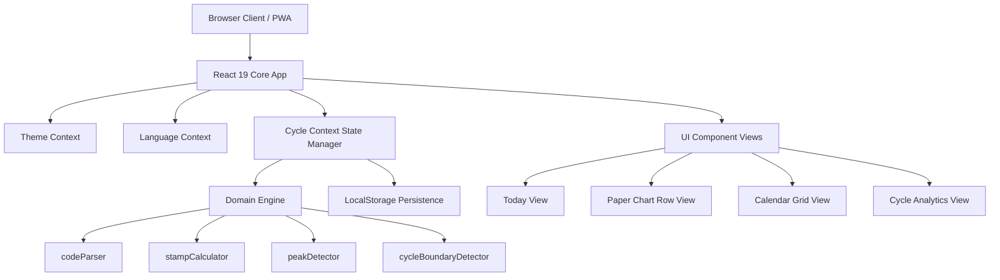
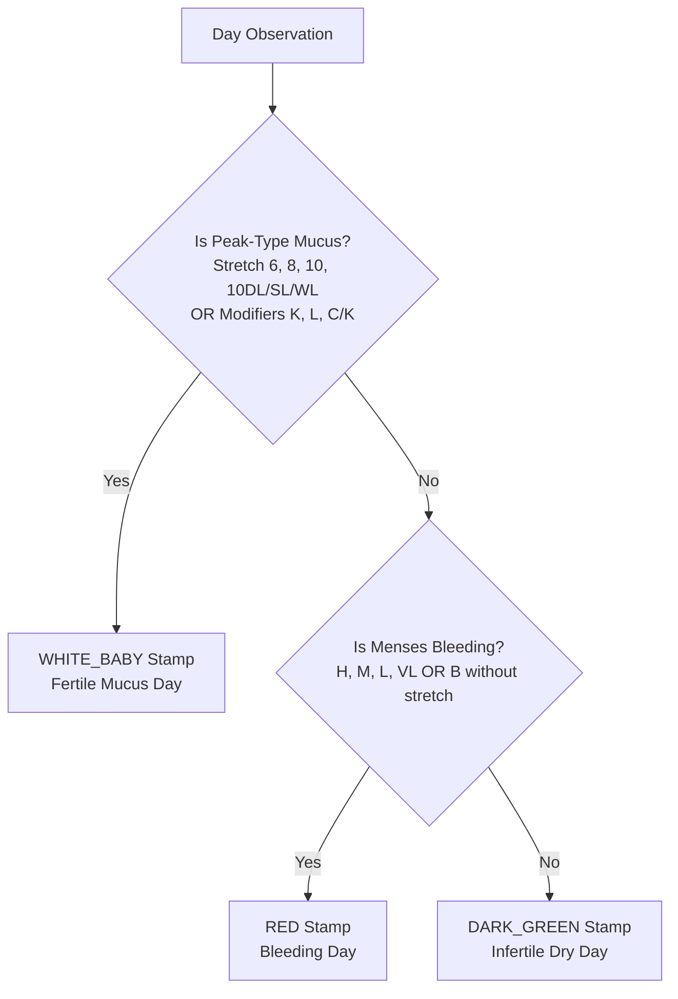

# Fertility Tracker Specification

**Document Version:** 1.15.7  
**Status:** Approved  
**Last Updated:** October 27, 2026  
**Repository:** [github.com/gsuquet/fertility-tracker](https://github.com/gsuquet/fertility-tracker)

---

## Table of Contents

1. [Executive Summary](#1-executive-summary)
2. [System Architecture & Technology Stack](#2-system-architecture--technology-stack)
3. [Domain Engine Specification (CrMS Rules)](#3-domain-engine-specification-crms-rules)
   - [3.1 Biomarker Codes catalog](#31-biomarker-codes-catalog)
   - [3.2 Code Parser Engine](#32-code-parser-engine)
   - [3.3 Stamp Calculation Rules](#33-stamp-calculation-rules)
   - [3.4 Peak Day & Post-Peak Detector](#34-peak-day--post-peak-detector)
   - [3.5 Cycle Boundary Detector](#35-cycle-boundary-detector)
   - [3.6 Version Tracker Engine](#36-version-tracker-engine)
4. [Data Schemas & Type System](#4-data-schemas--type-system)
5. [User Interface & Views](#5-user-interface--views)
   - [5.1 Navigation & Global Controls](#51-navigation--global-controls)
   - [5.2 Cycle Stats Header](#52-cycle-stats-header)
   - [5.3 Today View (Dashboard)](#53-today-view-dashboard)
   - [5.4 Paper Chart Row View](#54-paper-chart-row-view)
   - [5.5 Monthly Calendar Grid View](#55-monthly-calendar-grid-view)
   - [5.6 Cycle Analytics View](#56-cycle-analytics-view)
   - [5.7 Observation Drawer](#57-observation-drawer)
   - [5.8 Export & Printing System](#58-export--printing-system)
   - [5.9 Version Tracker & System Info Modal](#59-version-tracker--system-info-modal)
   - [5.10 Welcome Screen & Onboarding Guide Modal](#510-welcome-screen--onboarding-guide-modal)
6. [State Management & Data Persistence](#6-state-management--data-persistence)
7. [Internationalization & Design System](#7-internationalization--design-system)
8. [Testing & Quality Assurance](#8-testing--quality-assurance)
9. [Deployment & CI/CD Pipeline](#9-deployment--cicd-pipeline)
10. [Legal, Privacy & Medical Compliance](#10-legal-privacy--medical-compliance)

---

## 1. Executive Summary

**Fertility Tracker** is a privacy-first web application designed for tracking, charting, and analyzing
female reproductive health using the standardized **Creighton Model FertilityCare™ System (CrMS)**.

Unlike conventional period tracking applications that rely on opaque statistical calendars or period
prediction algorithms, Fertility Tracker implements standardized clinical CrMS charting logic. It parses
natural biomarker observations—such as cervical mucus stretch, color, consistency, sensation, bleeding
codes, and frequency—to dynamically determine stamp colors, calculate Peak Day ($P$), count post-peak fertile/infertile
transitions ($P+1, P+2, P+3$), and delineate cycle boundaries.

### Key Objectives

- **Clinical Accuracy:** Strict adherence to standardized Creighton Model biomarker classification and stamping rules.
- **Visual Authenticity:** Paper-style visual chart rows mirroring standard physical Creighton paper charts, alongside interactive calendar grids and analytics.
- **Privacy First:** 100% client-side data processing and local storage without third-party tracking, analytics, or external backend requirements.
- **Exportability:** Native capability to export cycle charts to high-resolution PNG, printable PDF formats, and structured JSON data backups.

---

## 2. System Architecture & Technology Stack

The application is architected as a lightweight, high-performance Single Page Application (SPA) with zero backend runtime dependencies.



### Technology Stack Details

Every runtime, tool, dependency, pre-commit hook and CI action is pinned to an exact version. `.npmrc` sets `save-exact=true` and `engine-strict=true`; `package.json` declares `engines`, `devEngines` and `packageManager`; `.mise/config.toml` and `.mise/mise.lock` pin the toolchain with checksums.

| Layer                  | Technology                                 | Specification / Version                                                                          |
| :--------------------- | :----------------------------------------- | :----------------------------------------------------------------------------------------------- |
| **Runtime**            | Node.js & npm                              | `node v26.12.1`, `npm v11.20.0` (bundled with Node; `.node-version` and mise `2026.10.19`)       |
| **UI Library**         | React                                      | `v19.3.1`                                                                                        |
| **Language**           | TypeScript                                 | `v7.0.2` (strict, ES2023 target, unchecked index access and exact optional property checks)      |
| **Build Tool**         | Vite                                       | `v8.3.5`                                                                                         |
| **Linter & Formatter** | Biome                                      | `@biomejs/biome v2.6.3` (TS, TSX, CSS, JSON, YAML, Markdown; warnings fail the build)            |
| **Git Hooks**          | pre-commit                                 | `pre-commit v4.7.0`, `pre-commit-hooks v6.0.0`, `gitleaks v8.30.1`, local Biome and `tsc` hooks  |
| **Icons**              | Lucide React                               | `v1.61.0`                                                                                        |
| **Styling**            | Custom Vanilla CSS                         | CSS Custom Properties, Glassmorphism, CSS Grid/Flexbox                                           |
| **Testing & Coverage** | Vitest, React Testing Library, V8 Coverage | `vitest v5.0.5`, `@vitest/coverage-v8 v5.0.5`, `@testing-library/react v16.3.3`, `jsdom v30.1.3` |
| **Deployment**         | Cloudflare Pages                           | `wrangler v4.153.0`, `compatibility_date 2026-10-23`                                             |
| **Dependency Updates** | Dependabot                                 | Weekly grouped updates for npm and GitHub Actions                                                |

---

## 3. Domain Engine Specification (CrMS Rules)

The Domain Engine is isolated in `src/domain/` with pure, deterministic logic independent of the React UI layer.

### 3.1 Biomarker Codes Catalog

The Creighton Model system uses standardized alphanumeric tokens to record daily observations:

#### Bleeding Codes

- `H`: Heavy Bleeding (Menses)
- `M`: Moderate Bleeding (Menses)
- `L`: Light Bleeding (Menses)
- `VL`: Very Light Bleeding / Spotting
- `B`: Brown Bleeding / Discharge

#### Mucus Stretch Codes

- `0`: Dry / No Mucus
- `2`: 1/4 inch stretch
- `2W`: 1/4 inch stretch, Watery
- `4`: 1/2 inch stretch
- `6`: 3/4 inch stretch
- `8`: 1 inch stretch
- `10`: $\ge 1$ inch stretch (Stretchy)
- `10DL`: Damp, Lubricative
- `10SL`: Shiny, Lubricative
- `10WL`: Wet, Lubricative

#### Mucus Modifier Codes

- `B`: Brown
- `C`: Cloudy
- `C/K`: Cloudy/Clear
- `G`: Gummy
- `K`: Clear
- `L`: Lubricative
- `P`: Pasty / Peasty
- `Y`: Yellow

#### Frequency Codes

- `X1`: Observed 1 time during the day
- `X2`: Observed 2 times during the day
- `X3`: Observed 3 times during the day
- `AD`: Observed all day

#### Symptom & Intercourse Codes

- `AP`: Abdominal Pain / Ovulation pain
- `RAP`: Right Abdominal Pain
- `LAP`: Left Abdominal Pain
- `I`: Intercourse occurred on this day

---

### 3.2 Code Parser Engine

**Module:** [src/domain/codeParser.ts](./src/domain/codeParser.ts)  
**CrMS Specification Version:** `1.1.0` (Streamlined CrMS token formatting without whitespace between mucus and frequency)

The parser operates in two directions:

1. **Formatting (`formatCodeString`):** Concatenates structured observation attributes into canonical Creighton order without whitespace between mucus stretch/modifiers and frequency:  
   `[Bleeding] [Stretch][Modifiers][Frequency] [Intercourse]`  
   _Note:_ Symptom codes (`AP`, `RAP`, `LAP`) are intentionally excluded from `codeString` so that symptoms are strictly rendered in dedicated symptom badges/sections below the observation code.  
   _Example:_ `10KLX3 I` or `H` or `2WX2` or `0AD`.
2. **Parsing (`parseCodeString`):** Softly parses freeform text input entered by users, supporting inputs with or without whitespace between mucus stretch/modifier and frequency (e.g. `10KLX3`, `10KL X3`, `0AD`, `0 AD`), splitting tokens by whitespace, recognizing valid stretch prefixes (e.g. `10WL`, `2W`, `10`), extracting modifiers (e.g. `C/K`, `K`, `L`), identifying frequencies (`X1`, `X2`, `X3`, `AD`), symptoms (`AP`, `RAP`, `LAP`), and the `I` intercourse flag.

---

### 3.3 Stamp Calculation Rules

**Module:** [src/domain/stampCalculator.ts](./src/domain/stampCalculator.ts)

The `calculateStamp` function classifies each day's observation into one of the standardized CrMS stamp categories:



---

### 3.4 Peak Day & Post-Peak Detector

**Module:** [src/domain/peakDetector.ts](./src/domain/peakDetector.ts)

1. **Peak Day ($P$) Determination:**
   - **Automatic Mode:** Scans observations chronologically within a cycle and identifies the **last consecutive day** exhibiting Peak-type mucus characteristics (stretch $\ge 6$ or clear/lubricative qualities `K`, `L`, `C/K`).
   - **Manual Override Mode:** Respects user-set `isManualPeak` flag or cycle-level `manualPeakDate`.
2. **Count of Three After Fertile Mucus ($+1, +2, +3$):**
   - After each run of `WHITE_BABY` days, and after the Peak Day, the next three calendar days get light green baby stamps when they are dry (`DARK_GREEN`):
     - $+1 \rightarrow$ `LIGHT_GREEN_BABY_1`
     - $+2 \rightarrow$ `LIGHT_GREEN_BABY_2`
     - $+3 \rightarrow$ `LIGHT_GREEN_BABY_3`
   - The rule applies to every patch of fertile mucus, before and after the Peak Day.
   - The count uses calendar days, so a day without an observation still counts.
   - A new `WHITE_BABY` day restarts the count. A `RED` day stays red.
   - A `WHITE_BABY` day after a manual Peak Day stays white.

---

### 3.5 Cycle Boundary Detector

**Module:** [src/domain/cycleBoundaryDetector.ts](./src/domain/cycleBoundaryDetector.ts)

- Automatically groups a raw timeline of observations into distinct menstrual cycles.
- A **new cycle boundary** is determined based on user explicit confirmation or default menses rules:
  - If `isCycleStart === true` on an observation, it explicitly starts a new cycle boundary regardless of bleeding code.
  - If `isCycleStart === false` on an observation, it is explicitly excluded from starting a new cycle (e.g. breakthrough bleeding or intermenstrual spotting).
  - If `isCycleStart` is `undefined`, a new cycle boundary is triggered when menses bleeding (`H`, `M`, `L`, `VL`) occurs after non-bleeding or dry days.
- When logging or saving the first bleeding day (`H`, `M`, `L`, `VL`, `B`) of a series (preceded by a non-bleeding day), the system prompts the user: _"Is this bleeding day the start of a new cycle?"_.
- Output cycles are returned ordered newest-to-oldest, with recalculated relative `cycleDay` indices (Day 1, 2, 3...) calculated relative to each cycle's start date.

---

### 3.6 Version Tracker Engine

**Module:** [src/domain/versionTracker.ts](./src/domain/versionTracker.ts)

- **Version & Release History Management:** Maintains structured release entries (`VERSION_HISTORY`) detailing version tags, release dates, titles, taglines, and feature highlights (e.g. `v1.1.0` release notes).
- **Runtime Metadata:** Retrieves application version from Vite build-time constants (`__APP_VERSION__`, `__BUILD_DATE__`) falling back to `package.json` specifications.
- **Version Update Tracking:** Evaluates user's last-seen version stored in `localStorage` (`fertility_tracker_last_seen_version`) via `checkAndRecordVersionSeen()`.
- **Storage Footprint Diagnostics:** Calculates live browser storage usage statistics via `getStorageStats()`, parsing stored observations in `fertility_care_observations` and running cycle boundary detection to measure exact cycles and observations count.

---

## 4. Data Schemas & Type System

**Module:** [src/types/crms.ts](./src/types/crms.ts)

```typescript
export type BleedingCode = 'H' | 'M' | 'L' | 'VL' | 'B';

export type MucusStretch = '0' | '2' | '2W' | '4' | '6' | '8' | '10' | '10DL' | '10SL' | '10WL';

export type MucusModifier = 'B' | 'C' | 'C/K' | 'G' | 'K' | 'L' | 'P' | 'Y';

export type FrequencyCode = 'X1' | 'X2' | 'X3' | 'AD';

export type SymptomCode = 'AP' | 'RAP' | 'LAP';

export type StampType =
  | 'RED' // Bleeding menses
  | 'DARK_GREEN' // Infertile dry day
  | 'WHITE_BABY' // Fertile mucus day
  | 'LIGHT_GREEN_BABY_1' // Post-peak day 1
  | 'LIGHT_GREEN_BABY_2' // Post-peak day 2
  | 'LIGHT_GREEN_BABY_3'; // Post-peak day 3

export interface Observation {
  id: string;
  date: string; // YYYY-MM-DD
  cycleDay: number; // 1, 2, 3...
  bleeding?: BleedingCode;
  stretch?: MucusStretch;
  modifiers?: MucusModifier[];
  frequency?: FrequencyCode;
  symptoms?: SymptomCode[];
  intercourse?: boolean; // 'I' marker
  notes?: string;
  isManualPeak?: boolean; // Manual Peak override flag
  isCycleStart?: boolean; // Explicitly designated cycle start boundary
  stamp: StampType;
  codeString: string; // Formatted code string e.g. "10KLX3 I"
  isPeakDay?: boolean; // Designated Peak Day ('P')
}

export interface Cycle {
  id: string;
  startDate: string; // YYYY-MM-DD
  observations: Observation[];
  manualPeakDate?: string;
  notes?: string;
}

export type Language = 'en' | 'fr' | 'es';
export type Theme = 'dark' | 'light';
export type ActiveTab = 'today' | 'chart' | 'calendar' | 'analytics';
```

---

## 5. User Interface & Views

The user interface comprises four primary view tabs, global navigation, header summary stats, an observation drawer, and an export modal.

### 5.1 Navigation & Global Controls

- **Desktop & Mobile Header ([Header.tsx](./src/components/Header.tsx), [src/styles/views/header.css](./src/styles/views/header.css)):** Displays logo, primary view selector (`Today`, `Chart`, `Calendar`, `Analytics`), Export Button, Welcome Guide Button (`BookOpen` icon), Version/About Info Button, Dark/Light Theme toggle, and Language Switcher (`en`, `fr`, `es`).
  - **Desktop View:** Directly exposes all individual control buttons in the top header control bar with standard 42px touch targets.
  - **Mobile View ($\le 640\text{px}$):** Streamlines the top navigation bar to only three primary elements: Logo (`🌱`), Cycle Picker dropdown, and a single More Actions button (`⋮`), aligned with uniform 38px heights (`height: 38px; min-height: 38px;`). Secondary action buttons (Export, Welcome Guide, Version Info, Language toggle, and Theme toggle) are consolidated into a slide-up mobile Action Sheet portaled directly to `document.body` via `ReactDOM.createPortal` (preventing CSS `backdrop-filter` stacking context displacement) and anchored at `bottom: 0`.
- **Mobile Modal Bottom-Sheet Architecture ([dialogs.css](./src/styles/primitives/dialogs.css), [modals.css](./src/styles/views/modals.css)):** On mobile viewports ($\le 640\text{px}$), all modal dialogs (`ExportModal`, `WelcomeModal`, `VersionModal`, `CycleStartModal`) render as bottom sheets anchored to the bottom of the viewport with rounded top corners (`24px`), height clamped at `88dvh`, sticky header and action footer, and an independently scrolling modal body.
- **Footer ([Footer.tsx](./src/components/Footer.tsx), [src/styles/views/footer.css](./src/styles/views/footer.css)):** Displays legal and medical disclaimers along with an interactive Help / Onboarding User Guide link and Version Badge button linking to the Version Tracker modal. On mobile devices ($\le 640\text{px}$), the copyright text and the action badge links (`User Guide` and `v1.9.2`) are structured on separate aligned rows to ensure neat one-line presentation of badges with clear bottom-navigation safe area clearance.
- **Mobile Navigation ([MobileNav.tsx](./src/components/MobileNav.tsx)):** Bottom fixed navigation bar optimized for touch devices.

---

### 5.2 Cycle Stats Header

**Module:** [src/components/CycleStatsHeader.tsx](./src/components/CycleStatsHeader.tsx)

Displays key statistics for the currently selected cycle or aggregated cycles:

- **Cycle Selector:** Dropdown to switch between active and historical cycles.
- **Current Cycle Day:** Total days logged in the cycle.
- **Peak Day Indicator:** Displays designated Peak Day (e.g. Day 14) or "Searching...".
- **Post-Peak Luteal Length:** Total days count post-peak ($P+1$ through cycle end). The all-cycles view shows the average over the cycles that have a Peak Day.
- **Mucific Score:** Calculated biomarker score summarizing mucus quantity and quality.

---

### 5.3 Today View (Dashboard)

**Module:** [src/components/TodayView.tsx](./src/components/TodayView.tsx)  
**Decomposed Subcomponents:**

- [TodayDateNav.tsx](./src/components/today/TodayDateNav.tsx): Compact date navigation bar with previous/next day stepping, native date picker trigger, formatted date display, and status badges (Today indicator, Cycle Day, Recorded/Pending status).
- [TodayHistoryList.tsx](./src/components/today/TodayHistoryList.tsx): Recent 5-day observation timeline card with aligned 3-column layout (date label, stamp badge slot, and truncated code string).
- [TodayObservationForm.tsx](./src/components/today/TodayObservationForm.tsx): Observation logging form supporting dual entry modes (Direct Code Entry and Detailed Selectors for bleeding, stretch, modifiers, frequency, symptoms, intercourse, notes, and cycle start).
- [TodayFertilityGuidance.tsx](./src/components/today/TodayFertilityGuidance.tsx): Real-time CrMS stamp preview badge, formatted code text, and clinical fertility guidance message (rendered in top mobile banner and desktop status card).

- **Daily Status Card:** Hero summary card displaying active date, current cycle day, assigned stamp badge, formatted code string, and intercourse status.
- **Recent 5-Day Observation History Card:** Aligned 3-column layout featuring a fixed-width date column, aligned `.recent-stamp-slot` for stamp badges, and single-line observation code string with ellipsis truncation.

---

### 5.4 Paper Chart Row View

**Module:** [src/components/ChartRow.tsx](./src/components/ChartRow.tsx)

- Recreates the visual aesthetic of official Creighton paper chart strips.
- Renders 35 days per row with color-coded stamp blocks:
  - **Red:** Menses bleeding
  - **Dark Green:** Dry infertile day
  - **White with Baby Icon:** Fertile mucus day
  - **Light Green with Baby & Number (1, 2, 3):** Post-peak count days
- Displays day numbers, formatted code strings, intercourse (`I`) flags, and Peak (`P`) markers.
- Allows toggling manual Peak Day designation directly on individual stamp cells.
- **Current Day Highlighting:** Automatically detects today's date (`todayStr`) across active cycle slots (both filled observation cells and empty slots), rendering a glowing 2px accent border (`var(--accent-primary)`), subtle ambient background glow, an uppercase `TODAY` pill header badge (`.cell-today-pill`), and `aria-current="date"` attribute.

---

### 5.5 Monthly Calendar Grid View

**Module:** [src/components/CalendarGrid.tsx](./src/components/CalendarGrid.tsx)

- Monthly grid layout displaying observations on their actual calendar date.
- Shows stamp badge color, day code snippet, and intercourse indicator on calendar tiles.
- **Current Day Highlighting:** Automatically highlights the current date tile (`.calendar-day.is-today`) with a 2px accent border ring (`var(--accent-primary)`), soft theme-aware background tint (`var(--accent-soft)`), a circular date number badge (`.calendar-day-num`), and `aria-current="date"` attribute.
- Clicking any tile opens the Observation Drawer pre-populated for that date.
- **Theme:** Tile text uses the theme tokens (`--text-primary`, `--text-secondary`), so it stays readable in dark mode.
- **Mobile (≤ 640px):** A long observation code wraps onto more lines, and the tile grows to fit it. The code is never cut.

---

### 5.6 Cycle Analytics View

**Module:** [src/components/CycleAnalyticsView.tsx](./src/components/CycleAnalyticsView.tsx)

- Historical charts and summary metrics across all logged cycles:
  - **Cycle Length Variability:** Min, max, and average cycle duration.
  - **Luteal Phase Health:** Post-peak phase duration monitoring (ideal: 9–16 days).
  - **Phase Lengths** ([src/domain/cyclePhases.ts](./src/domain/cyclePhases.ts)):
    - Follicular phase: cycle day 1 to the Peak Day. Before the Peak Day, it is the number of days logged so far, marked "in progress".
    - Luteal phase: the days after the Peak Day. It is 0 before the Peak Day.
    - The all-cycles view shows the average per cycle. Follicular and luteal averages use only the cycles that have a Peak Day, when one or more exist.
  - **Mucus Cycle Score Trends:** Tracking mucus quality over time.
  - **Fertility Window Distribution:** Breakdown of fertile vs. infertile days.
- **Mobile Stats Header Visibility:** Retains top `.stats-dashboard` header cards on mobile view while hiding them on Today, Graph, and Calendar views to maximize charting space.

---

### 5.7 Observation Drawer

**Module:** [src/components/ObservationDrawer.tsx](./src/components/ObservationDrawer.tsx)

Interactive slide-over drawer for entering and editing observations with two sync'd input modes:

1. **Interactive Form Builder:** Dropdown selectors for Bleeding, Stretch, Modifiers, Frequency, Symptoms, and Intercourse toggle.
2. **Natural Language String Input:** Freeform text field with real-time parser validation.
3. **Live Stamp & Code Preview:** Real-time preview of the resulting stamp color and code string prior to saving.
4. **Mobile Footer:** On screens of 640px or less, the footer buttons shrink to fit, and the delete button shows only its icon.

---

### 5.8 Export & Printing System

**Modules:** [ExportModal.tsx](./src/components/ExportModal.tsx), [PrintExportView.tsx](./src/components/PrintExportView.tsx), [exportUtils.ts](./src/utils/exportUtils.ts)

- **Standardized Export Filename Generator:** Utilizes `getExportFilename()` to enforce strictly lowercase, dash-separated filenames (`[a-z0-9-]`):
  - **JSON Data Backup & Restore:** Downloads formatted JSON backup files named `fertility-tracker-data-backup-YYYY-MM-DD.json`.
  - **Print / PDF Export Filenames:** The export dialog names the selection (`cycle-N`, `selected-cycles` or `all-cycles`) and passes it to the app. The app sets the browser document title to that file name before `window.print()` and restores the title one second later (e.g. `fertility-tracker-chart-cycle-1-YYYY-MM-DD` or `fertility-tracker-chart-all-cycles-YYYY-MM-DD`).
- **PNG Image Export:** Renders paper chart view into high-resolution PNG image suitable for digital sharing.
- **Print / PDF Export Layout:** Generates clean, printer-optimized 35-day landscape PDF layout hiding UI chrome and headers:
  - Day of week display is omitted from chart cells to conserve horizontal and vertical space.
  - Observation codes (`codeString`) have spaces removed and support 2-line word wrapping for long codes.
  - Adds a dedicated horizontal line under the observation code at the bottom of each cell for free-form user notes (`obs.notes`).
  - Automatically closes the Export Modal upon triggering print/export and displays a real-time success toast notification.

---

### 5.9 Version Tracker & System Info Modal

**Module:** [src/components/VersionModal.tsx](./src/components/VersionModal.tsx)

- **Accessible Modal Dialog:** Triggered via the `Info` button in the header control bar or the version badge button (`v1.5.0`) in the footer.
- **Tabbed Interface:**
  1. **Release Notes Tab:** Featured card displaying the latest release (`v1.5.0`) with feature highlights, release date, and full changelog history. Past releases feature a clean accordion header (version badge & date only) with title displayed inside the expanded section body.
  2. **System Information Tab:** Diagnostic card displaying App Version, CrMS Specification Version, Build Date, Runtime Environment, Local Storage item count, tracked cycles, logged observations, and total storage footprint in KB, alongside a GitHub open-source repository link with responsive mobile icon layout.
- **Design System Integration:** Uses `var(--bg-surface)`, `var(--bg-primary)`, and `var(--bg-surface-border)` CSS surface tokens for solid background opacity and theme harmony in light and dark modes.

---

### 5.10 Welcome Screen & Onboarding Guide Modal

**Module:** [src/components/WelcomeModal.tsx](./src/components/WelcomeModal.tsx)

- **First-Visit Auto-Popup:** Automatically opens when a user opens the app for the first time (`fertility_tracker_has_seen_welcome` is not present in `localStorage`).
- **Interactive Multi-Step Stepper (4 Slides):**
  1. **CrMS Overview & Privacy First:** Explains natural biomarker charting principles and 100% client-side local storage privacy.
  2. **Biomarker & Stamp Legend:** Interactive visual matrix explaining Red (Bleeding), Dark Green (Dry), Green+Baby (Fertile Mucus), White+Baby (Peak/High Fertility), and Yellow stamps, as well as post-peak counting ($P+1, P+2, P+3$).
  3. **Daily Charting Guide:** Walkthrough of the Today Dashboard, Observation Drawer, Direct Code Entry (`10KLX3 I AP`), and Detailed Selectors.
  4. **Views Tour & Quick Start Launcher:** Introduces Paper Chart, Monthly Calendar, and Cycle Analytics, with interactive actions to **"Explore Demo Data"** (pre-loading sample observations) or **"Start Fresh"**.
- **Accessible Design & Navigation:** Keyboard navigation (`Escape` close, tab trap), step indicator dots, "Previous", "Next", and "Skip" controls, fully translated in English and French.

---

## 6. State Management & Data Persistence

**Module:** [src/context/CycleContext.tsx](./src/context/CycleContext.tsx)

- **Decoupled Context Architecture:**
  - `CycleDataContext` / `useCycleData()`: Manages domain data entities, cycles, and CRUD mutations (`observations`, `cycles`, `selectedCycleId`, `saveObservation`, `deleteObservation`, `toggleManualPeak`, etc.).
  - `CycleUiContext` / `useCycleUi()`: Manages user interaction and drawer states (`selectedObservation`, `isDrawerOpen`, `setSelectedObservation`, `setIsDrawerOpen`).
  - `useCycle()`: Unified hook combining data and UI contexts for complete backward compatibility.
  - Prevents observation drawer open/close toggles from triggering unnecessary re-renders in heavy charting views (`ChartRow`, `CalendarGrid`).
- **Storage Strategy:** Browser `localStorage` using primary data key `fertility_care_observations` for observations, `fertility_care_lang` for active language, `fertility_care_theme` for theme preference, `fertility_tracker_last_seen_version` for version update tracking, and `fertility_tracker_has_seen_welcome` for onboarding completion state.
- **Automatic Reprocessing:** Any modification (addition, update, deletion, manual peak toggle) automatically triggers reprocessing of cycle boundaries, peak day detection, and post-peak stamps across all cycles.
- **Demo Data Generator:** Built-in sample dataset generator allowing new users to immediately test all views and features with realistic multi-cycle CrMS data.

---

## 7. Internationalization & Design System

### 7.1 Internationalization (i18n)

**Modules & Directory Structure:** [src/context/LanguageContext.tsx](./src/context/LanguageContext.tsx), `src/i18n/`

- **Modular Locales Directory:**
  - `src/i18n/types.ts`: Strictly typed `TranslationSchema` matching the canonical structure.
  - `src/i18n/locales/en.ts`: English canonical dictionary.
  - `src/i18n/locales/fr.ts`: French localized dictionary implementing `TranslationSchema`.
  - `src/i18n/index.ts`: Unified export providing `translations`, `TranslationSchema`, `supportedLanguages`.
- Supported languages: **English (`en`)**, **French (`fr`)**.
- Context-driven translation dictionary managing view labels, biomarker code explanations, drawer inputs, version tracker strings, and error messages.
- TypeScript compiler strictly enforces key parity across all language modules (`TranslationSchema`).
- Components read every user-facing string and the date locale (`t.locale`: `en-US` or `fr-FR`) from the dictionary. Components do not branch on `language === 'fr'` and do not keep fallback strings, because each key always exists.
- Release notes in `VERSION_HISTORY` require both languages (`title`/`titleFr`, `tagline`/`taglineFr`, `highlights`/`highlightsFr`).

### 7.2 Design System & Layered CSS Architecture

**Modules & Directory Structure:** [src/context/ThemeContext.tsx](./src/context/ThemeContext.tsx), [src/styles/index.css](./src/styles/index.css), `src/styles/`
**Architecture Decision:** [ADR 0002: CSS Maintainability & Layered Design System Architecture](docs/adr/0002-css-maintainability-design-system.md)

- **Cascade Layer Order:** Native CSS `@layer` declaration enforcing strict override precedence without specificity conflicts:

  ```css
  @layer tokens, base, primitives, views, utilities;
  ```
- **Modular Directory Organization:**
  - `src/styles/tokens/`:
    - `tokens.css`: Color tokens, light/dark themes (`:root`, `[data-theme='dark']`, each with its `color-scheme`), radii (`--radius-xs` to `--radius-full`), shadows (`--shadow-sm` to `--shadow-glow`), stamp palette (`--stamp-red`, `--stamp-dark-green`, `--stamp-white`, `--stamp-light-green`), accent tokens (`--accent-primary`, `--accent-solid`, `--accent-solid-hover`, `--accent-light`), and semantic feedback tokens (`--color-danger`, `--color-success`, `--color-success-solid`, `--color-success-text`, `--color-success-surface`, `--color-warning`, `--color-warning-text`, `--color-warning-surface`, `--color-info`, `--color-info-text`, `--color-info-surface`, `--color-white`, `--color-black`), observation toggle fills (`--color-intercourse`, `--color-peak`), `--accent-soft`, `--bg-overlay`, `--shadow-xl` and `--font-mono`.
    - `spacing.css`: Standardized spacing scale (`--space-xs` (4px), `--space-sm` (8px), `--space-md` (16px), `--space-lg` (24px), `--space-xl` (32px), `--space-2xl` (48px)) and z-index layer stack (`--z-base` (1), `--z-sticky` (100), `--z-drawer` (500), `--z-modal` (1000), `--z-popover` (1100), `--z-toast` (1200)).
    - `animations.css`: Keyframe definitions (`fadeIn`, `pulseGlow`, `drawerSlideIn`).
  - `src/styles/base/`:
    - `reset.css`: Modern CSS box-sizing resets, zero-margin defaults, font smoothing.
    - `layout.css`: App shell container (`.app-layout`, `.main-content`), mobile bottom bar offsets, global focus outlines.
  - `src/styles/primitives/`:
    - `buttons.css`: Reusable action button primitives (`.btn`, `.btn-primary`, `.btn-secondary`, `.btn-ghost`, `.btn-icon`, `.btn-danger`, `.btn-sm`, `.btn-lg`, `.toggle-btn`).
    - `cards.css`: Reusable surface containers (`.card`, `.card-surface`, `.card-glass`, `.card-interactive`, `.card-header`, `.card-body`).
    - `forms.css`: Form inputs, selects, textareas, custom checkboxes, and toggle switches.
    - `badges.css`: Indicators, pills, and biomarker badges (`.badge`, `.badge-pill`, `.stamp-badge`).
    - `dialogs.css`: Modal backdrops, dialog containers, and slide-in drawer panels.
  - `src/styles/views/`:
    - `header.css`: Global header, navigation brand, language selector, and theme switcher.
    - `cycle-picker.css`: Cycle dropdown selector and cycle summary metrics.
    - `today.css`: Dedicated Today Dashboard view, date selector strip, quick log banner, and recent history cards.
    - `chart.css`: Creighton paper chart strip (`.chart-table`, `.cell-day`, `.paper-cell`, `.is-today`, `.peak-marker`).
    - `calendar.css`: Monthly calendar grid view, day cells, month navigation, and calendar legend.
    - `analytics.css`: Cycle analytics metrics, Mucus Cycle Score (MCS) card, and biomarker distribution graphs.
    - `drawer.css`: Full-featured observation logger drawer, direct code entry, and biomarker pickers.
    - `modals.css`: View modals including `ExportModal`, `VersionModal`, `WelcomeModal`, and `CycleStartModal`.
    - `footer.css`: App footer, legal disclaimers, and version badge.
    - `print.css`: High-resolution export layouts and `@media print` rules.
  - `src/styles/utilities/`:
    - `utilities.css`: Layout helpers (`.flex-center`, `.gap-2`, `.items-center`), text helpers (`.text-truncate`, `.sr-only`).
- **Text Contrast (WCAG 2 AA):** In both themes, each text token meets a contrast ratio of at least 4.5:1 on the surfaces that show it. `--text-primary`, `--text-secondary`, `--text-muted` and `--accent-primary` are text colors on `--bg-primary`, `--bg-surface` and `--bg-surface-elevated`. `--accent-primary` is also a text color on `--accent-light`. `--accent-solid` and `--accent-solid-hover` are the fill colors behind white text, for example `.btn-primary`. A rule that puts white text on an accent fill uses `--accent-solid`, not `--accent-primary`. `--color-danger` and `--color-danger-hover` are the fills of `.btn-danger` behind white text. `--color-intercourse` and `--color-peak` are the fills of the active intercourse and Peak toggles, and `--color-success-solid` is the fill of the Today saved message (`.today-toast`), all behind white text. `--color-info-text` on `--color-info-surface` is the form mode badge of the welcome guide. `--color-success-text` on `--color-success-surface` is the version badge of the mobile menu. `--color-warning-text` on `--color-warning-surface` is the symptom tag of the chart (`.cell-symptom-tag`). The footer copyright text and the empty days of the chart (`.empty-cell.paper-cell`, marked by a dashed border) have no opacity, so their text keeps the contrast of its token. Each custom property that a style uses is defined in `src/styles/tokens/`. The test `src/styles/__tests__/tokenContrast.test.ts` calculates these ratios from `tokens.css`.

---

## 8. Testing & Quality Assurance

The project uses **test-driven development (TDD)**. Write a failing test before each behavior change, then write the minimum code to make it pass. The tools are **Vitest**, **React Testing Library** and the **V8 coverage** engine. **Biome** and the strict **TypeScript** compiler do the static analysis.

### Coverage Policy

- Coverage must stay at **100%** for statements, branches, functions and lines. `vite.config.ts` sets `coverage.thresholds: { 100: true }`, so `npm run test:coverage` fails below 100%. CI runs this command on each pull request.
- Coverage ignore comments are not permitted. Code that no test can reach is removed (for example, guards for values that the types do not permit, or fallbacks for translation keys that always exist).
- The coverage report includes `src/**` and `scripts/**`. It excludes test files, `src/test/**`, `src/setupTests.ts` and `src/vite-env.d.ts`.

### Test Layers

| Layer       | Location                       | Purpose                                                                                      |
| ----------- | ------------------------------ | -------------------------------------------------------------------------------------------- |
| Domain      | `src/domain/__tests__/`        | Pure rules: code parser, stamps, Peak Day, cycle limits, validation, demo data, form values. |
| Utilities   | `src/utils/__tests__/`         | Dates, export file names, safe `localStorage` access.                                        |
| Hooks       | `src/hooks/__tests__/`         | `useObservationForm`, the form state that Today and the drawer share.                        |
| Contexts    | `src/context/__tests__/`       | Saved data, cycle selection, language and theme.                                             |
| Components  | `src/components/**/__tests__/` | Rendered output and user actions, found by role and accessible name.                         |
| Application | `src/__tests__/`               | Flows across components: first-visit guide, print, entry point.                              |
| Styles      | `src/styles/__tests__/`        | CSS rules that jsdom cannot render, for example theme colors and mobile wrapping.            |
| Tools       | `scripts/docs/__tests__/`      | The documentation checker.                                                                   |

### Test Helpers (`src/test/`)

- `makeObservation({ date, ...fields })`: a valid observation with defaults.
- `renderWithProviders(ui, { language, observations, selectedCycleId })`: renders inside every provider with optional French, saved data and a selected cycle.
- `src/setupTests.ts` clears `localStorage` after each test.

### Quality & Test Suite Execution

```bash
# Install the pinned toolchain and the git hooks
mise install && mise run hooks

# Execute full unit test suite (or watch mode with test:watch)
npm run test

# Execute the suite with coverage (fails below 100%)
mise run coverage  # or: npm run test:coverage

# Biome lint + format check (warnings fail)
npm run check

# Auto-fix lint findings and format the codebase
npm run check:fix

# TypeScript strict type check
npm run typecheck

# Check the docs (STE writing rules, Diátaxis structure, links)
mise run docs

# Run every CI gate locally (tasks live in .mise/tasks/)
mise run validate
```

### Documentation

- The docs in `docs/` follow the [Diátaxis](https://diataxis.fr/) framework strictly. Each page is a tutorial, a how-to guide, a reference page or an explanation, in the folder of that type. Decision records are in `docs/adr/`. `docs/README.md` is the index.
- `README.md`, `AGENTS.md` and `docs/` use a subset of ASD-STE100 Simplified Technical English: at most 20 words in a procedure step, 25 words in a descriptive sentence, 6 sentences in a paragraph, no contractions, and no word from the list of words that are not approved.
- `scripts/docs/checkDocs.ts` checks these rules, the Diátaxis folders, the index entries, the steps in tutorials and how-to guides, and all relative links and heading anchors. `mise run docs` runs it. The `docs-check` pre-commit hook runs it in CI.
- See [docs/reference/documentation-rules.md](docs/reference/documentation-rules.md).

See [docs/explanation/testing-strategy.md](docs/explanation/testing-strategy.md), [docs/reference/test-rules.md](docs/reference/test-rules.md) and [docs/how-to/write-a-test-first.md](docs/how-to/write-a-test-first.md).

---

## 9. Deployment & CI/CD Pipeline

- **Target Platform:** Cloudflare Pages (Static Web Site Deployment).
- **Configuration:** [wrangler.json](./wrangler.json)
  - `name`: `fertility-tracker`
  - `pages_build_output_dir`: `dist`
- **Build Command:**

  ```bash
  npm run build  # executes tsc --noEmit && vite build
  ```

- **Deployment Command:**

  ```bash
  npm run deploy # executes npm run build && wrangler pages deploy dist
  ```

- **CI/CD Quality Gates:** The `ci` GitHub Actions workflow runs on every pull request that targets `main` (not on pushes to `main`). It installs the toolchain from `.mise/config.toml` with `jdx/mise-action`, then runs:
  1. **Dependency Install & Provenance:** `npm ci` and `npm audit signatures`
  2. **Pre-commit Hooks:** `pre-commit run --all-files` (file hygiene, gitleaks secret scan, Biome lint and format, `tsc --noEmit`)
  3. **Unit Tests & Code Coverage:** `npm run test:coverage` (Vitest V8 Coverage)
  4. **Production Build:** `vite build`
- **Action Pinning:** Every action is pinned to a full commit SHA with the release tag in a comment.

---

## 10. Legal, Privacy & Medical Compliance

### Privacy

Fertility Tracker operates with a 100% client-side execution model. All biomarker observations and health data remain strictly within the user's browser local storage. No health data is ever transmitted to remote servers.

### Trademark Notice

`FertilityCare™` and `Creighton Model FertilityCare™ System (CrMS)` are registered trademarks owned by the **Saint Paul VI Institute for the Study of Human Reproduction**. Fertility Tracker is an independent open-source project and is not affiliated with or endorsed by the Saint Paul VI Institute, FCCA, or FCCI.

### Medical Disclaimer

Fertility Tracker is intended solely for personal tracking, record-keeping, and educational purposes. It does not provide medical advice, clinical diagnosis, or treatment. Users should consult a certified FertilityCare Practitioner or Medical Consultant for clinical interpretation.
