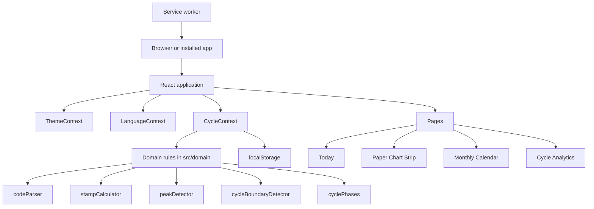

# Fertility Tracker specification

- **Document version:** 1.32.0
- **Status:** Approved
- **Last updated:** October 28, 2026
- **Repository:** [github.com/gsuquet/fertility-tracker](https://github.com/gsuquet/fertility-tracker)

This document is the full specification of the application. Change it before you change the code. The [docs](docs/README.md) give the same rules for users and contributors.

## Table of contents

1. [Summary](#1-summary)
2. [Architecture and technology](#2-architecture-and-technology)
   - [2.1 Versions](#21-versions)
   - [2.2 Code splitting and lazy loading](#22-code-splitting-and-lazy-loading)
3. [Domain rules](#3-domain-rules)
4. [Data types](#4-data-types)
5. [User interface](#5-user-interface)
   - [5.1 Navigation and dialogs](#51-navigation-and-dialogs)
   - [5.2 Statistics bar](#52-statistics-bar)
   - [5.3 Today page](#53-today-page)
   - [5.4 Paper Chart Strip page](#54-paper-chart-strip-page)
   - [5.5 Monthly Calendar page](#55-monthly-calendar-page)
   - [5.6 Cycle Analytics page](#56-cycle-analytics-page)
   - [5.7 Observation drawer](#57-observation-drawer)
   - [5.8 Export, backup and print](#58-export-backup-and-print)
   - [5.9 Version dialog](#59-version-dialog)
   - [5.10 Welcome guide](#510-welcome-guide)
   - [5.11 Error boundary](#511-error-boundary)
   - [5.12 to 5.18 Application behavior](#512-to-518-application-behavior)
6. [State and data storage](#6-state-and-data-storage)
7. [Languages and design system](#7-languages-and-design-system)
8. [Tests and quality](#8-tests-and-quality)
9. [Deployment and CI](#9-deployment-and-ci)
10. [Privacy, trademarks and medical limits](#10-privacy-trademarks-and-medical-limits)

## 1. Summary

Fertility Tracker is a web application to chart fertility signs with the Creighton Model FertilityCare™ System (CrMS). The user records bleeding and cervical mucus each day with the standard CrMS codes.

The application does not predict fertile days from a calendar. It uses only the daily observations. From these observations, it calculates the stamp of each day, the Peak Day, the count of three and the start of each cycle.

| Objective      | Requirement                                                                              |
| -------------- | ---------------------------------------------------------------------------------------- |
| Clinical rules | The application follows the standard CrMS codes and stamp rules.                         |
| Paper chart    | The chart looks like the CrMS paper chart. A calendar and statistics are also available. |
| Privacy        | All data stays in the browser. There is no server database, no account and no tracking.  |
| Export         | The user can print a 35-day chart, save it as a PDF file, and back up the data as JSON.  |

## 2. Architecture and technology

The application is a single-page React application. It has no backend. Vite builds it into static files, and Cloudflare Pages serves them.

### 2.1 Versions

Each runtime, tool, dependency, pre-commit hook and CI action has an exact pinned version.

- `.npmrc` sets `save-exact=true` and `engine-strict=true`.
- `package.json` declares `engines`, `devEngines` and `packageManager`.
- `.mise/config.toml` and `.mise/mise.lock` pin the tools with checksums.

| Layer              | Technology                                 | Version                                                                                             |
| ------------------ | ------------------------------------------ | --------------------------------------------------------------------------------------------------- |
| Runtime            | Node.js and npm                            | `node 26.12.1`, `npm 11.20.0` (the npm of that Node.js release), `.node-version`, mise `2026.10.19` |
| User interface     | React                                      | `19.3.1`                                                                                            |
| Language           | TypeScript                                 | `7.0.2`, strict, ES2023 target, unchecked index access and exact optional properties                |
| Build              | Vite                                       | `8.3.5`                                                                                             |
| Lint and format    | Biome                                      | `@biomejs/biome 2.6.3` for TS, TSX, CSS, JSON, YAML and Markdown. A warning is a failure.           |
| Git hooks          | pre-commit                                 | `pre-commit 4.7.0`, `pre-commit-hooks 6.0.0`, `gitleaks 8.30.1`, local hooks                        |
| Icons              | Lucide React                               | `1.61.0`                                                                                            |
| Font               | Font of the operating system               | `system-ui` stack, no font file                                                                     |
| Styles             | CSS                                        | Custom properties, cascade layers, grid and flexbox                                                 |
| Unit tests         | Vitest, React Testing Library, V8 coverage | `vitest 5.0.5`, `@vitest/coverage-v8 5.0.5`, `@testing-library/react 16.3.3`, `jsdom 30.1.3`        |
| End-to-end tests   | Playwright and axe                         | `@playwright/test` and `@axe-core/playwright`, pinned in `package.json`                             |
| Deployment         | Cloudflare Pages                           | `wrangler 4.153.0`, `compatibility_date 2026-10-23`                                                 |
| Dependency updates | Dependabot                                 | Weekly grouped updates for npm and GitHub Actions                                                   |

### 2.2 Code splitting and lazy loading

The main chunk has only the code of the first screen. The other parts load with `React.lazy` when the user needs them.

| Part                                                                                     | Rule                                                                                    |
| ---------------------------------------------------------------------------------------- | --------------------------------------------------------------------------------------- |
| `CycleAnalyticsView`, `ExportModal`, `VersionModal`, `WelcomeModal`, `InstallGuideModal` | Lazy chunks. `App.tsx` renders a dialog only while it is open.                          |
| `VERSION_HISTORY`                                                                        | Only in the `VersionModal` chunk. The main chunk gets the version from `appVersion.ts`. |
| `PrintExportView`                                                                        | A lazy chunk that the application renders from the start.                               |
- Each opening of a dialog starts a new dialog. The version dialog opens on **Release Notes**, and the welcome guide opens on step 1. The export dialog opens in **Single Cycle** mode with the cycle of the cycle picker.
- A unit test follows the static imports from `main.tsx`. It fails if they reach `versionTracker.ts` or a lazy component.
- **Print / Save as PDF** calls `window.print()` only after the print view chunk loads and renders the selected cycles. A click before that waits for the chunk.
- The browser print command (**Ctrl+P**) does not wait. Before the print view chunk loads, it prints an empty page.
- If the print view chunk does not load, **Print / Save as PDF** does not print and does not show the success message. It shows the error `exportModal.printError`.
- Each dialog and the print view has its own `React.Suspense`. Thus, a dialog that loads does not hide the print view.
- While a page or a dialog loads, a hidden `role="status"` element announces `common.loading`. A dialog shows nothing visible while it loads. The page fallback keeps a minimum height, so the footer does not move.
- After the first render, when the browser is idle, the application imports the four lazy chunks, except `InstallGuideModal`. Only Safari on iOS uses the install guide, so it does not load before it opens. It uses `requestIdleCallback` with a 2-second `timeout`, or `setTimeout` in a browser without it.
- A failed preload has no effect. The part tries again when the user opens it.
- Each lazy dialog has its own `ErrorBoundary` in dialog mode (section 5.11). A failure does not block the other dialogs, and the next opening tries again.
- The service worker keeps all the lazy chunks ([Offline use and installation](docs/reference/deployment.md#offline-use-and-installation)). Thus, each lazy part also opens offline.

## 3. Domain rules

These rules are in [Observation codes](docs/reference/observation-codes.md), [Stamp and Peak Day rules](docs/reference/stamp-and-peak-rules.md), [Cycle and phase rules](docs/reference/cycle-and-phase-rules.md), [Domain API](docs/reference/domain-api.md) and [Version tracker](docs/reference/version-tracker.md).

## 4. Data types

The types are in [Data format](docs/reference/data-format.md#typescript-types).

## 5. User interface

The application has four pages, a header, a statistics bar, an observation drawer and dialogs. A phone screen is 640 pixels wide or less.

### 5.1 Navigation and dialogs

| Part                                                         | Wide screen                                                                                                                                                                            | Phone screen                                                                                                          |
| ------------------------------------------------------------ | -------------------------------------------------------------------------------------------------------------------------------------------------------------------------------------- | --------------------------------------------------------------------------------------------------------------------- |
| Header ([Header.tsx](src/components/Header.tsx))             | Logo, page tabs, cycle picker, **Log Observation**, export, guide, version, language (`en`, `fr`) and theme buttons. The header is 68 pixels high, and the buttons are 42 pixels high. | Logo (sprout), cycle picker and a menu button (`⋮`). The buttons are 38 pixels high. The other buttons are in a menu. |
| Page buttons ([MobileNav.tsx](src/components/MobileNav.tsx)) | In the header                                                                                                                                                                          | Fixed at the bottom, with a **+** button for a new observation                                                        |
| Dialogs                                                      | Centered                                                                                                                                                                               | Open from the bottom, with 24-pixel top corners, a maximum height of `88dvh`, and a fixed header and footer           |
| Footer ([Footer.tsx](src/components/Footer.tsx))             | Legal text, **Install app** (when the browser can install the application), **User Guide** button and version button. Not in the installed application.                                | The copyright and the buttons are on separate lines. Not in the installed application.                                |
- The phone menu (`aria-label="Mobile Navigation Menu"`) uses the dialog component below. It opens from the bottom of the screen.
- The page selector is a `role="tablist"` element. Each tab has `aria-controls` that points to the `role="tabpanel"` element of its page.
- Each page has this panel in all its states. For example, the empty analytics page has `id="analytics-panel"`.
- The cycle menu of [CyclePicker.tsx](src/components/CyclePicker.tsx) uses the dialog component below (`aria-label="Filter Cycle View"`). Its list of cycles is a `role="listbox"` element. On a wide screen, the menu opens under its button. On a phone, it opens from the bottom of the screen.
- The cycle menu closes with its close button, `Escape`, **Back**, a choice and a click outside the menu. Its backdrop dims the page on a phone only. When it opens, the focus goes to the selected cycle.
- On a phone, each dialog of `Modal` is a bottom sheet, like the drawer. The user drags it down to close it (section 5.7). The error screen of `ErrorBoundary` is the only exception: it shows after a crash and keeps its buttons.
- The address has the hash of the open page: `#today`, `#chart`, `#calendar` or `#analytics` ([Back button and address](docs/reference/application-behavior.md#back-button-and-address)).

[Modal.tsx](src/components/Modal.tsx) is the only dialog component. `ExportModal`, `VersionModal`, `WelcomeModal`, `CycleStartModal`, `ObservationDrawer`, `ConfirmDialog`, `InstallGuideModal`, `KeyboardShortcutsModal`, `ErrorBoundary`, the phone menu and the cycle menu use it. No other component has a focus trap or an `Escape` handler for a dialog.

| Function       | Rule                                                                                                                                                                 |
| -------------- | -------------------------------------------------------------------------------------------------------------------------------------------------------------------- |
| Element        | A native `<dialog>` in a portal on `document.body`, opened with `showModal()`. The browser makes the page under it inert.                                            |
| Name           | `aria-modal="true"`, and a name from `aria-labelledby` (the title) or `aria-label`.`aria-describedby` is optional.                                                   |
| First focus    | The element of `initialFocusRef`, else the first element that can get the focus. The `<dialog>` itself does not scroll to it.                                        |
| Focus trap     | `Tab` on the last element goes to the first. `Shift+Tab` on the first goes to the last.                                                                              |
| Two dialogs    | The dialog on top keeps the focus. The dialog under it ignores the keys.                                                                                             |
| `Escape`       | Calls `onClose` of the top dialog only. The event does not go to the dialog under it or to the document.                                                             |
| `cancel` event | Calls `onClose`. It does not close the `<dialog>` itself, so React state always controls the dialog.                                                                 |
| Backdrop       | A click on the `<dialog>` outside the panel calls `onClose`. A click in the panel does not.                                                                          |
| Back           | **Back** calls `onClose` of the top dialog only, with `useHistoryLayer` ([Back button and address](docs/reference/application-behavior.md#back-button-and-address)). |
| Focus return   | On close, it calls `close()`, then moves the focus back to the element that had it before.                                                                           |
| Listeners      | `keydown` and `click` are native listeners on the `<dialog>`. Thus, they also get events from portals, such as the undo message.                                     |
| Scroll area    | A body that scrolls is a `<section>` with `tabIndex={0}` and `aria-labelledby` (role `region`).                                                                      |

`useTopDialog()` gives the open `<dialog>` on top, or `null`. `showModal()` makes all the page outside the dialog inert, also a `popover` element. Thus, while a dialog is open, `UndoToast` goes into the top dialog with a portal.

- In a dialog, the undo message stays visible, and **Undo** and **Delete the copy** stay available. The focus trap includes them.
- After **Undo** or **Delete the copy** in a dialog, the focus goes to the top dialog. When the dialog closes, the message goes back to the page.
- In the phone menu, the undo message shows at the top of the screen. Thus, it does not cover the menu.

### 5.2 Statistics bar

**Module:** [src/components/CycleStatsHeader.tsx](src/components/CycleStatsHeader.tsx)

The bar shows four cards for the selected cycle, or for all cycles:

| Card                  | One cycle                                    | All cycles                                                         |
| --------------------- | -------------------------------------------- | ------------------------------------------------------------------ |
| Cycle Length          | Number of observations                       | Average number of observations per cycle (`stats.averageDays`)     |
| Estimated Peak Day    | Cycle day and date of the Peak Day, or `---` | The Peak Day of the newest cycle that has one, or `---`            |
| Luteal Phase Count    | Days after the Peak Day                      | Average of the cycles with a Peak Day. Without a Peak Day: 0 days. |
| Intercourse Frequency | Days with `I`                                | Days with `I` in all cycles                                        |

On a screen of 768 pixels or less, the bar shows only on the **Cycle Analytics** page.

### 5.3 Today page

**Module:** [src/components/TodayView.tsx](src/components/TodayView.tsx)

| Part                                                                                  | Content                                                                                                                                           |
| ------------------------------------------------------------------------------------- | ------------------------------------------------------------------------------------------------------------------------------------------------- |
| [TodayDateNav.tsx](src/components/today/TodayDateNav.tsx)                             | Previous and next day, date picker, date, and status: today, cycle day, recorded or not.                                                          |
| [TodayObservationForm.tsx](src/components/today/TodayObservationForm.tsx)             | **Direct Code Only** or **Detailed Form** mode, the code buttons, intercourse, peak, notes, save and delete.                                      |
| [ObservationCodeSelector.tsx](src/components/observation/ObservationCodeSelector.tsx) | The code buttons. The drawer uses the same component (section 5.7).                                                                               |
| [TodayFertilityGuidance.tsx](src/components/today/TodayFertilityGuidance.tsx)         | Stamp preview, code and a guidance text. A banner on a screen of 900 pixels or less, else a card.                                                 |
| [TodayHistoryList.tsx](src/components/today/TodayHistoryList.tsx)                     | The selected date and the 4 days before it, in three columns: date, stamp and code. A click selects that date. A long code ends with an ellipsis. |
- The entry mode selector is a `role="radiogroup"` with two native radio inputs (`name="entry-mode"`). Each input is in a `<label>`, and the arrow keys move between them.
- The application saves the last entry mode in `fertility_care_entry_mode`.
- A save or a delete shows a message (`role="status"`). The message closes 3 seconds after the last save or delete. The page stops the timer when it unmounts.

#### Swipe between days

On a touch screen, a swipe on the **Today** page changes the day. The hook [useDaySwipe.ts](src/hooks/useDaySwipe.ts) uses Pointer Events of `touch` and `pen` type only. Thus, a mouse does not swipe, and the arrow buttons stay for the keyboard and the desktop.

- A swipe to the left opens the next day. A swipe to the right opens the previous day. The swipe calls the same functions as the arrow buttons, with the same rules.
- [swipe.ts](src/domain/swipe.ts) decides at the release:
  - The angle of the swipe must be less than 30 degrees from horizontal.
  - The swipe must be longer than 60 pixels, or a fast flick: at least 0.5 pixels per millisecond over at least 24 pixels.
- The page has `touch-action: pan-y pinch-zoom`. Thus, a vertical drag scrolls the page and the browser cancels the swipe. A vertical drag never changes the day.
- These swipes do nothing:
  - A swipe that starts in an input, a text area, a select or an element that scrolls horizontally.
  - A swipe that starts less than 20 pixels from the left or right edge of the screen. The back and forward gestures of iOS use these edges.
  - A swipe that starts its move with an angle of 30 degrees or more from horizontal.
  - A swipe in a dialog of the page, for example **New Cycle Start?**. React sends the events of a portal to the page, so the hook ignores a target outside the page.
  - A swipe on a zoomed page. The page then has `touch-action: auto`, so that the finger can pan the zoomed page in all directions.
- After a swipe, the hook blocks the next click for 100 milliseconds. Thus, a swipe that starts on a button does not also press it. A tap that moves a little is not a swipe, so its click stays.
- A second swipe during the slide first applies the day change of the first swipe. Thus, two fast swipes move two days.
- During the swipe, the main grid follows the finger by 40% of the move. After a swipe, the grid slides out in the swipe direction in 150 milliseconds. Then the day changes, and the grid slides in from the other side. Else the grid goes back.
- With `prefers-reduced-motion: reduce`, the grid does not move. The day changes at the release.

### 5.4 Paper Chart Strip page

**Module:** [src/components/ChartRow.tsx](src/components/ChartRow.tsx)

| Part                                                                  | Content                                                                                                    |
| --------------------------------------------------------------------- | ---------------------------------------------------------------------------------------------------------- |
| [ChartToolbar.tsx](src/components/chart/ChartToolbar.tsx)             | Title, grid mode, phase bar and legend buttons. An empty chart shows only the title and the legend button. |
| [ChartLegend.tsx](src/components/chart/ChartLegend.tsx)               | The stamp legend.                                                                                          |
| [ChartBlankGrid.tsx](src/components/chart/ChartBlankGrid.tsx)         | A 35-day grid before the first observation, from today. Each cell opens a new observation.                 |
| [ChartCycleRow.tsx](src/components/chart/ChartCycleRow.tsx)           | One cycle: number, dates, length, Peak Day, scroll and jump buttons, phase bar and cells.                  |
| [ChartPhaseTimeline.tsx](src/components/chart/ChartPhaseTimeline.tsx) | The phase bar above the cells of a cycle.                                                                  |
| [ChartCell.tsx](src/components/chart/ChartCell.tsx)                   | A filled cell, an empty day cell or a blank grid cell. Each cell is a native `<button type="button">`.     |
| [ChartCellPopover.tsx](src/components/chart/ChartCellPopover.tsx)     | Details of a filled cell: code, bleeding, stretch, modifiers, intercourse and notes.                       |
- Each cycle is one row, in the format of the CrMS paper chart. **Full 35-Day Paper Grid** shows a minimum of 35 cells. A longer cycle adds cells in groups of 7. **Compact Strip** shows only the recorded days.
- Each cell shows the cycle day, the date, the stamp, the code, the symptom tag, the `I` mark and the `P` mark.
- Buttons go to day 1, to the Peak Day and to the newest day of each row. Each row has its own scroll area.
- When the chart opens, the row of the current cycle shows today near the middle of its scroll area. Late in the cycle, the row stops at its end. The current cycle is the newest cycle, when today is on or after its start date.
  - If today has no cell, the row opens at its end. For example, today is after the last cell of the grid, or has no observation in **Compact Strip**.
  - The row sets `scrollLeft` at once, before the browser paints. There is no smooth scroll, and the page does not scroll vertically.
  - A change of the grid mode puts today in view again.
  - The rows of past cycles open at day 1.
- A click, `Enter` or `Space` on a cell opens the observation drawer. The user sets or removes the manual Peak Day there with **Designate Peak Day (P)**.
- The details show when the mouse is on a filled cell or when the cell has the focus. Each cell has its own hover state, so a hover does not render other cells again.
- Two details can show at the same time: one on the cell with the focus and one under the mouse.
- Today has a 2-pixel accent border, a `TODAY` label (`.cell-today-pill`) and `aria-current="date"`. This applies to filled cells and empty cells. The date of today comes from `getTodayStr()`.

### 5.5 Monthly Calendar page

**Module:** [src/components/CalendarGrid.tsx](src/components/CalendarGrid.tsx)

- The grid shows one month. Each day shows its stamp, its code and the intercourse mark.
- A click on a day opens the observation drawer for that date. Days after today are disabled.
- The next-month button is disabled in the current month. Thus, the user cannot go to a month after the current month.
- Today (`.calendar-day.is-today`) has a 2-pixel accent border, an `--accent-soft` background, a round day number and `aria-current="date"`. The date of today comes from `getTodayStr()`.
- Text uses the theme tokens `--text-primary` and `--text-secondary`. Thus, it is readable in the dark theme.
- On a phone, a long code goes onto more lines and the day cell becomes taller. The code is never cut.

#### Swipe between months

On a touch screen, a swipe on the calendar changes the month. It uses the hook of the **Today** page, [useDaySwipe.ts](src/hooks/useDaySwipe.ts), with the same rules (section 5.3), and these differences:

- A swipe to the left opens the next month. A swipe to the right opens the previous month. The swipe calls the same functions as the arrow buttons.
- In the current month, a swipe to the left does nothing, as the disabled next-month button. The grid goes back, and the click after the swipe is blocked.
- The days grid follows the finger and slides. The header with the month name and the buttons stays in place.
- The calendar has `touch-action: pan-y pinch-zoom`. Thus, a vertical drag scrolls the page and never changes the month.

### 5.6 Cycle Analytics page

**Module:** [src/components/CycleAnalyticsView.tsx](src/components/CycleAnalyticsView.tsx)

| Section                          | Content                                                                                                                                                                                                 |
| -------------------------------- | ------------------------------------------------------------------------------------------------------------------------------------------------------------------------------------------------------- |
| Cycle Phases Breakdown           | Menses, follicular and luteal lengths from [Cycle and phase rules](docs/reference/cycle-and-phase-rules.md), as bars.                                                                                   |
| Mucus & Stamp Score Distribution | Number and percentage of red, dry, fertile and count-of-three days.                                                                                                                                     |
| Creighton Mucus Score Trend      | One bar for each day, with its [mucus score](docs/reference/cycle-and-phase-rules.md#mucus-score). Dry bars are dark green, fertile bars (score 6 or more) use the accent and the Peak Day bar is pink. |
| Practitioner Clinical Summary    | Average mucus score, Peak Day, luteal phase health and intercourse count.                                                                                                                               |
| Creighton Mucus Score guide      | A short explanation of the score.                                                                                                                                                                       |
- Before the Peak Day, the page shows "in progress" after the follicular value.
- Luteal phase health is "Normal" from 9 to 17 days. Above 0 and below 9 days, or above 17 days, it is "Short/Extended". The value of all cycles is an average and can have decimals. At 0 days, it is "Pending Peak Day".
- The trend chart (`.mucus-trend-wrapper`) scrolls horizontally on a narrow screen. It is a `<section>` with `tabIndex={0}` and `aria-labelledby` (role `region`).
- Without observations, the page shows an empty state with `id="analytics-panel"`.

### 5.7 Observation drawer

**Module:** [src/components/ObservationDrawer.tsx](src/components/ObservationDrawer.tsx)

- The drawer has the same fields as the Today form: date, direct code, the code buttons, intercourse, peak and notes.
- The drawer always shows the saved observation of its date, as the Today form does. This is true for each way to open it: **+**, **Log Observation**, **Log today**, the chart and the calendar.
  - When the date has an observation, the title is **Edit Observation**, the fields show the saved values and **Delete** shows.
  - When the date has no observation, the title is **Log Observation** and the form is empty.
  - Thus, a save with no change never replaces a saved day with an empty observation.
- A change of the date input loads the observation of the new date. When the new date has no observation, a form with no change becomes empty. Thus, the values of a saved day are not copied to another day. A changed form keeps the draft.
- The saved data can change while the drawer is open, for example with **Undo**. Then the title and **Delete** follow the saved data of the date. A form with no change shows the new saved values. A changed form keeps the draft.
- The direct code and the buttons stay synchronized. The stamp preview shows the stamp and the code before the save.
- On a phone, the footer buttons become smaller to fit. The delete button shows only its icon.

#### Drag down to close

On a phone, the drawer, the phone menu, the cycle menu and the other dialogs are bottom sheets (section 5.1). The other dialogs are export, **About & Version Tracker**, the welcome guide, **New Cycle Start?**, the confirmation dialog, the install guide and the keyboard shortcuts. The hook [useSheetDrag.ts](src/hooks/useSheetDrag.ts) lets the user drag them down to close them. On a larger screen, nothing changes.

The rules below apply to all these sheets. The body is the part that scrolls. It is the form of the drawer, the list of a menu, or the body of a dialog.

- A grab handle shows at the top center of the sheet. It has `aria-hidden="true"`. The close button stays the accessible way to close the sheet.
- A drag down from the handle or the header moves the sheet with the finger. These two parts have `touch-action: none` and use Pointer Events. A press on a button of the header does not start a drag.
- A drag in the body scrolls the body. It moves the sheet only when the body is at the top and the finger moves down. The body uses touch events, so that the drag can stop the scroll. A drag that starts on a button of the body also moves the sheet, and the button does not get a click.
- A swipe on the sheet never scrolls the page under it:
  - A body that has nothing to scroll stops the scroll of the browser for each move of one finger. A move that starts in a text area, or in an element of the body that scrolls by itself, keeps its scroll.
  - A body that scrolls has `overscroll-behavior: contain`. At its end, the page does not scroll.
  - A move of one finger outside the body, for example on the backdrop, stops the scroll of the browser.
  - A pinch with two fingers stays available, so the user can zoom. It never moves the sheet, also when the second finger lands outside the body.
- One gesture moves the sheet at a time. A touch of the body does not move or end a drag of the handle. During the slide down, the sheet ignores taps.
- A close in another way during the slide, for example with `Escape` or **Back**, stops the slide timer. Thus, the timer cannot close a drawer that opens again.
- The backdrop becomes lighter in proportion to the drag.
- At the release, [sheetDrag.ts](src/domain/sheetDrag.ts) decides:
  - The sheet closes when the drag is more than 25% of the sheet height.
  - The sheet also closes after a fast flick down: at least 0.5 pixels per millisecond over at least 24 pixels. The speed comes from the moves of the last 100 milliseconds. Thus, a pause before the release is not a flick.
  - Else the sheet goes back to its position.
- A close by drag does the same as the close button (for the confirmation dialog and **New Cycle Start?**: the cancel). The draft is not kept, and the history entry of the sheet goes ([Back button and address](docs/reference/application-behavior.md#back-button-and-address)).
- The sheet slides down in 200 milliseconds, then closes. With `prefers-reduced-motion: reduce`, the sheet has no animation: it opens and closes at once.

[ObservationCodeSelector.tsx](src/components/observation/ObservationCodeSelector.tsx) shows the button groups in this sequence:

- Bleeding.
- The cycle start button, only when a bleeding code is selected.
- Stretch, modifiers, frequency and symptoms.

It reads the values and functions of `useObservationForm`. The drawer and the Today form have the same markup, classes, ARIA attributes and labels. Each group is a `<fieldset>` with a `<legend>`, so it has the role `group` and a name.

### 5.8 Export, backup and print

**Modules:** [ExportModal.tsx](src/components/ExportModal.tsx), [PrintExportView.tsx](src/components/PrintExportView.tsx), [exportUtils.ts](src/utils/exportUtils.ts), [backupImport.ts](src/domain/backupImport.ts)

| Action              | Result                                                                                |
| ------------------- | ------------------------------------------------------------------------------------- |
| Print / Save as PDF | Prints one cycle or the selected cycles with the browser print dialog.                |
| Backup Data         | Downloads `fertility-tracker-backup-YYYY-MM-DD.ftbackup` and records the backup date. |
| Restore Data        | Shows a preview, then replaces or merges the observations with the file.              |
| Load Demo Cycle     | Replaces all observations with the demo data.                                         |
| Clear Data / Reset  | Deletes all observations.                                                             |

`getExportFilename()` makes file names with only lowercase letters, digits and dashes. There is no PNG export.

#### Backup file

- The file uses the write format of the browser storage ([Storage format](docs/reference/data-storage.md#storage-format)). In this version, that is a bare JSON array, so older versions can restore it.
- **Restore Data** accepts the bare array (format 0) and the object `{ "schemaVersion": 1, "observations": [...] }` (format 1).
- The file is plain JSON. It is not encrypted. The texts `exportModal.jsonDescription` and `exportModal.pdfDescription` tell this to the user.
- **Restore Data** is a button that opens a hidden file input. Thus, the keyboard can reach it.
- The file has the extension `.ftbackup` and the type `application/octet-stream`. With `application/json`, a browser can add `.json` after the name. The content is plain JSON, and any text editor can open it.
- The file input has no `accept` filter. iOS greys out a file with an extension that it does not know. The application checks the contents, not the extension. Thus, a `.ftbackup` file and an old `.json` backup both restore.
- A file that is not a valid backup shows `exportModal.importError` (`role="alert"`) in the export dialog. The data does not change.

#### Confirmation

[ConfirmDialog.tsx](src/components/ConfirmDialog.tsx) is a small confirmation dialog. It replaces `window.confirm()` and `window.alert()`, which no code in `src/` uses.

- It opens over the export dialog, with `aria-labelledby` (its title) and `aria-describedby` (its message). All its text comes from the dictionary (`confirmDialog.*`, `actions.cancel`).
- When it opens, the focus goes to **Cancel**. `Escape`, **Cancel** and a click on the backdrop cancel it. They do not close the export dialog.
- **Load Demo Cycle**, **Restore Data** and **Clear Data / Reset** open it when observations exist.
- Without observations, **Load Demo Cycle** and **Restore Data** act immediately, and **Clear Data / Reset** is disabled.
- The message for **Clear Data / Reset** says that a copy stays on the device until the user selects **Delete the copy**.

Before a backup changes existing observations, the dialog shows a preview from `summarizeObservations()`. The preview gives the number of observations in the file and the first and last date. If the file has no observations, the preview says so.

| Action  | Result                                                                                                                  |
| ------- | ----------------------------------------------------------------------------------------------------------------------- |
| Replace | `importDataJson(text, 'replace')`: the file replaces all the current observations.                                      |
| Merge   | `importDataJson(text, 'merge')`: each day of the file replaces the current day with the same date. The other days stay. |

During a merge, `mergeObservations()` keeps one manual Peak Day in each cycle. When a day of the file is a manual Peak Day, it clears the manual Peak Day of the current days in the same cycle.

#### Print

1. The dialog names the selection: `cycle-N`, `selected-cycles` or `all-cycles`.
2. The application sets the document title to the file name, for example `fertility-tracker-chart-cycle-1-YYYY-MM-DD`.
3. The application calls `window.print()`. The browser uses the title as the default PDF file name.
4. The application restores the title one second later. A second print in that second restores the first title.
5. The application closes the dialog. It shows the success message when the user clicks, before the print starts. The message closes 3.5 seconds after the last print.

When the application unmounts, it stops the title and message timers.

The print layout:

- It is landscape, with 35 days in each row. It hides the user interface.
- It does not show the day of the week. It removes the spaces from the codes and lets a long code go onto two lines.
- It has a line under the code of each day for the notes.
- Without cycles, it shows one empty cycle that starts today (`getTodayStr()`).
- It uses the language of the interface: `printExport.*`, `chartStrip.*` and `t.locale` for the export date. The CrMS codes and the stamp colors are the same in each language.
- The date of each cell uses `common.monthDay`: `MM-DD` in English and `DD/MM` in French.
- Each legend label is one text: `chartStrip.legendMenses`, `legendDry`, `legendFertile`, `legendPostPeak` and `legendPeakDay`. The chart legend uses the same texts.

### 5.9 Version dialog

**Module:** [src/components/VersionModal.tsx](src/components/VersionModal.tsx)

- The info button in the header, the **About & Version Tracker** item of the phone menu and the version button in the footer open the dialog.
- The **Release Notes** tab shows the newest release and the full history. Each old release opens and closes. Its header shows only the version and the date.
- The **System Information** tab shows the version, the CrMS version, the build date and the environment. It also has the repository link.
- The tab also shows the storage statistics: the number of storage keys, cycles and observations, and the size in KB.
- At the end, the tab shows the legal notice of the footer ([LegalNotice.tsx](src/components/LegalNotice.tsx)): the trademark text, the medical text and the copyright. Thus, the installed application, which has no footer, also shows this text.
- The dialog uses the surface tokens `--bg-surface`, `--bg-primary` and `--bg-surface-border`.

### 5.10 Welcome guide

**Module:** [src/components/WelcomeModal.tsx](src/components/WelcomeModal.tsx)

The guide opens at the first visit, when `fertility_tracker_has_seen_welcome` is not in `localStorage`. It has four slides:

| Slide | Content                                                                                          |
| ----- | ------------------------------------------------------------------------------------------------ |
| 1     | The CrMS method and the privacy of the data.                                                     |
| 2     | The stamps: red, green, green with a baby, white with a baby and yellow, and the count of three. |
| 3     | How to record: direct code (for example `10KLX3 I AP`) or the form buttons.                      |
| 4     | The pages, with **Explore Demo Data** and **Start Fresh**.                                       |

In the installed application on iOS and iPadOS, with no observations, slide 4 also has **Restore a backup**. It closes the guide and opens the export dialog with the focus on **Restore Data** ([Install and update](docs/reference/application-behavior.md#install-and-update)).

The guide has **Previous**, **Next** and **Skip** buttons and step dots. The dialog component gives `Escape`, the focus trap and the focus return. The slide body can get the focus and scroll. The guide is in English and in French.

### 5.11 Error boundary

**Module:** [src/components/ErrorBoundary.tsx](src/components/ErrorBoundary.tsx)

- `App.tsx` puts each `React.Suspense` in an `ErrorBoundary`: the pages, the lazy dialogs and the print view.
- The boundary of the pages has `key={activeTab}`. Thus, a change of page removes the alert and loads the new page again.
- When a child fails during render, or a lazy chunk does not load, the boundary shows an alert (`role="alert"`). The header, the footer and the navigation stay visible.
- The alert shows `errorBoundary.title`, `errorBoundary.message` and a **Reload** button (`errorBoundary.reload`) that calls `window.location.reload()`.
- With an `onClose` property, the boundary shows the alert in the dialog component, named by the alert title. It adds a **Close** button (`errorBoundary.close`).
- In this dialog mode, **Close**, `Escape` and the backdrop call `onClose`. Each lazy dialog uses this mode.
- With an `onError` property, the boundary calls it one time when a child fails. The print view uses it to show `exportModal.printError`.

### 5.12 to 5.18 Application behavior

The rules of sections 5.12 to 5.18 are in [Application behavior](docs/reference/application-behavior.md).

## 6. State and data storage

These rules are in [Data storage](docs/reference/data-storage.md).

## 7. Languages and design system

These rules are in [Languages](docs/reference/languages.md) and [Design system](docs/reference/design-system.md).

## 8. Tests and quality

These rules are in [Test rules and helpers](docs/reference/test-rules.md), [Commands](docs/reference/commands.md), [Documentation rules](docs/reference/documentation-rules.md) and [Commit messages](docs/reference/commit-messages.md).

## 9. Deployment and CI

These rules are in [Deployment](docs/reference/deployment.md). The CI workflow is in [Commands](docs/reference/commands.md#ci-workflow).

## 10. Privacy, trademarks and medical limits

These rules are in [Legal and medical limits](docs/reference/legal-and-medical-limits.md).
