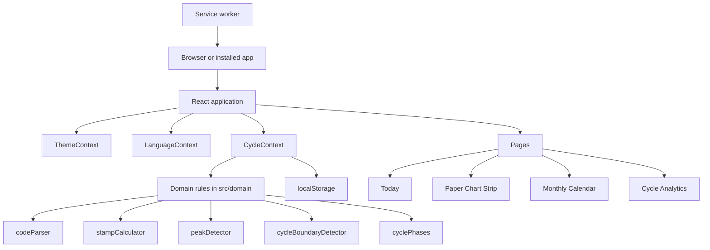

# Fertility Tracker specification

- **Document version:** 1.32.0
- **Status:** Approved
- **Last updated:** October 28, 2026
- **Repository:** [github.com/gsuquet/fertility-tracker](https://github.com/gsuquet/fertility-tracker)

This document is the full specification of the application. Change it before you change the code. The [docs](docs/README.md) give the same rules for users and contributors.

## Table of contents

1. [Summary](#1-summary)
2. [Architecture and technology](#2-architecture-and-technology)
   - [2.1 Versions](#21-versions)
   - [2.2 Code splitting and lazy loading](#22-code-splitting-and-lazy-loading)
3. [Domain rules](#3-domain-rules)
4. [Data types](#4-data-types)
5. [User interface](#5-user-interface)
   - [5.1 to 5.6 Navigation, dialog component and pages](#51-to-56-navigation-dialog-component-and-pages)
   - [5.7 to 5.11 Drawer, dialogs and error screen](#57-to-511-drawer-dialogs-and-error-screen)
   - [5.12 to 5.18 Application behavior](#512-to-518-application-behavior)
6. [State and data storage](#6-state-and-data-storage)
7. [Languages and design system](#7-languages-and-design-system)
8. [Tests and quality](#8-tests-and-quality)
9. [Deployment and CI](#9-deployment-and-ci)
10. [Privacy, trademarks and medical limits](#10-privacy-trademarks-and-medical-limits)

## 1. Summary

Fertility Tracker is a web application to chart fertility signs with the Creighton Model FertilityCare™ System (CrMS). The user records bleeding and cervical mucus each day with the standard CrMS codes.

The application does not predict fertile days from a calendar. It uses only the daily observations. From these observations, it calculates the stamp of each day, the Peak Day, the count of three and the start of each cycle.

| Objective      | Requirement                                                                              |
| -------------- | ---------------------------------------------------------------------------------------- |
| Clinical rules | The application follows the standard CrMS codes and stamp rules.                         |
| Paper chart    | The chart looks like the CrMS paper chart. A calendar and statistics are also available. |
| Privacy        | All data stays in the browser. There is no server database, no account and no tracking.  |
| Export         | The user can print a 35-day chart, save it as a PDF file, and back up the data as JSON.  |

## 2. Architecture and technology

The application is a single-page React application. It has no backend. Vite builds it into static files, and Cloudflare Pages serves them.

### 2.1 Versions

Each runtime, tool, dependency, pre-commit hook and CI action has an exact pinned version.

- `.npmrc` sets `save-exact=true` and `engine-strict=true`.
- `package.json` declares `engines`, `devEngines` and `packageManager`.
- `.mise/config.toml` and `.mise/mise.lock` pin the tools with checksums.

| Layer              | Technology                                 | Version                                                                                             |
| ------------------ | ------------------------------------------ | --------------------------------------------------------------------------------------------------- |
| Runtime            | Node.js and npm                            | `node 26.12.1`, `npm 11.20.0` (the npm of that Node.js release), `.node-version`, mise `2026.10.19` |
| User interface     | React                                      | `19.3.1`                                                                                            |
| Language           | TypeScript                                 | `7.0.2`, strict, ES2023 target, unchecked index access and exact optional properties                |
| Build              | Vite                                       | `8.3.5`                                                                                             |
| Lint and format    | Biome                                      | `@biomejs/biome 2.6.3` for TS, TSX, CSS, JSON, YAML and Markdown. A warning is a failure.           |
| Git hooks          | pre-commit                                 | `pre-commit 4.7.0`, `pre-commit-hooks 6.0.0`, `gitleaks 8.30.1`, local hooks                        |
| Icons              | Lucide React                               | `1.61.0`                                                                                            |
| Font               | Font of the operating system               | `system-ui` stack, no font file                                                                     |
| Styles             | CSS                                        | Custom properties, cascade layers, grid and flexbox                                                 |
| Unit tests         | Vitest, React Testing Library, V8 coverage | `vitest 5.0.5`, `@vitest/coverage-v8 5.0.5`, `@testing-library/react 16.3.3`, `jsdom 30.1.3`        |
| End-to-end tests   | Playwright and axe                         | `@playwright/test` and `@axe-core/playwright`, pinned in `package.json`                             |
| Deployment         | Cloudflare Pages                           | `wrangler 4.153.0`, `compatibility_date 2026-10-23`                                                 |
| Dependency updates | Dependabot                                 | Weekly grouped updates for npm and GitHub Actions                                                   |

### 2.2 Code splitting and lazy loading

The main chunk has only the code of the first screen. The other parts load with `React.lazy` when the user needs them.

| Part                                                                                     | Rule                                                                                    |
| ---------------------------------------------------------------------------------------- | --------------------------------------------------------------------------------------- |
| `CycleAnalyticsView`, `ExportModal`, `VersionModal`, `WelcomeModal`, `InstallGuideModal` | Lazy chunks. `App.tsx` renders a dialog only while it is open.                          |
| `VERSION_HISTORY`                                                                        | Only in the `VersionModal` chunk. The main chunk gets the version from `appVersion.ts`. |
| `PrintExportView`                                                                        | A lazy chunk that the application renders from the start.                               |
- Each opening of a dialog starts a new dialog. The version dialog opens on **Release Notes**, and the welcome guide opens on step 1. The export dialog opens in **Single Cycle** mode with the cycle of the cycle picker.
- A unit test follows the static imports from `main.tsx`. It fails if they reach `versionTracker.ts` or a lazy component.
- **Print / Save as PDF** calls `window.print()` only after the print view chunk loads and renders the selected cycles. A click before that waits for the chunk.
- The browser print command (**Ctrl+P**) does not wait. Before the print view chunk loads, it prints an empty page.
- If the print view chunk does not load, **Print / Save as PDF** does not print and does not show the success message. It shows the error `exportModal.printError`.
- Each dialog and the print view has its own `React.Suspense`. Thus, a dialog that loads does not hide the print view.
- While a page or a dialog loads, a hidden `role="status"` element announces `common.loading`. A dialog shows nothing visible while it loads. The page fallback keeps a minimum height, so the footer does not move.
- After the first render, when the browser is idle, the application imports the four lazy chunks, except `InstallGuideModal`. Only Safari on iOS uses the install guide, so it does not load before it opens. It uses `requestIdleCallback` with a 2-second `timeout`, or `setTimeout` in a browser without it.
- A failed preload has no effect. The part tries again when the user opens it.
- Each lazy dialog has its own `ErrorBoundary` in dialog mode ([Error screen](docs/reference/screens/error-screen.md)). A failure does not block the other dialogs, and the next opening tries again.
- The service worker keeps all the lazy chunks ([Offline use and installation](docs/reference/deployment.md#offline-use-and-installation)). Thus, each lazy part also opens offline.

## 3. Domain rules

These rules are in [Observation codes](docs/reference/observation-codes.md), [Stamp and Peak Day rules](docs/reference/stamp-and-peak-rules.md), [Cycle and phase rules](docs/reference/cycle-and-phase-rules.md), [Domain API](docs/reference/domain-api.md) and [Version tracker](docs/reference/version-tracker.md).

## 4. Data types

The types are in [Data format](docs/reference/data-format.md#typescript-types).

## 5. User interface

### 5.1 to 5.6 Navigation, dialog component and pages

These rules are in [Navigation](docs/reference/screens/navigation.md), [Dialog component](docs/reference/dialog-component.md), [Statistics bar](docs/reference/screens/statistics-bar.md), [Today page](docs/reference/screens/today.md), [Paper Chart Strip page](docs/reference/screens/chart.md), [Monthly Calendar page](docs/reference/screens/calendar.md) and [Cycle Analytics page](docs/reference/screens/analytics.md).

### 5.7 to 5.11 Drawer, dialogs and error screen

These rules are in [Observation drawer](docs/reference/screens/observation-drawer.md), [Export dialog](docs/reference/screens/export-dialog.md), [Version dialog](docs/reference/screens/version-dialog.md), [Welcome guide](docs/reference/screens/welcome-guide.md) and [Error screen](docs/reference/screens/error-screen.md).

### 5.12 to 5.18 Application behavior

The rules of sections 5.12 to 5.18 are in [Application behavior](docs/reference/application-behavior.md).

## 6. State and data storage

These rules are in [Data storage](docs/reference/data-storage.md).

## 7. Languages and design system

These rules are in [Languages](docs/reference/languages.md) and [Design system](docs/reference/design-system.md).

## 8. Tests and quality

These rules are in [Test rules and helpers](docs/reference/test-rules.md), [Commands](docs/reference/commands.md), [Documentation rules](docs/reference/documentation-rules.md) and [Commit messages](docs/reference/commit-messages.md).

## 9. Deployment and CI

These rules are in [Deployment](docs/reference/deployment.md). The CI workflow is in [Commands](docs/reference/commands.md#ci-workflow).

## 10. Privacy, trademarks and medical limits

These rules are in [Legal and medical limits](docs/reference/legal-and-medical-limits.md).
