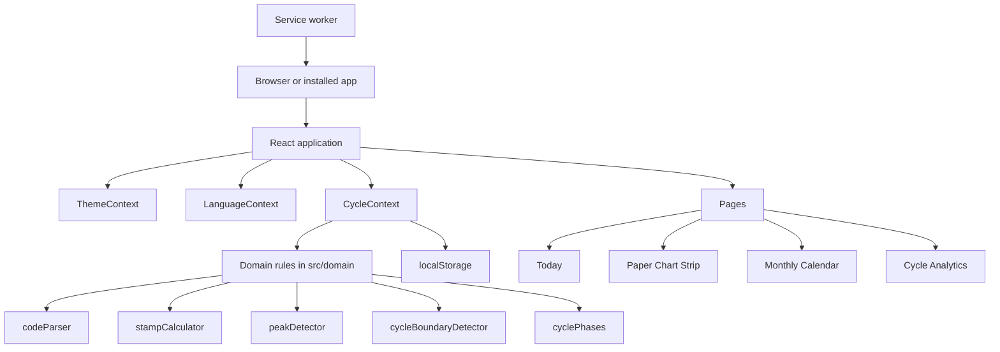

# Fertility Tracker specification

- **Document version:** 1.22.0
- **Status:** Approved
- **Last updated:** October 28, 2026
- **Repository:** [github.com/gsuquet/fertility-tracker](https://github.com/gsuquet/fertility-tracker)

This document is the full specification of the application. Change it before you change the code. The [docs](docs/README.md) give the same rules for users and contributors.

## Table of contents

1. [Summary](#1-summary)
2. [Architecture and technology](#2-architecture-and-technology)
   - [2.1 Versions](#21-versions)
   - [2.2 Code splitting and lazy loading](#22-code-splitting-and-lazy-loading)
3. [Domain rules](#3-domain-rules)
   - [3.1 Codes](#31-codes)
   - [3.2 Code parser](#32-code-parser)
   - [3.3 Stamp of one day](#33-stamp-of-one-day)
   - [3.4 Peak Day and count of three](#34-peak-day-and-count-of-three)
   - [3.5 Cycles](#35-cycles)
   - [3.6 Phases and mucus score](#36-phases-and-mucus-score)
   - [3.7 Version tracker](#37-version-tracker)
4. [Data types](#4-data-types)
5. [User interface](#5-user-interface)
   - [5.1 Navigation and dialogs](#51-navigation-and-dialogs)
   - [5.2 Statistics bar](#52-statistics-bar)
   - [5.3 Today page](#53-today-page)
   - [5.4 Paper Chart Strip page](#54-paper-chart-strip-page)
   - [5.5 Monthly Calendar page](#55-monthly-calendar-page)
   - [5.6 Cycle Analytics page](#56-cycle-analytics-page)
   - [5.7 Observation drawer](#57-observation-drawer)
   - [5.8 Export, backup and print](#58-export-backup-and-print)
   - [5.9 Version dialog](#59-version-dialog)
   - [5.10 Welcome guide](#510-welcome-guide)
   - [5.11 Error boundary](#511-error-boundary)
   - [5.12 Installed application and touch](#512-installed-application-and-touch)
   - [5.13 Install and update](#513-install-and-update)
6. [State and data storage](#6-state-and-data-storage)
   - [6.1 Contexts](#61-contexts)
   - [6.2 Storage keys](#62-storage-keys)
   - [6.3 Storage format](#63-storage-format)
   - [6.4 Data recovery](#64-data-recovery)
   - [6.5 Save failure and persistent storage](#65-save-failure-and-persistent-storage)
   - [6.6 Backup reminder](#66-backup-reminder)
   - [6.7 Undo of replaced data](#67-undo-of-replaced-data)
7. [Languages and design system](#7-languages-and-design-system)
   - [7.1 Languages](#71-languages)
   - [7.2 Design system and CSS layers](#72-design-system-and-css-layers)
   - [7.3 Text contrast](#73-text-contrast)
8. [Tests and quality](#8-tests-and-quality)
9. [Deployment and CI](#9-deployment-and-ci)
   - [9.1 Offline use and installation](#91-offline-use-and-installation)
   - [9.2 Security headers](#92-security-headers)
10. [Privacy, trademarks and medical limits](#10-privacy-trademarks-and-medical-limits)

## 1. Summary

Fertility Tracker is a web application to chart fertility signs with the Creighton Model FertilityCare™ System (CrMS). The user records bleeding and cervical mucus each day with the standard CrMS codes.

The application does not predict fertile days from a calendar. It uses only the daily observations. From these observations, it calculates the stamp of each day, the Peak Day, the count of three and the start of each cycle.

| Objective      | Requirement                                                                              |
| -------------- | ---------------------------------------------------------------------------------------- |
| Clinical rules | The application follows the standard CrMS codes and stamp rules.                         |
| Paper chart    | The chart looks like the CrMS paper chart. A calendar and statistics are also available. |
| Privacy        | All data stays in the browser. There is no server database, no account and no tracking.  |
| Export         | The user can print a 35-day chart, save it as a PDF file, and back up the data as JSON.  |

## 2. Architecture and technology

The application is a single-page React application. It has no backend. Vite builds it into static files, and Cloudflare Pages serves them.



### 2.1 Versions

Each runtime, tool, dependency, pre-commit hook and CI action has an exact pinned version.

- `.npmrc` sets `save-exact=true` and `engine-strict=true`.
- `package.json` declares `engines`, `devEngines` and `packageManager`.
- `.mise/config.toml` and `.mise/mise.lock` pin the tools with checksums.

| Layer              | Technology                                 | Version                                                                                             |
| ------------------ | ------------------------------------------ | --------------------------------------------------------------------------------------------------- |
| Runtime            | Node.js and npm                            | `node 26.12.1`, `npm 11.20.0` (the npm of that Node.js release), `.node-version`, mise `2026.10.19` |
| User interface     | React                                      | `19.3.1`                                                                                            |
| Language           | TypeScript                                 | `7.0.2`, strict, ES2023 target, unchecked index access and exact optional properties                |
| Build              | Vite                                       | `8.3.5`                                                                                             |
| Lint and format    | Biome                                      | `@biomejs/biome 2.6.3` for TS, TSX, CSS, JSON, YAML and Markdown. A warning is a failure.           |
| Git hooks          | pre-commit                                 | `pre-commit 4.7.0`, `pre-commit-hooks 6.0.0`, `gitleaks 8.30.1`, local hooks                        |
| Icons              | Lucide React                               | `1.61.0`                                                                                            |
| Font               | Font of the operating system               | `system-ui` stack, no font file                                                                     |
| Styles             | CSS                                        | Custom properties, cascade layers, grid and flexbox                                                 |
| Unit tests         | Vitest, React Testing Library, V8 coverage | `vitest 5.0.5`, `@vitest/coverage-v8 5.0.5`, `@testing-library/react 16.3.3`, `jsdom 30.1.3`        |
| End-to-end tests   | Playwright and axe                         | `@playwright/test` and `@axe-core/playwright`, pinned in `package.json`                             |
| Deployment         | Cloudflare Pages                           | `wrangler 4.153.0`, `compatibility_date 2026-10-23`                                                 |
| Dependency updates | Dependabot                                 | Weekly grouped updates for npm and GitHub Actions                                                   |

### 2.2 Code splitting and lazy loading

The main chunk has only the code of the first screen. The other parts load with `React.lazy` when the user needs them.

| Part                                                                                     | Rule                                                                                    |
| ---------------------------------------------------------------------------------------- | --------------------------------------------------------------------------------------- |
| `CycleAnalyticsView`, `ExportModal`, `VersionModal`, `WelcomeModal`, `InstallGuideModal` | Lazy chunks. `App.tsx` renders a dialog only while it is open.                          |
| `VERSION_HISTORY`                                                                        | Only in the `VersionModal` chunk. The main chunk gets the version from `appVersion.ts`. |
| `PrintExportView`                                                                        | A lazy chunk that the application renders from the start.                               |
- Each opening of a dialog starts a new dialog. The version dialog opens on **Release Notes**, and the welcome guide opens on step 1. The export dialog opens in **Single Cycle** mode with the cycle of the cycle picker.
- A unit test follows the static imports from `main.tsx`. It fails if they reach `versionTracker.ts` or a lazy component.
- **Print / Save as PDF** calls `window.print()` only after the print view chunk loads and renders the selected cycles. A click before that waits for the chunk.
- The browser print command (**Ctrl+P**) does not wait. Before the print view chunk loads, it prints an empty page.
- If the print view chunk does not load, **Print / Save as PDF** does not print and does not show the success message. It shows the error `exportModal.printError`.
- Each dialog and the print view has its own `React.Suspense`. Thus, a dialog that loads does not hide the print view.
- While a page or a dialog loads, a hidden `role="status"` element announces `common.loading`. A dialog shows nothing visible while it loads. The page fallback keeps a minimum height, so the footer does not move.
- After the first render, when the browser is idle, the application imports the four lazy chunks before `InstallGuideModal`. Only iOS uses the install guide, so it does not load before it opens. It uses `requestIdleCallback` with a 2-second `timeout`, or `setTimeout` in a browser without it.
- A failed preload has no effect. The part tries again when the user opens it.
- Each lazy dialog has its own `ErrorBoundary` in dialog mode (section 5.11). A failure does not block the other dialogs, and the next opening tries again.
- The service worker keeps all the lazy chunks (section 9.1). Thus, each lazy part also opens offline.

## 3. Domain rules

The rules are pure functions in `src/domain/`. They do not use React.

### 3.1 Codes

[src/types/crms.ts](src/types/crms.ts) is the single source of the code lists. It exports each list as an `as const` array, and each code type comes from its array. No other file repeats a code list.

| Constant                  | Codes                                                       |
| ------------------------- | ----------------------------------------------------------- |
| `BLEEDING_CODES`          | `H`, `M`, `L`, `VL`, `B`                                    |
| `MENSES_BLEEDING_CODES`   | `H`, `M`, `L`, `VL`                                         |
| `STRETCH_CODES`           | `0`, `2`, `2W`, `4`, `6`, `8`, `10`, `10DL`, `10SL`, `10WL` |
| `PEAK_TYPE_STRETCH_CODES` | `6`, `8`, `10`, `10DL`, `10SL`, `10WL`                      |
| `MODIFIER_CODES`          | `B`, `C`, `C/K`, `G`, `K`, `L`, `P`, `Y`                    |
| `PEAK_TYPE_MODIFIERS`     | `K`, `L`, `C/K`                                             |
| `FREQUENCY_CODES`         | `X1`, `X2`, `X3`, `AD`                                      |
| `SYMPTOM_CODES`           | `AP`, `RAP`, `LAP`                                          |

| Group       | Code and meaning                                                                                                                                                                             |
| ----------- | -------------------------------------------------------------------------------------------------------------------------------------------------------------------------------------------- |
| Bleeding    | `H` heavy, `M` moderate, `L` light, `VL` very light, `B` brown or black                                                                                                                      |
| Stretch     | `0` dry, `2` damp, `2W` wet, `4` shiny (without lubrication), `6` slightly stretchy, `8` moderately stretchy, `10` very stretchy, `10DL`, `10SL`, `10WL` damp, shiny or wet with lubrication |
| Modifier    | `B` brown, `C` cloudy, `C/K` cloudy and clear, `G` gummy, `K` clear, `L` lubricative, `P` pasty, `Y` yellow                                                                                  |
| Frequency   | `X1` one time, `X2` two times, `X3` three times, `AD` all day                                                                                                                                |
| Symptoms    | `AP` abdominal pain, `RAP` right abdominal pain, `LAP` left abdominal pain                                                                                                                   |
| Intercourse | `I`                                                                                                                                                                                          |

### 3.2 Code parser

**Module:** [src/domain/codeParser.ts](src/domain/codeParser.ts). **CrMS specification version:** `1.1.0`.

`formatCodeString` writes the code in this sequence: `[bleeding] [stretch][modifiers][frequency] [I] [symptoms]`.

A modifier code describes the appearance of the mucus. The form calls the group **Appearance / Characteristics**.

- There is no space between the mucus code and the frequency. Examples: `10KLX3 I AP`, `H`, `2WX2`, `0AD`.
- The symptoms come last, with a space between them. Thus, `parseCodeString(formatCodeString(obs))` keeps each field.
- The chart cell and the print layout remove the symptoms from the code and show them in a separate symptom tag.
- A mucus code with only the modifier `B` or `L` is the same text as a bleeding code. `formatCodeString` writes it with a dash: `-B` or `-L`.

`parseCodeString` reads the text that the user types.

- It accepts lowercase letters, and text with or without a space before the frequency. For example, `10KLX3`, `10KL X3`, `0AD` and `0 AD` are correct.
- It finds the longest stretch code first, for example `10WL` before `10`. The sequence comes from `STRETCH_CODES`, sorted by length.
- It finds the modifier codes, the frequency, the symptoms and `I`. It ignores letters that are not codes.
- A `B` token is brown bleeding only when it is the first token. In other positions, it is the brown modifier.
- A bare `L` token is light bleeding. The parser ignores the dash of `-B` and `-L`, so they are modifier codes.
- For each set of fields, `parseCodeString(formatCodeString(obs))` gives the same fields.

`appendMissingSymptoms` repairs saved data. The data validator uses it when a saved `codeString` does not have all the `symptoms` of the observation. This occurs in data from before version 1.17.2.

- It adds each missing symptom code to the end of the saved code. It keeps the remaining text.
- A saved code that is only `B` or `L` (any case), on an observation without bleeding, is a modifier. The validator writes it again as `-B` or `-L`.

### 3.3 Stamp of one day

**Module:** [src/domain/stampCalculator.ts](src/domain/stampCalculator.ts)

`isPeakTypeMucus` is true for stretch `6`, `8`, `10`, `10DL`, `10SL` or `10WL`, or for modifier `K`, `L` or `C/K`. `calculateStamp` uses the first rule that applies:


### 3.4 Peak Day and count of three

**Module:** [src/domain/peakDetector.ts](src/domain/peakDetector.ts)

`processCycleObservations` sorts the days of one cycle by date. It sets `cycleDay`, `stamp` and `isPeakDay` on each day. The Peak Day is the first day of the cycle with `isManualPeak`. If no day has `isManualPeak`, it is the last day of the cycle with Peak-type mucus.

A cycle has a maximum of one manual Peak Day. When `saveObservation` saves a day with `isManualPeak`, it clears `isManualPeak` on the other days of the same cycle. It finds that cycle after it adds the saved day. The manual Peak Days of other cycles do not change.

The count of three follows each run of fertile days. The Peak Day is also a fertile day for this rule.

| Calendar days after the last fertile day | Stamp of a dry day   |
| ---------------------------------------- | -------------------- |
| 1                                        | `LIGHT_GREEN_BABY_1` |
| 2                                        | `LIGHT_GREEN_BABY_2` |
| 3                                        | `LIGHT_GREEN_BABY_3` |
| 4 or more                                | `DARK_GREEN`         |
- The count applies before and after the Peak Day.
- The count uses calendar days. A day without an observation is part of the count.
- A new `WHITE_BABY` day starts the count again.
- Only a `DARK_GREEN` day changes. A `RED` day stays red.
- A `WHITE_BABY` day after a manual Peak Day stays white.

### 3.5 Cycles

**Module:** [src/domain/cycleBoundaryDetector.ts](src/domain/cycleBoundaryDetector.ts)

`groupObservationsIntoCycles` puts the days into cycles. The first observation starts the first cycle. For each subsequent day, the first rule that matches applies:

| Condition                                                               | Result                                                                   |
| ----------------------------------------------------------------------- | ------------------------------------------------------------------------ |
| `isCycleStart === true`                                                 | The day starts a new cycle.                                              |
| `isCycleStart === false`                                                | The day stays in the current cycle, for example spotting between cycles. |
| Bleeding `H`, `M`, `L` or `VL` after a day without bleeding or with `B` | The day starts a new cycle.                                              |
| Other days                                                              | The day stays in the current cycle.                                      |
- The function gives the cycles from the newest to the oldest. The `id` of a cycle is `cycle_` and its start date.
- Each cycle goes through `processCycleObservations`. Thus, `cycleDay` counts from the start date of its cycle.
- `getCycleEndDate` gives the date of the last observation of a cycle.

The form asks "Is this bleeding day the start of a new cycle?" when `needsCycleStartChoice` in [observationForm.ts](src/domain/observationForm.ts) is true. That occurs in this condition:

- The day has a bleeding code: `H`, `M`, `L`, `VL` or `B`.
- The previous observation has no bleeding, or there is no previous observation.
- The user did not answer for this day before (`isCycleStart` is not set).

### 3.6 Phases and mucus score

**Modules:** [src/domain/cyclePhases.ts](src/domain/cyclePhases.ts), [src/domain/mucusScore.ts](src/domain/mucusScore.ts)

| Value      | One cycle (`getCyclePhases`)                                       | All cycles (`averagePhases`)                  |
| ---------- | ------------------------------------------------------------------ | --------------------------------------------- |
| Length     | Cycle day of the last observation                                  | Average of all cycles                         |
| Menses     | Number of `RED` days                                               | Average of all cycles                         |
| Follicular | Cycle day 1 to the Peak Day. Before the Peak Day: all days so far. | Average of the cycles with a Peak Day, if any |
| Luteal     | Days after the Peak Day. Before the Peak Day: 0.                   | Average of the cycles with a Peak Day, if any |

`getMucusScore` gives the mucus score of one day:

| Observation                                                    | Score |
| -------------------------------------------------------------- | ----- |
| Stretch `10`, `10DL`, `10SL` or `10WL`, or modifier `K` or `L` | 10    |
| Stretch `8`                                                    | 8     |
| Stretch `6`                                                    | 6     |
| Stretch `4`                                                    | 4     |
| Stretch `2` or `2W`                                            | 2     |
| Other days                                                     | 0     |

The modifier `C/K` alone gives a score of 0, although `isPeakTypeMucus` is true for `C/K`.

### 3.7 Version tracker

**Modules:** [src/domain/versionTracker.ts](src/domain/versionTracker.ts), [src/domain/appVersion.ts](src/domain/appVersion.ts)

- `VERSION_HISTORY` has the release notes, newest first. Each release has a version, a date, a title, a tagline, highlights and the CrMS version, in English and French.
- Vite puts the version from `package.json` and the build time into `__APP_VERSION__` and `__BUILD_DATE__`. `appVersion.ts` reads them.
- `checkAndRecordVersionSeen()` in `appVersion.ts` compares the version with `fertility_tracker_last_seen_version` in `localStorage`. Then it saves the current version.
- `appVersion.ts` does not import `versionTracker.ts`. Thus, the release notes stay out of the main chunk (section 2.2).
- `getStorageStats()` counts the storage keys, the size, the observations and the cycles. It reads the observations with `parseObservationData()` (section 6.3).

## 4. Data types

**Module:** [src/types/crms.ts](src/types/crms.ts)

```typescript
export const BLEEDING_CODES = ['H', 'M', 'L', 'VL', 'B'] as const;
export type BleedingCode = (typeof BLEEDING_CODES)[number];

export const STRETCH_CODES = ['0', '2', '2W', '4', '6', '8', '10', '10DL', '10SL', '10WL'] as const;
export type MucusStretch = (typeof STRETCH_CODES)[number];

export const MODIFIER_CODES = ['B', 'C', 'C/K', 'G', 'K', 'L', 'P', 'Y'] as const;
export type MucusModifier = (typeof MODIFIER_CODES)[number];

export const FREQUENCY_CODES = ['X1', 'X2', 'X3', 'AD'] as const;
export type FrequencyCode = (typeof FREQUENCY_CODES)[number];

export const SYMPTOM_CODES = ['AP', 'RAP', 'LAP'] as const;
export type SymptomCode = (typeof SYMPTOM_CODES)[number];

// Subsets: MENSES_BLEEDING_CODES, PEAK_TYPE_STRETCH_CODES, PEAK_TYPE_MODIFIERS (section 3.1)

export type StampType =
  | 'RED' // Bleeding
  | 'DARK_GREEN' // Dry day
  | 'WHITE_BABY' // Peak-type mucus
  | 'LIGHT_GREEN_BABY_1' // Count of three, day 1
  | 'LIGHT_GREEN_BABY_2' // Count of three, day 2
  | 'LIGHT_GREEN_BABY_3' // Count of three, day 3
  | 'YELLOW'; // Shown in the welcome guide only

export interface Observation {
  id: string;
  date: string; // YYYY-MM-DD
  cycleDay: number;
  bleeding?: BleedingCode | undefined;
  stretch?: MucusStretch | undefined;
  modifiers?: MucusModifier[] | undefined;
  frequency?: FrequencyCode | undefined;
  symptoms?: SymptomCode[] | undefined;
  intercourse?: boolean | undefined;
  notes?: string | undefined;
  isManualPeak?: boolean | undefined;
  isCycleStart?: boolean | undefined;
  stamp: StampType;
  codeString: string; // For example "10KLX3 I"
  isPeakDay?: boolean | undefined;
}

export type ObservationInput = { [K in keyof Observation]?: Observation[K] | undefined };

export interface Cycle {
  id: string;
  startDate: string; // YYYY-MM-DD
  observations: Observation[];
  notes?: string | undefined;
}

export type Language = 'en' | 'fr';
export type Theme = 'dark' | 'light';
export type ActiveTab = 'today' | 'chart' | 'calendar' | 'analytics';
```

## 5. User interface

The application has four pages, a header, a statistics bar, an observation drawer and dialogs. A phone screen is 640 pixels wide or less.

### 5.1 Navigation and dialogs

| Part                                                         | Wide screen                                                                                                                                                                            | Phone screen                                                                                                          |
| ------------------------------------------------------------ | -------------------------------------------------------------------------------------------------------------------------------------------------------------------------------------- | --------------------------------------------------------------------------------------------------------------------- |
| Header ([Header.tsx](src/components/Header.tsx))             | Logo, page tabs, cycle picker, **Log Observation**, export, guide, version, language (`en`, `fr`) and theme buttons. The header is 68 pixels high, and the buttons are 42 pixels high. | Logo (sprout), cycle picker and a menu button (`⋮`). The buttons are 38 pixels high. The other buttons are in a menu. |
| Page buttons ([MobileNav.tsx](src/components/MobileNav.tsx)) | In the header                                                                                                                                                                          | Fixed at the bottom, with a **+** button for a new observation                                                        |
| Dialogs                                                      | Centered                                                                                                                                                                               | Open from the bottom, with 24-pixel top corners, a maximum height of `88dvh`, and a fixed header and footer           |
| Footer ([Footer.tsx](src/components/Footer.tsx))             | Legal text, **User Guide** button and version button. Not in the installed application.                                                                                                | The copyright and the two buttons are on separate lines. Not in the installed application.                            |
- The phone menu (`aria-label="Mobile Navigation Menu"`) uses the dialog component below. It opens from the bottom of the screen.
- The page selector is a `role="tablist"` element. Each tab has `aria-controls` that points to the `role="tabpanel"` element of its page.
- Each page has this panel in all its states. For example, the empty analytics page has `id="analytics-panel"`.
- The cycle menu of [CyclePicker.tsx](src/components/CyclePicker.tsx) (`role="listbox"`) is not a modal dialog.
- The cycle menu closes with its button, its close button, `Escape`, **Back** and a click outside the menu. Its backdrop dims the page on a phone only.
- The address has the hash of the open page: `#today`, `#chart`, `#calendar` or `#analytics` ([5.12](#back-button-and-address)).

[Modal.tsx](src/components/Modal.tsx) is the only dialog component. `ExportModal`, `VersionModal`, `WelcomeModal`, `CycleStartModal`, `ObservationDrawer`, `ConfirmDialog` and the phone menu use it. No other component has a focus trap or an `Escape` handler for a dialog.

| Function       | Rule                                                                                                                             |
| -------------- | -------------------------------------------------------------------------------------------------------------------------------- |
| Element        | A native `<dialog>` in a portal on `document.body`, opened with `showModal()`. The browser makes the page under it inert.        |
| Name           | `aria-modal="true"`, and a name from `aria-labelledby` (the title) or `aria-label`.`aria-describedby` is optional.               |
| First focus    | The element of `initialFocusRef`, else the first element that can get the focus.                                                 |
| Focus trap     | `Tab` on the last element goes to the first. `Shift+Tab` on the first goes to the last.                                          |
| Two dialogs    | The dialog on top keeps the focus. The dialog under it ignores the keys.                                                         |
| `Escape`       | Calls `onClose` of the top dialog only. The event does not go to the dialog under it or to the document.                         |
| `cancel` event | Calls `onClose`. It does not close the `<dialog>` itself, so React state always controls the dialog.                             |
| Backdrop       | A click on the `<dialog>` outside the panel calls `onClose`. A click in the panel does not.                                      |
| Back           | **Back** calls `onClose` of the top dialog only, with `useHistoryLayer` ([5.12](#back-button-and-address)).                      |
| Focus return   | On close, it calls `close()`, then moves the focus back to the element that had it before.                                       |
| Listeners      | `keydown` and `click` are native listeners on the `<dialog>`. Thus, they also get events from portals, such as the undo message. |
| Scroll area    | A body that scrolls is a `<section>` with `tabIndex={0}` and `aria-labelledby` (role `region`).                                  |

`useTopDialog()` gives the open `<dialog>` on top, or `null`. `showModal()` makes all the page outside the dialog inert, also a `popover` element. Thus, while a dialog is open, `UndoToast` goes into the top dialog with a portal.

- In a dialog, the undo message stays visible, and **Undo** and **Delete the copy** stay available. The focus trap includes them.
- After **Undo** or **Delete the copy** in a dialog, the focus goes to the top dialog. When the dialog closes, the message goes back to the page.
- In the phone menu, the undo message shows at the top of the screen. Thus, it does not cover the menu.

### 5.2 Statistics bar

**Module:** [src/components/CycleStatsHeader.tsx](src/components/CycleStatsHeader.tsx)

The bar shows four cards for the selected cycle, or for all cycles:

| Card                  | One cycle                                    | All cycles                                                         |
| --------------------- | -------------------------------------------- | ------------------------------------------------------------------ |
| Cycle Length          | Number of observations                       | Average number of observations per cycle (`stats.averageDays`)     |
| Estimated Peak Day    | Cycle day and date of the Peak Day, or `---` | The Peak Day of the newest cycle that has one, or `---`            |
| Luteal Phase Count    | Days after the Peak Day                      | Average of the cycles with a Peak Day. Without a Peak Day: 0 days. |
| Intercourse Frequency | Days with `I`                                | Days with `I` in all cycles                                        |

On a screen of 768 pixels or less, the bar shows only on the **Cycle Analytics** page.

### 5.3 Today page

**Module:** [src/components/TodayView.tsx](src/components/TodayView.tsx)

| Part                                                                                  | Content                                                                                                                                           |
| ------------------------------------------------------------------------------------- | ------------------------------------------------------------------------------------------------------------------------------------------------- |
| [TodayDateNav.tsx](src/components/today/TodayDateNav.tsx)                             | Previous and next day, date picker, date, and status: today, cycle day, recorded or not.                                                          |
| [TodayObservationForm.tsx](src/components/today/TodayObservationForm.tsx)             | **Direct Code Only** or **Detailed Form** mode, the code buttons, intercourse, peak, notes, save and delete.                                      |
| [ObservationCodeSelector.tsx](src/components/observation/ObservationCodeSelector.tsx) | The code buttons. The drawer uses the same component (section 5.7).                                                                               |
| [TodayFertilityGuidance.tsx](src/components/today/TodayFertilityGuidance.tsx)         | Stamp preview, code and a guidance text. A banner on a screen of 900 pixels or less, else a card.                                                 |
| [TodayHistoryList.tsx](src/components/today/TodayHistoryList.tsx)                     | The selected date and the 4 days before it, in three columns: date, stamp and code. A click selects that date. A long code ends with an ellipsis. |
- The entry mode selector is a `role="radiogroup"` with two native radio inputs (`name="entry-mode"`). Each input is in a `<label>`, and the arrow keys move between them.
- The application saves the last entry mode in `fertility_care_entry_mode`.
- A save or a delete shows a message (`role="status"`). The message closes 3 seconds after the last save or delete. The page stops the timer when it unmounts.

### 5.4 Paper Chart Strip page

**Module:** [src/components/ChartRow.tsx](src/components/ChartRow.tsx)

| Part                                                                  | Content                                                                                                    |
| --------------------------------------------------------------------- | ---------------------------------------------------------------------------------------------------------- |
| [ChartToolbar.tsx](src/components/chart/ChartToolbar.tsx)             | Title, grid mode, phase bar and legend buttons. An empty chart shows only the title and the legend button. |
| [ChartLegend.tsx](src/components/chart/ChartLegend.tsx)               | The stamp legend.                                                                                          |
| [ChartBlankGrid.tsx](src/components/chart/ChartBlankGrid.tsx)         | A 35-day grid before the first observation, from today. Each cell opens a new observation.                 |
| [ChartCycleRow.tsx](src/components/chart/ChartCycleRow.tsx)           | One cycle: number, dates, length, Peak Day, scroll and jump buttons, phase bar and cells.                  |
| [ChartPhaseTimeline.tsx](src/components/chart/ChartPhaseTimeline.tsx) | The phase bar above the cells of a cycle.                                                                  |
| [ChartCell.tsx](src/components/chart/ChartCell.tsx)                   | A filled cell, an empty day cell or a blank grid cell. Each cell is a native `<button type="button">`.     |
| [ChartCellPopover.tsx](src/components/chart/ChartCellPopover.tsx)     | Details of a filled cell: code, bleeding, stretch, modifiers, intercourse and notes.                       |
- Each cycle is one row, in the format of the CrMS paper chart. **Full 35-Day Paper Grid** shows a minimum of 35 cells. A longer cycle adds cells in groups of 7. **Compact Strip** shows only the recorded days.
- Each cell shows the cycle day, the date, the stamp, the code, the symptom tag, the `I` mark and the `P` mark.
- Buttons go to day 1, to the Peak Day and to the newest day of each row. Each row has its own scroll area.
- A click, `Enter` or `Space` on a cell opens the observation drawer. The user sets or removes the manual Peak Day there with **Designate Peak Day (P)**.
- The details show when the mouse is on a filled cell or when the cell has the focus. Each cell has its own hover state, so a hover does not render other cells again.
- Two details can show at the same time: one on the cell with the focus and one under the mouse.
- Today has a 2-pixel accent border, a `TODAY` label (`.cell-today-pill`) and `aria-current="date"`. This applies to filled cells and empty cells. The date of today comes from `getTodayStr()`.

### 5.5 Monthly Calendar page

**Module:** [src/components/CalendarGrid.tsx](src/components/CalendarGrid.tsx)

- The grid shows one month. Each day shows its stamp, its code and the intercourse mark.
- A click on a day opens the observation drawer for that date. Days after today are disabled.
- The next-month button is disabled in the current month. Thus, the user cannot go to a month after the current month.
- Today (`.calendar-day.is-today`) has a 2-pixel accent border, an `--accent-soft` background, a round day number and `aria-current="date"`. The date of today comes from `getTodayStr()`.
- Text uses the theme tokens `--text-primary` and `--text-secondary`. Thus, it is readable in the dark theme.
- On a phone, a long code goes onto more lines and the day cell becomes taller. The code is never cut.

### 5.6 Cycle Analytics page

**Module:** [src/components/CycleAnalyticsView.tsx](src/components/CycleAnalyticsView.tsx)

| Section                          | Content                                                                                                                                                        |
| -------------------------------- | -------------------------------------------------------------------------------------------------------------------------------------------------------------- |
| Cycle Phases Breakdown           | Menses, follicular and luteal lengths from section 3.6, as bars.                                                                                               |
| Mucus & Stamp Score Distribution | Number and percentage of red, dry, fertile and count-of-three days.                                                                                            |
| Creighton Mucus Score Trend      | One bar for each day, with its mucus score (section 3.6). Dry bars are dark green, fertile bars (score 6 or more) use the accent and the Peak Day bar is pink. |
| Practitioner Clinical Summary    | Average mucus score, Peak Day, luteal phase health and intercourse count.                                                                                      |
| Creighton Mucus Score guide      | A short explanation of the score.                                                                                                                              |
- Before the Peak Day, the page shows "in progress" after the follicular value.
- Luteal phase health is "Normal" from 9 to 17 days. Above 0 and below 9 days, or above 17 days, it is "Short/Extended". The value of all cycles is an average and can have decimals. At 0 days, it is "Pending Peak Day".
- The trend chart (`.mucus-trend-wrapper`) scrolls horizontally on a narrow screen. It is a `<section>` with `tabIndex={0}` and `aria-labelledby` (role `region`).
- Without observations, the page shows an empty state with `id="analytics-panel"`.

### 5.7 Observation drawer

**Module:** [src/components/ObservationDrawer.tsx](src/components/ObservationDrawer.tsx)

- The drawer has the same fields as the Today form: date, direct code, the code buttons, intercourse, peak and notes.
- The direct code and the buttons stay synchronized. The stamp preview shows the stamp and the code before the save.
- On a phone, the footer buttons become smaller to fit. The delete button shows only its icon.

[ObservationCodeSelector.tsx](src/components/observation/ObservationCodeSelector.tsx) shows the button groups in this sequence:

- Bleeding.
- The cycle start button, only when a bleeding code is selected.
- Stretch, modifiers, frequency and symptoms.

It reads the values and functions of `useObservationForm`. The drawer and the Today form have the same markup, classes, ARIA attributes and labels. Each group is a `<fieldset>` with a `<legend>`, so it has the role `group` and a name.

### 5.8 Export, backup and print

**Modules:** [ExportModal.tsx](src/components/ExportModal.tsx), [PrintExportView.tsx](src/components/PrintExportView.tsx), [exportUtils.ts](src/utils/exportUtils.ts), [backupImport.ts](src/domain/backupImport.ts)

| Action                 | Result                                                                                 |
| ---------------------- | -------------------------------------------------------------------------------------- |
| Print / Save as PDF    | Prints one cycle or the selected cycles with the browser print dialog.                 |
| Download Backup (JSON) | Downloads `fertility-tracker-data-backup-YYYY-MM-DD.json` and records the backup date. |
| Restore Data (JSON)    | Shows a preview, then replaces or merges the observations with the file.               |
| Load Demo Cycle        | Replaces all observations with the demo data.                                          |
| Clear Data / Reset     | Deletes all observations.                                                              |

`getExportFilename()` makes file names with only lowercase letters, digits and dashes. There is no PNG export.

#### Backup file

- The file uses the write format of the browser storage (section 6.3). In this version, that is a bare JSON array, so older versions can restore it.
- **Restore Data (JSON)** accepts the bare array (format 0) and the object `{ "schemaVersion": 1, "observations": [...] }` (format 1).
- The file is plain JSON. It is not encrypted. The texts `exportModal.jsonDescription` and `exportModal.pdfDescription` tell this to the user.
- **Restore Data (JSON)** is a button that opens a hidden file input. Thus, the keyboard can reach it.
- A file that is not a valid backup shows `exportModal.importError` (`role="alert"`) in the export dialog. The data does not change.

#### Confirmation

[ConfirmDialog.tsx](src/components/ConfirmDialog.tsx) is a small confirmation dialog. It replaces `window.confirm()` and `window.alert()`, which no code in `src/` uses.

- It opens over the export dialog, with `aria-labelledby` (its title) and `aria-describedby` (its message). All its text comes from the dictionary (`confirmDialog.*`, `actions.cancel`).
- When it opens, the focus goes to **Cancel**. `Escape`, **Cancel** and a click on the backdrop cancel it. They do not close the export dialog.
- **Load Demo Cycle**, **Restore Data (JSON)** and **Clear Data / Reset** open it when observations exist.
- Without observations, **Load Demo Cycle** and **Restore Data (JSON)** act immediately, and **Clear Data / Reset** is disabled.
- The message for **Clear Data / Reset** says that a copy stays on the device until the user selects **Delete the copy**.

Before a backup changes existing observations, the dialog shows a preview from `summarizeObservations()`. The preview gives the number of observations in the file and the first and last date. If the file has no observations, the preview says so.

| Action  | Result                                                                                                                  |
| ------- | ----------------------------------------------------------------------------------------------------------------------- |
| Replace | `importDataJson(text, 'replace')`: the file replaces all the current observations.                                      |
| Merge   | `importDataJson(text, 'merge')`: each day of the file replaces the current day with the same date. The other days stay. |

During a merge, `mergeObservations()` keeps one manual Peak Day in each cycle. When a day of the file is a manual Peak Day, it clears the manual Peak Day of the current days in the same cycle.

#### Print

1. The dialog names the selection: `cycle-N`, `selected-cycles` or `all-cycles`.
2. The application sets the document title to the file name, for example `fertility-tracker-chart-cycle-1-YYYY-MM-DD`.
3. The application calls `window.print()`. The browser uses the title as the default PDF file name.
4. The application restores the title one second later. A second print in that second restores the first title.
5. The application closes the dialog. It shows the success message when the user clicks, before the print starts. The message closes 3.5 seconds after the last print.

When the application unmounts, it stops the title and message timers.

The print layout:

- It is landscape, with 35 days in each row. It hides the user interface.
- It does not show the day of the week. It removes the spaces from the codes and lets a long code go onto two lines.
- It has a line under the code of each day for the notes.
- Without cycles, it shows one empty cycle that starts today (`getTodayStr()`).
- It uses the language of the interface: `printExport.*`, `chartStrip.*` and `t.locale` for the export date. The CrMS codes and the stamp colors are the same in each language.
- The date of each cell uses `common.monthDay`: `MM-DD` in English and `DD/MM` in French.
- Each legend label is one text: `chartStrip.legendMenses`, `legendDry`, `legendFertile`, `legendPostPeak` and `legendPeakDay`. The chart legend uses the same texts.

### 5.9 Version dialog

**Module:** [src/components/VersionModal.tsx](src/components/VersionModal.tsx)

- The info button in the header, the **About & Version Tracker** item of the phone menu and the version button in the footer open the dialog.
- The **Release Notes** tab shows the newest release and the full history. Each old release opens and closes. Its header shows only the version and the date.
- The **System Information** tab shows the version, the CrMS version, the build date and the environment. It also has the repository link.
- The tab also shows the storage statistics: the number of storage keys, cycles and observations, and the size in KB.
- At the end, the tab shows the legal notice of the footer ([LegalNotice.tsx](src/components/LegalNotice.tsx)): the trademark text, the medical text and the copyright. Thus, the installed application, which has no footer, also shows this text.
- The dialog uses the surface tokens `--bg-surface`, `--bg-primary` and `--bg-surface-border`.

### 5.10 Welcome guide

**Module:** [src/components/WelcomeModal.tsx](src/components/WelcomeModal.tsx)

The guide opens at the first visit, when `fertility_tracker_has_seen_welcome` is not in `localStorage`. It has four slides:

| Slide | Content                                                                                          |
| ----- | ------------------------------------------------------------------------------------------------ |
| 1     | The CrMS method and the privacy of the data.                                                     |
| 2     | The stamps: red, green, green with a baby, white with a baby and yellow, and the count of three. |
| 3     | How to record: direct code (for example `10KLX3 I AP`) or the form buttons.                      |
| 4     | The pages, with **Explore Demo Data** and **Start Fresh**.                                       |

In the installed application on iOS and iPadOS, with no observations, slide 4 also has **Restore a backup**. It closes the guide and opens the export dialog, which has **Restore Data (JSON)** ([5.13](#513-install-and-update)).

The guide has **Previous**, **Next** and **Skip** buttons and step dots. The dialog component gives `Escape`, the focus trap and the focus return. The slide body can get the focus and scroll. The guide is in English and in French.

### 5.11 Error boundary

**Module:** [src/components/ErrorBoundary.tsx](src/components/ErrorBoundary.tsx)

- `App.tsx` puts each `React.Suspense` in an `ErrorBoundary`: the pages, the lazy dialogs and the print view.
- The boundary of the pages has `key={activeTab}`. Thus, a change of page removes the alert and loads the new page again.
- When a child fails during render, or a lazy chunk does not load, the boundary shows an alert (`role="alert"`). The header, the footer and the navigation stay visible.
- The alert shows `errorBoundary.title`, `errorBoundary.message` and a **Reload** button (`errorBoundary.reload`) that calls `window.location.reload()`.
- With an `onClose` property, the boundary shows the alert in the dialog component, named by the alert title. It adds a **Close** button (`errorBoundary.close`).
- In this dialog mode, **Close**, `Escape` and the backdrop call `onClose`. Each lazy dialog uses this mode.
- With an `onError` property, the boundary calls it one time when a child fails. The print view uses it to show `exportModal.printError`.

### 5.12 Installed application and touch

**Modules:** [src/styles/base/reset.css](src/styles/base/reset.css), [src/styles/base/layout.css](src/styles/base/layout.css), [src/styles/views/footer.css](src/styles/views/footer.css), [src/utils/launchShortcut.ts](src/utils/launchShortcut.ts)

The installed application must behave like the other applications of the device. The installed application has the display mode `standalone`, `fullscreen`, `minimal-ui` or `window-controls-overlay`.

| Behavior          | Rule                                                                                                                                                                                                                                                          |
| ----------------- | ------------------------------------------------------------------------------------------------------------------------------------------------------------------------------------------------------------------------------------------------------------- |
| Pull to refresh   | In an installed display mode, `html` has `overscroll-behavior: none`. A pull at the top of a page does not reload the application, and the page does not bounce. A browser tab keeps the pull to refresh of the browser.                                      |
| Scroll chaining   | Each element that scrolls has `overscroll-behavior: contain`. At its end, the page under it does not scroll.                                                                                                                                                  |
| Tap highlight     | `html` has `-webkit-tap-highlight-color: transparent`. The `:focus-visible` outlines do not change.                                                                                                                                                           |
| Double tap        | Buttons, links, form fields and labels have `touch-action: manipulation`. A double tap does not zoom. Pinch zoom stays available (`maximum-scale=5.0`).                                                                                                       |
| Long press        | Buttons, tabs, the header and the page buttons have `user-select: none` and `-webkit-touch-callout: none`. The text of fields, notes, dialogs and release notes stays selectable.                                                                             |
| Safe areas        | The header adds `env(safe-area-inset-top)` above its height (68 pixels, 54 pixels on a phone), and the left and right insets on its sides. The main content and the page buttons also add the left and right insets. The toasts at the top add the top inset. |
| Space for buttons | `--mobile-nav-height` (62 pixels) and `--mobile-nav-space` (that height and `env(safe-area-inset-bottom)`) are the only values for the page buttons. The body, the toasts and the chart popover use them.                                                     |
| Footer            | In an installed display mode, `footer.css` hides the footer. The version dialog shows the legal notice ([5.9](#59-version-dialog)).                                                                                                                           |

#### Launch shortcuts

The manifest has two shortcuts. A long press (or a right click) on the application icon shows them on Android and in Chromium on a computer.

| Shortcut  | URL                 | Result                                                                      |
| --------- | ------------------- | --------------------------------------------------------------------------- |
| Log today | `./?shortcut=log`   | The **Today** page, with the observation drawer open for a new observation. |
| Chart     | `./?shortcut=chart` | The **Paper Chart Strip** page.                                             |
- `readLaunchShortcut()` reads the `shortcut` parameter one time, at the start. An unknown value has no effect.
- Then it removes the parameter from the address with `history.replaceState`. Thus, a reload does not open the drawer again.
- At the first visit, the welcome guide opens and **Log today** does not open the drawer under it.
- **Chart** replaces the hash with `#chart`. Thus, a reload keeps the **Paper Chart Strip** page.
- When the window is already open, `listenForLaunchShortcuts()` gets the shortcut from `window.launchQueue` (Chromium only). The application changes the page or opens the drawer without a reload. When the drawer is already open, **Log today** keeps it and its draft.
- The manifest cannot have a different language for each user. Thus, the shortcut names are in English.

#### Back button and address

**Module:** [src/hooks/useHistoryLayer.ts](src/hooks/useHistoryLayer.ts)

**Back** is the back button or back gesture of the device, or the back button of the browser. Each open layer and each page change has one entry in the browser history. A layer is a dialog of [Modal.tsx](src/components/Modal.tsx), the observation drawer, the phone menu or the cycle menu.

| Action                                   | Result                                                                                                                                                                  |
| ---------------------------------------- | ----------------------------------------------------------------------------------------------------------------------------------------------------------------------- |
| A layer opens                            | The application adds one history entry. Two open layers have two entries.                                                                                               |
| **Back** with a layer open               | Only the top layer closes. It closes as with its close button: the drawer does not keep a draft that its close button does not keep. The focus goes back to the opener. |
| A layer closes with a button or `Escape` | The application removes its entry with `history.go()`. Thus, the next **Back** does not find an old entry.                                                              |
| The page changes                         | The application adds an entry with the hash of the page, for example `#chart`.                                                                                          |
| **Back** with no layer open              | The previous page opens. On the first page, **Back** leaves the application, or goes to the previous site in a browser. The application never stops **Back**.           |
| The user changes the hash                | The page of the hash opens (`hashchange`).                                                                                                                              |
| Reload                                   | The page of the hash opens, with no layer open. An unknown or empty hash opens **Today**.                                                                               |
- `useHistoryLayer(onClose, open)` adds the entry of a layer while `open` is true. `Modal` and `CyclePicker` use it.
- No other module adds history entries or goes back. `clearLaunchShortcut()` only removes the `shortcut` parameter and keeps the state.
- `useHistoryTab(initialTab)` gives the page and the function that changes it. `App` uses it.
- Each entry of the application has `state.ftLayerDepth`: the number of layers that were open. The application compares it to the open layers after each change, in a microtask.
- Thus, React `StrictMode` does not add two entries. When a layer closes and another opens at the same time, they share one entry. For example, the phone menu opens the export dialog.
- When the page changes while a layer entry is current, the application first goes back to the entry of the page. Then it adds the entry of the new page and the entries of the layers that stay open.
- At the start after a reload with layers open, the current entry has `ftLayerDepth` above 0. The application goes back to the entry of the page with `history.go()`. Thus, the next **Back** does not find an old layer entry.
- Else, it sets `ftLayerDepth` to 0 with `history.replaceState`. When the hash does not show the first page, it also replaces the hash. An empty hash stays empty on **Today**.
- The browser does not send the hash to the server. Thus, the service worker gives the application shell offline also for an address with a hash ([9.1](#91-offline-use-and-installation)).

### 5.13 Install and update

**Modules:** [src/pwa/installPrompt.ts](src/pwa/installPrompt.ts), [src/pwa/registerServiceWorker.ts](src/pwa/registerServiceWorker.ts), [src/components/InstallBanner.tsx](src/components/InstallBanner.tsx), [src/components/InstallGuideModal.tsx](src/components/InstallGuideModal.tsx), [src/components/UpdatePrompt.tsx](src/components/UpdatePrompt.tsx)

The application offers installation one time, after it has some data. It never applies a new version while the user works.

#### Install

`installPrompt.ts` finds how the browser installs the application:

| Mode     | Condition                                                                                                                                                        | **Install** does                                                                   |
| -------- | ---------------------------------------------------------------------------------------------------------------------------------------------------------------- | ---------------------------------------------------------------------------------- |
| `prompt` | The browser sent `beforeinstallprompt` (Chromium on Android, Windows, macOS, ChromeOS and Linux). The app prevents the default mini-infobar and keeps the event. | Calls `prompt()` of the event. The event is then used, so the mode becomes `null`. |
| `ios`    | iOS or iPadOS (also an iPad that shows as `MacIntel` with touch points).                                                                                         | Opens the guide **Install on iPhone**.                                             |
| `null`   | The application is installed, or the browser cannot install it (Safari on macOS, Firefox). After `appinstalled`, the mode is `null`.                             | Nothing. No button shows.                                                          |
- The application is installed when a display mode of [5.12](#512-installed-application-and-touch) matches, or when `navigator.standalone` is true (iOS).
- When the mode is not `null`, the phone menu has **Install app** at the top, and the wide-screen header has an **Install** button.
- The application does not record if the user installed it.

The install banner is a slim card above the page buttons, at the bottom of the screen. It has the app icon, **Install Fertility Tracker**, one line on the benefits, an **Install** button and a close button (`×`). It is not a dialog, and the page under it stays usable. It shows only when all these conditions are true:

- The install mode is not `null`.
- The user saved 3 observations or more.
- `fertility_tracker_install_banner_closed` is not in `localStorage`.
- No dialog and no drawer is open (`useTopDialog()` is `null`).
- No update is ready. The update message comes first.
- The undo message does not show. It has the same place on the screen ([6.7](#67-undo-of-replaced-data)).

The close button and **Install** set `fertility_tracker_install_banner_closed`. Then the banner never shows again. The menu entry and the header button stay.

The guide **Install on iPhone** is a dialog of [Modal.tsx](src/components/Modal.tsx). At the top, a note says that the installed application has its own storage, separate from Safari. Then it has these steps, in this order:

1. Back up your data, with a **Back up my data** button. The button downloads the JSON backup, as the export dialog does ([5.8](#58-export-backup-and-print)).
2. Tap **Share** in the toolbar of Safari.
3. Choose **Add to Home Screen**.
4. Open the application and choose **Restore a backup** ([5.10](#510-welcome-guide)).

#### Update

The service worker of a new version waits ([9.1](#91-offline-use-and-installation)). `registerServiceWorker()` finds a waiting worker when the page already has a controller:

- after the registration, from `registration.waiting`
- when an installing worker gets the state `installed`

The first install has no controller. Thus, it activates at once and the application works offline from the first visit.

| Step                         | Result                                                                                                                            |
| ---------------------------- | --------------------------------------------------------------------------------------------------------------------------------- |
| A worker waits               | `UpdatePrompt` shows **A new version is ready** with a **Reload** button (`role="status"`).                                       |
| A dialog or the drawer opens | The message hides until the dialog closes. Thus, an update never interrupts an entry. It also hides while the undo message shows. |
| **Reload**                   | The page sends `SKIP_WAITING` to the waiting worker. On `controllerchange`, the page reloads one time.                            |
| No **Reload**                | The new version starts when all windows of the application are closed and opened again.                                           |
- After the reload, `checkAndRecordVersionSeen()` finds the new version, and the version dialog shows its release notes.

## 6. State and data storage

**Module:** [src/context/CycleContext.tsx](src/context/CycleContext.tsx)

### 6.1 Contexts

| Context or hook                      | Content                                                                                     |
| ------------------------------------ | ------------------------------------------------------------------------------------------- |
| `CycleDataContext`, `useCycleData()` | Observations, cycles, selected cycle, save, delete, import, demo, clear, recovery and undo. |
| `CycleUiContext`, `useCycleUi()`     | The selected observation and the open drawer.                                               |
| `useCycle()`                         | Both contexts together.                                                                     |
- The two contexts are separate. Thus, the drawer does not make the chart and the calendar render again.
- `deleteObservation(id)` deletes only the observation with that `id`. A date does not match an observation.
- `LanguageProvider` and `ThemeProvider` memoize their values. Thus, a parent that renders again with the same values does not give new values.
- After each change, the application calculates the cycles, the Peak Days and the stamps again for all days. This includes a change of the manual Peak Day.
- `buildDemoObservations` makes 56 days that end today: two 28-day cycles with the Peak Day on cycle day 13.

### 6.2 Storage keys

[storageKeys.ts](src/utils/storageKeys.ts) defines each key one time. All modules import the keys from this file.

| Constant                            | Key                                       | Content                                                       |
| ----------------------------------- | ----------------------------------------- | ------------------------------------------------------------- |
| `STORAGE_OBSERVATIONS_KEY`          | `fertility_care_observations`             | All observations                                              |
| `STORAGE_RECOVERY_KEY`              | `fertility_care_observations_recovery`    | Copy of saved data that is not readable                       |
| `STORAGE_UNDO_KEY`                  | `fertility_care_observations_undo`        | Copy before the last replacing change                         |
| `STORAGE_LAST_BACKUP_KEY`           | `fertility_care_last_backup`              | Date of the last JSON backup                                  |
| `STORAGE_BACKUP_REMINDER_START_KEY` | `fertility_care_backup_reminder_start`    | Start date of the backup reminder                             |
| `STORAGE_BACKUP_SNOOZED_UNTIL_KEY`  | `fertility_care_backup_snoozed_until`     | End date of the reminder snooze                               |
| `STORAGE_LANGUAGE_KEY`              | `fertility_care_lang`                     | Language                                                      |
| `STORAGE_THEME_KEY`                 | `fertility_care_theme`                    | Theme                                                         |
| `STORAGE_ENTRY_MODE_KEY`            | `fertility_care_entry_mode`               | Last entry mode of the Today page                             |
| `LAST_SEEN_VERSION_KEY`             | `fertility_tracker_last_seen_version`     | Last version that the user opened                             |
| `STORAGE_HAS_SEEN_WELCOME_KEY`      | `fertility_tracker_has_seen_welcome`      | The user closed the welcome guide                             |
| `STORAGE_INSTALL_BANNER_CLOSED_KEY` | `fertility_tracker_install_banner_closed` | The user closed the install banner or chose **Install** in it |

### 6.3 Storage format

[storageFormat.ts](src/domain/storageFormat.ts) controls the saved format of the observations.

| Format | Content                                                    |
| ------ | ---------------------------------------------------------- |
| 0      | A bare JSON array                                          |
| 1      | The object `{ "schemaVersion": 1, "observations": [...] }` |

`STORAGE_SCHEMA_VERSION = 1` is the newest format that the application reads. The change to format 1 occurs in two steps:

- **Step 1 (now):** The application reads both formats in the storage, the undo copy and backups. It still writes format 0, because `WRITE_SCHEMA_VERSION = 0`. Thus, versions 1.17.x and older can read all the data, for example after a rollback.
- **Step 2 (later):** When no installation runs a version older than 1.18.0, a release sets `WRITE_SCHEMA_VERSION` to 1. No other code changes.

`serializeObservations(observations, indent?, version = WRITE_SCHEMA_VERSION)` writes the data. `parseObservationData(text)` reads either format. It gives `{ observations, droppedCount }`, or `null` when it cannot read the text.

- A bare array keeps each valid record.
- An object without an `observations` array cannot be read. An object with a `schemaVersion` that is not an integer from 1 to `STORAGE_SCHEMA_VERSION` cannot be read.
- For data that it cannot read, the application uses the recovery in section 6.4. Thus, it never writes over data from a newer version.
- Each record goes through `validateObservation()`. `droppedCount` is the number of records that it rejects, for example a record without a valid `date`.
- Two records with the same date keep the last one. This is not a dropped record.
- `parseObservationData()` calculates `codeString` again with `formatCodeString()`. The function removes text in a saved code that no field holds. For example, `M custom` becomes `M`.
- The provider then calculates `stamp`, `cycleDay` and the Peak Day again.

### 6.4 Data recovery

When `parseObservationData()` cannot read `fertility_care_observations`, the application starts with no observations. Before it saves, it copies the original text to `fertility_care_observations_recovery`. It does this only when that key is empty, so it never replaces a copy.

- `writeStorage` gives `false` when the browser refuses a write, for example when the storage is full.
- If the application cannot write the copy, it does not write `fertility_care_observations` until the observations change. The original text stays in its key.
- `useCycleData()` gives `recoveryData` (the original text or `null`), `recoveryKept` and `dismissRecovery()`. `recoveryKept` is `true` when the recovery key has the text.
- `dismissRecovery()` deletes the copy when `recoveryKept` is `true`. Otherwise, it only hides the message.
- `clearAllData()` also deletes the recovery copy and sets `recoveryData` to `null`. The undo copy stays.

When the saved list is readable but `droppedCount` is more than 0, the application shows the valid observations. It keeps the original text with the same rules. `useCycleData()` gives `droppedCount`.

- On a subsequent load, the application calculates `droppedCount` again from the recovery copy. If the copy is not readable, `droppedCount` is 0.
- `StorageRecoveryNotice` shows `storageRecovery.messagePartial` (copy kept) or `storageRecovery.messagePartialNoCopy` (no copy), with the number of dropped records.
- For one dropped record, it uses `messagePartialOne` and `messagePartialNoCopyOne`.

`StorageRecoveryNotice` shows an alert above the pages while `recoveryData` is set.

- **Download unreadable data** saves the original text as `fertility-tracker-data-recovery-YYYY-MM-DD.txt`.
- When `recoveryKept` is `true`, the message says that a copy is kept. The second button is **Delete the copy**. It opens a confirmation (`confirmDialog.recoveryTitle`, `recoveryMessage`, `recoveryConfirm`), and only its confirm button calls `dismissRecovery()`.
- When `recoveryKept` is `false`, the message says that the next change replaces the data. The second button is **Close**.

### 6.5 Save failure and persistent storage

- Each write of `fertility_care_observations` gives its result. `saveFailed` in `useCycleData()` is `true` after a refused write and `false` after the next write that succeeds.
- [StorageSaveWarning.tsx](src/components/StorageSaveWarning.tsx) shows an alert (`role="alert"`, `storageWarning.saveFailed`) above the pages while `saveFailed` is `true`. It has no close button.
- The alert has a **Back up now** button. It opens the export dialog, so the user can download the observations that are only in memory.
- When observations exist, the provider calls `requestPersistentStorage()` from [storage.ts](src/utils/storage.ts) one time. It calls `navigator.storage.persist()` to stop the browser from removing the data.
- `requestPersistentStorage()` gives `false` when the API is not available or fails. The application works the same when the browser refuses.

### 6.6 Backup reminder

**Modules:** [backupReminder.ts](src/domain/backupReminder.ts), [BackupReminder.tsx](src/components/BackupReminder.tsx)

- **Download Backup (JSON)** calls `markBackedUp()`. It saves the date of today in `fertility_care_last_backup` and in `lastBackupDate`.
- When the first observation that is not demo data exists, the provider saves today in `fertility_care_backup_reminder_start` (`backupReminderStart`). Before that, `backupReminderStart` is `null`. A value that exists does not change.
- `saveObservation()` gives a new `id` (`obs_DATE_TIME`) to a day whose `id` starts with `demo_`. Thus, a changed demo day is an observation of the user.
- Delete, the manual Peak Day and the merge find a day by its new `id` or by its date.

`isBackupDue({ lastBackupDate, reminderStart, snoozedUntil }, observations, today)` is `true` when all these conditions are true:

- At least one observation is not demo data. Its `id` does not start with `demo_`.
- No snooze is active. `snoozedUntil` is missing, is not a valid date, or is not after `today`.
- `BACKUP_REMINDER_DAYS` (30) days or more passed since the last backup. Without a valid backup date, the count starts at `reminderStart`. Without either date, the result is `false`.

`BackupReminder` shows a message (`role="note"`, `backupReminder.*`) above the pages while the backup is due. **Back up now** opens the export dialog. **Later** calls `snoozeBackupReminder()`, which saves today plus `BACKUP_SNOOZE_DAYS` (7) in `fertility_care_backup_snoozed_until`. Thus, the message stays hidden after a reload.

### 6.7 Undo of replaced data

Before `loadDemoData()`, `importDataJson()` or `clearAllData()` changes the observations, the provider writes them to `fertility_care_observations_undo`. It uses the write format of section 6.3.

- While a copy exists, a second replacing change does not replace it. Thus, **Undo** after the demo and a reset brings back the data from before the demo.
- `saveObservation()` and `deleteObservation()` delete the copy, as `dismissUndo()` does, and the message closes. Thus, **Undo** never removes a day that the user saved after the change.
- `undoPersisted` is `false` when `writeStorage` cannot write the copy. The message then adds `undoToast.notSaved`: **Undo** works only until the page loads again.
- `undoChange` is the last change that the copy can undo: `'demo'`, `'import'`, `'merge'`, `'clear'` or `'earlier'`. It is `null` without a copy.
- `undoLastChange()` restores the copy, selects its newest cycle and deletes the copy. `dismissUndo()` deletes the copy and keeps the change.
- At start, if the undo key has readable data, `undoChange` is `'earlier'`. Thus, the copy stays available after a reload.
- [UndoToast.tsx](src/components/UndoToast.tsx) shows a message (`role="status"`, `undoToast.*`) while `undoChange` is set. It has **Undo** and **Delete the copy** buttons, and it does not close by itself.

## 7. Languages and design system

### 7.1 Languages

**Modules:** [src/context/LanguageContext.tsx](src/context/LanguageContext.tsx), `src/i18n/`

| File                     | Content                                                  |
| ------------------------ | -------------------------------------------------------- |
| `src/i18n/types.ts`      | The types `TranslationSchema` and `SupportedLanguage`    |
| `src/i18n/locales/en.ts` | The English text                                         |
| `src/i18n/locales/fr.ts` | The French text, with the type of the translation schema |
| `src/i18n/index.ts`      | The objects `translations` and `supportedLanguages`      |
| `src/i18n/format.ts`     | The function `formatMessage(template, values)`           |
- The languages are English (`en`) and French (`fr`). The type check fails if a language file does not have all the keys.
- Components get each text and the date locale (`t.locale`: `en-US` or `fr-FR`) from the dictionary. They do not test `language === 'fr'` and they have no fallback texts.
- `LanguageProvider` sets `document.documentElement.lang` to the language at each change. Thus, screen readers use the correct voice.
- `formatMessage` replaces each `{name}` with its value. It keeps a placeholder without a value, and it reads only the own properties of `values` (`Object.hasOwn`).
- A template has the full sentence, for example `Day {day}: {phase}`. Thus, each language can put the values in its own word sequence.
- Each release in `VERSION_HISTORY` has English and French text: `title` and `titleFr`, `tagline` and `taglineFr`, `highlights` and `highlightsFr`.

All the text that the user sees comes from the dictionary. This includes:

- JSX text and the `aria-label`, `aria-description`, `title`, `placeholder` and `alt` attributes.
- The chart cell labels, the details, the legends, the calendar month and day names, the cycle picker and the footer.
- The empty analytics page, the printed report, the chart subtitle (`chartStrip.subtitle`, `chartStrip.subtitleBlank`) and the cycle start state (`cycleStartModal.isCycleStartYes`, `isCycleStartNo`).
- The average values of the statistics bar (`stats.averageDays`, `{value} days (avg)`).

Some texts are the same in each language: the CrMS codes (`10KLX3 I AP`, `P`, `I`), the stamp names in cell labels and the prefix `v`. The cycle day abbreviation is `CD` in English and `JC` (_jour du cycle_) in French.

`src/i18n/__tests__/noHardcodedText.test.ts` reads each `.tsx` file of `src/`, but not the tests, with the parser of Vite. It fails when one of these items has a letter:

- A JSX text, or a string or template literal in a JSX expression.
- A string in an `aria-label`, `aria-description`, `title`, `placeholder` or `alt` attribute.
- A string property of an application component, that is a tag that starts with a capital letter.

The test ignores these properties: `className`, `id`, `key`, `stamp`, `size`, `variant`, `fill`, `aria-hidden`, `labelledBy`, `describedBy` and `panelClassName`. It reads through parentheses, TypeScript casts, arrays, conditions, `&&`, `||` and `+`. The test accepts the texts `P`, `I`, `v` and `10KLX3 I AP`.

### 7.2 Design system and CSS layers

**Modules:** [src/context/ThemeContext.tsx](src/context/ThemeContext.tsx), [src/styles/index.css](src/styles/index.css). **Decision:** [ADR 0002](docs/adr/0002-css-maintainability-design-system.md).

The layer order is:

```css
@layer tokens, base, primitives, views, utilities;
```

| Folder        | Files                                                                                                                                                                                                              |
| ------------- | ------------------------------------------------------------------------------------------------------------------------------------------------------------------------------------------------------------------ |
| `tokens/`     | `tokens.css`: fonts, brand colors, light and dark themes, each with its `color-scheme`, radii, shadows, stamp, accent and feedback colors. `spacing.css`: spacing and z-index scales. `animations.css`: keyframes. |
| `base/`       | `reset.css`: box sizing, resets, font smoothing and touch behavior. `layout.css`: application frame, phone navigation space, safe areas and focus outlines.                                                        |
| `primitives/` | `buttons.css`, `forms.css`, `badges.css`, `dialogs.css` (dialogs, confirmation and drawer) and `toast.css` (undo message).                                                                                         |
| `views/`      | `header.css`, `cycle-picker.css`, `mobile-nav.css`, `today.css`, `chart.css`, `calendar.css`, `analytics.css`, `drawer.css`, `modals.css`, `footer.css` and `print.css`.                                           |
| `utilities/`  | `utilities.css`: layout and text helpers, for example `.flex-center` and `.sr-only`.                                                                                                                               |

| Scale   | Values                                                                                                                                                                                                                                              |
| ------- | --------------------------------------------------------------------------------------------------------------------------------------------------------------------------------------------------------------------------------------------------- |
| Spacing | `--space-2xs` 2px, `--space-xs` 4px, `--space-sm` 8px, `--space-md` 16px, `--space-lg` 24px, `--space-xl` 32px, `--space-2xl` 48px, `--space-3xl` 64px                                                                                              |
| Z-index | `--z-base` 1, `--z-raised` 10, `--z-sticky` 100, `--z-header` 200, `--z-mobile-nav` 300, `--z-drawer` 500, `--z-modal-backdrop` 900, `--z-modal` 1000, `--z-popover` 1100, `--z-toast` 1200                                                         |
| Type    | `--font-size-4xs` 9px, `--font-size-3xs` 10px, `--font-size-2xs` 11px, `--font-size-xs` 12px, `--font-size-sm` 13px, `--font-size-md` 14px, `--font-size-base` 16px, `--font-size-lg` 18px, `--font-size-xl` 22px, `--font-size-2xl` 28px, in `rem` |
| Radius  | `--radius-2xs` 4px, `--radius-xs` 6px, `--radius-sm` 10px, `--radius-md` 14px, `--radius-lg` 18px, `--radius-xl` 24px, `--radius-full`                                                                                                              |
- `ThemeContext` sets `data-theme` on the `html` element. The first theme comes from `localStorage`, else from `prefers-color-scheme`.
- The `.modal-dialog` rule removes the browser styles of the native `<dialog>`: margin, border, padding, size limits and `::backdrop`.
#### Brand

The brand is **Paper and ink**: chart ink on warm paper, like a printed CrMS chart. The stamps are the only strong colors on the screen. The brand hue (navy, about 215°) is far from the red and green hues of the stamps.

| Token                                | Light                | Dark      | Use                                                   |
| ------------------------------------ | -------------------- | --------- | ----------------------------------------------------- |
| `--brand-ink`                        | `#1f3a5f`            | `#1f3a5f` | Manifest theme color, the `I` mark and its legend key |
| `--brand-tile`                       | `#1f3a5f`            | `#2b5080` | Tile of the logo                                      |
| `--brand-leaf`, `--brand-leaf-light` | `#86efac`, `#bbf7d0` | Same      | Leaves of the logo                                    |
| `--bg-primary`                       | `#f8f6f1` (paper)    | `#13171d` | Page                                                  |
| `--accent-primary`                   | `#1f3a5f`            | `#a9c1e0` | Accent text, icons and borders                        |
| `--accent-solid`                     | `#1f3a5f`            | `#34659e` | Fills behind white text                               |
- The logo is a sprout on an ink tile. [BrandMark.tsx](src/components/icons/BrandMark.tsx) draws it in the header. The `fill` attributes have the light colors. The classes in `header.css` give the colors of each theme. [public/icons/logo.svg](public/icons/logo.svg) is the same drawing for the favicon. The task `mise run icons` draws the PNG icons from this file.
- [BabyIcon.tsx](src/components/icons/BabyIcon.tsx) is the only drawing of the baby of the white and light green stamps: a round head with a curl and a swaddled body. The stamps, the chart legend and the print legend use it. The CSS sets its size: 18 pixels in a stamp, 12 pixels in the chart legend and 10 pixels in the print legend.

#### Fonts

- All the text uses the font of the operating system: SF Pro on Apple devices, Roboto on Android and Segoe UI on Windows. Thus, the application looks like the other applications of the device.
- `--font-family` has this stack: `system-ui`, `-apple-system`, `BlinkMacSystemFont`, `'Segoe UI'`, `Roboto`, `'Helvetica Neue'`, `Arial`, `sans-serif`.
- The wordmark and the `h1`, `h2` and `h3` headings use `--font-display`, which is `var(--font-family)`. The size and the weight of the type scale make the difference between headings and text. Print keeps its own font, also for headings.
- The application has no font file and no `@font-face` rule. No font or stylesheet comes from another host, such as Google Fonts.
- Each custom property that a style or a component uses has a definition in `src/styles/tokens/`.
- Only `src/styles/tokens/` and `views/print.css` contain color values, such as `#1f3a5f`, `rgba()` or `white`. The other style files use tokens. Print has its own colors for paper.
- Outside `views/print.css`, each `font-size` is a type scale token (`--font-size-*`), or `100%` in `reset.css`. Each `border-radius` is a radius token, `0` or `50%`. Print uses `pt` sizes.
- A token has the values of both themes. Thus, a view has no `[data-theme='dark']` rule.
- The test `src/styles/__tests__/tokenUsage.test.ts` checks these rules.

### 7.3 Text contrast

Each text token has a contrast of 4.5:1 or more on its surfaces, in both themes (WCAG 2 AA). The test `src/styles/__tests__/tokenContrast.test.ts` calculates these ratios from `tokens.css`.

| Text color                                                               | Surface or use                                                                                      |
| ------------------------------------------------------------------------ | --------------------------------------------------------------------------------------------------- |
| `--text-primary`, `--text-secondary`, `--text-muted`, `--accent-primary` | `--bg-primary`, `--bg-surface` and `--bg-surface-elevated`                                          |
| `--color-intercourse-text`, `--color-peak-text`                          | The same surfaces: the intercourse text of the chart and the purple icon of the welcome guide       |
| `--accent-primary`                                                       | Also `--accent-light`                                                                               |
| White                                                                    | `--accent-solid` and `--accent-solid-hover`, for example `.btn-primary`                             |
| White                                                                    | `--color-danger` and `--color-danger-hover` (`.btn-danger`)                                         |
| White                                                                    | `--color-intercourse` and `--color-peak` (active toggles), `--color-success-solid` (`.today-toast`) |
| `--color-info-text`                                                      | `--color-info-surface`: the entry mode badge of the welcome guide                                   |
| `--color-success-text`                                                   | `--color-success-surface`: the version badge of the phone menu                                      |
| `--color-cycle-start-text`                                               | `--color-cycle-start-surface`: the active cycle start button                                        |
| `--color-warning-text`                                                   | `--color-warning-surface`: the symptom tag, the Peak Day pill and the Peak Day button of the chart  |
| `--stamp-yellow-text`                                                    | `--color-warning`: the `P` key of the chart legend                                                  |
| `--stamp-light-green-text`, white                                        | `--stamp-light-green`; `--stamp-red` and `--stamp-dark-green`                                       |

The edge of a stamp has a contrast of 3:1 or more (WCAG 2 SC 1.4.11), in both themes. `--stamp-white-border` reaches 3:1 on `--stamp-white`, `--bg-surface` and `--bg-primary`. `--stamp-light-green-border` reaches 3:1 on `--bg-surface` and `--bg-primary`.

- A rule with white text on an accent color uses `--accent-solid`, not `--accent-primary`.
- The footer copyright and the empty days of the chart have no opacity. Thus, their text keeps the contrast of its token. Empty days have a dashed border.

## 8. Tests and quality

The project uses test-driven development (TDD). Write a test that fails before each change of behavior. Then write the minimum code that makes it pass. Biome and the strict TypeScript compiler do the static analysis.

- `biome.json` keeps all the `a11y` rules of the recommended preset. No override disables an accessibility rule.
- jsdom has no `HTMLDialogElement.showModal()` or `close()`. `src/setupTests.ts` adds two small versions that set and remove the `open` attribute.

### 8.1 Coverage

- Coverage is 100% for statements, branches, functions and lines. `vite.config.ts` sets `coverage.thresholds: { 100: true }`. Thus, `npm run test:coverage` fails below 100%, also in CI.
- Do not add coverage ignore comments. Remove code that no test can reach, for example guards for values that the types do not permit.
- The report includes `src/**` and `scripts/**`. It excludes test files, `src/test/**`, `src/setupTests.ts` and `src/vite-env.d.ts`.

### 8.2 Test layers

| Layer       | Location                                  | Content                                                                                 |
| ----------- | ----------------------------------------- | --------------------------------------------------------------------------------------- |
| Domain      | `src/domain/__tests__/`                   | Code parser, stamps, Peak Day, cycles, validation, demo data, form values, mucus score. |
| Utilities   | `src/utils/__tests__/`                    | Dates, export file names, safe `localStorage` access and storage keys.                  |
| Hooks       | `src/hooks/__tests__/`                    | `useObservationForm` and `useToast`.                                                    |
| Contexts    | `src/context/__tests__/`                  | Saved data, cycle selection, language and theme.                                        |
| Components  | `src/components/**/__tests__/`            | Output and user actions. Tests find elements by role and accessible name.               |
| Application | `src/__tests__/`                          | Flows across components: welcome guide, print, entry point and error boundary.          |
| PWA         | `src/sw/__tests__/`, `src/pwa/__tests__/` | Service worker cache rules and registration.                                            |
| Styles      | `src/styles/__tests__/`                   | CSS rules that jsdom cannot show, for example theme colors and phone layout.            |
| Tools       | `scripts/**/__tests__/`                   | The documentation check, the commit message check and the service worker plugin.        |
| End-to-end  | `e2e/`                                    | Playwright flows and axe checks in Chromium, on the production build.                   |

The helpers are in `src/test/`:

- `makeObservation({ date, ...fields })` makes a valid observation.
- `renderWithProviders(ui, { language, observations, selectedCycleId })` renders in all providers.
- `src/setupTests.ts` clears `localStorage` after each test.

### 8.3 End-to-end tests

- Playwright uses Chromium on the production build: `vite build`, then `vite preview` on port `4173`, or on the port in `PW_PORT`. `playwright.config.ts` sets this in `webServer`.
- The time zone is UTC and the clock is `2026-10-27T12:00:00Z`. Thus, the dates are stable.
- A local run uses a server that runs already only when `PW_REUSE=1` is set. It can use an installed Chromium through `PLAYWRIGHT_CHROMIUM_EXECUTABLE_PATH`.
- Vitest does not run the files in `e2e/`, and the coverage report does not include them. `npm run typecheck` checks them with `e2e/tsconfig.json`.

| Flow | Expected result                                                                                                                                                                                                                   |
| ---- | --------------------------------------------------------------------------------------------------------------------------------------------------------------------------------------------------------------------------------- |
| 1    | The first visit shows the welcome guide. `Escape` closes it.                                                                                                                                                                      |
| 2    | An observation from the **Today** page stays after a reload.                                                                                                                                                                      |
| 3    | Backup, reset (with **Delete all data** and the undo message), new observation, restore with preview and **Replace** bring back the backup.                                                                                       |
| 4    | After **Load Demo Cycle**, the chart, calendar and analytics pages show the demo data.                                                                                                                                            |
| 5    | A manual Peak Day moves the Peak Day and the count of three. Without it, the calculated Peak Day comes back, also after a reload.                                                                                                 |
| 6    | Saved data that is not JSON shows the recovery message, and the recovery key keeps the text. **Delete the copy** removes both.                                                                                                    |
| 7    | A saved list with one record that is not valid shows the other observations and the recovery message for 1 record.                                                                                                                |
| 8    | When `localStorage.setItem` fails for the observations, the save warning shows. **Back up now** opens the export dialog.                                                                                                          |
| 9    | After the first visit, the service worker controls the page. Offline, a reload opens the application and a new observation saves.                                                                                                 |
| 10   | After **Load Demo Cycle**, the undo message is in the drawer when it opens. **Undo** brings back the empty chart, and the focus goes to the dialog. After the drawer closes, the chart stays empty and the message does not show. |

`@axe-core/playwright` checks each page and the export dialog with the `wcag2a` and `wcag2aa` tags. `e2e/accessibility.spec.ts` has the list of known violations, as pairs of rule and target for each screen. All are `color-contrast` (issue #49, see also #34 and #35).

The test fails on a pair that is not in the list. It also fails on a listed pair that does not occur. Thus, the list becomes shorter with each correction.

### 8.4 Commands

```bash
# Install the pinned tools and the Git hooks
mise install && mise run hooks

# Run the tests one time (or in watch mode with npm run test:watch)
npm run test

# Run the tests with coverage. Fails below 100%.
mise run coverage

# Biome lint and format check. A warning is a failure.
npm run check

# Correct the lint and format findings
npm run check:fix

# Strict type check
npm run typecheck

# Check the docs: STE rules, Diátaxis structure and links
mise run docs

# Draw the PNG app icons again from public/icons/logo.svg
mise run icons

# Take the install screenshots again, with demo data
mise run screenshots

# Run the Playwright end-to-end and accessibility tests
mise run e2e

# Run all CI gates (the tasks are in .mise/tasks/)
mise run validate
```

### 8.5 Documentation

- The pages in `docs/` follow [Diátaxis](https://diataxis.fr/) strictly. Each page is a tutorial, a how-to guide, a reference page or an explanation, in the folder of that type.
- Decision records are in `docs/adr/`. `docs/README.md` is the index.
- `README.md`, `AGENTS.md`, `SPEC.md` and `docs/` use a subset of ASD-STE100 Simplified Technical English.
- The limits are 20 words in a procedure step, 25 words in a descriptive sentence and 6 sentences in a paragraph. Do not use contractions or the words that are not approved.
- `scripts/docs/checkDocs.ts` checks these rules, the Diátaxis folders, the index, the steps in guides, and the relative links and anchors.
- `mise run docs` runs the check. The `docs-check` pre-commit hook runs it in CI.

Read [Documentation rules](docs/reference/documentation-rules.md), [Testing strategy](docs/explanation/testing-strategy.md), [Test rules and helpers](docs/reference/test-rules.md) and [Write a test first](docs/how-to/write-a-test-first.md).

### 8.6 Commit messages

- Each commit message and each pull request title follows [Conventional Commits 1.0.0](https://www.conventionalcommits.org/en/v1.0.0/): `type(scope)!: description`.
- The types are `build`, `chore`, `ci`, `docs`, `feat`, `fix`, `perf`, `refactor`, `revert`, `style` and `test`. The scope and `!` are optional.
- `scripts/commits/checkCommitMessage.ts` does the check. The `conventional-commit` hook runs it on each commit message. Install the hook with `mise run hooks`.
- The `pr-title` workflow checks the pull request title in strict mode, because a squash merge uses it as the commit message. Strict mode also rejects `Merge` and `fixup!` messages.
- A blank line must separate the header and the body.
- Dependabot writes `build(deps)` and `ci(deps)` titles (`commit-message.prefix` in `.github/dependabot.yml`).
- Read [Commit messages](docs/reference/commit-messages.md).

## 9. Deployment and CI

| Item             | Value                                                                                               |
| ---------------- | --------------------------------------------------------------------------------------------------- |
| Platform         | Cloudflare Pages, static site                                                                       |
| Settings         | [wrangler.json](wrangler.json): `name` is `fertility-tracker`, `pages_build_output_dir` is `dist`   |
| Build command    | `npm run build`, that is `npm run typecheck` (`tsc --noEmit` for `src` and `e2e`) then `vite build` |
| Deploy command   | `npm run deploy`, that is the build then `wrangler pages deploy dist`                               |
| Automatic deploy | Cloudflare builds each commit on `main` and a preview for each pull request                         |

The `ci` workflow runs on each pull request to `main`. It does not run on a push to `main`. Each job installs the tools from `.mise/config.toml` with `jdx/mise-action`.

The `validate` job does these steps:

1. Installs the dependencies with `npm ci`.
2. Runs `npm audit signatures`.
3. Scans the pull request commits for secrets with gitleaks.
4. Runs `pre-commit run --all-files`: file hygiene, Biome, `tsc --noEmit` and the docs check.
5. Runs `npm run test:coverage`.
6. Runs `vite build`.

The `e2e` job does these steps at the same time:

1. Installs the dependencies with `npm ci`.
2. Installs Chromium with `npx playwright install --with-deps chromium`.
3. Runs `npm run test:e2e`.
4. Keeps the Playwright report if a test fails.

The `pr-title` workflow checks the pull request title with `.mise/tasks/commit-msg --strict`. It also runs when the title changes.

Each workflow pins its actions to a full commit SHA, with the release tag in a comment.

### 9.1 Offline use and installation

**Modules:** [src/sw/serviceWorker.ts](src/sw/serviceWorker.ts), [src/sw/entry.ts](src/sw/entry.ts), [src/pwa/registerServiceWorker.ts](src/pwa/registerServiceWorker.ts), [scripts/pwa/serviceWorkerPlugin.ts](scripts/pwa/serviceWorkerPlugin.ts)

The Vite plugin `serviceWorkerPlugin` runs only in a build. It bundles `src/sw/entry.ts` to `dist/sw.js`, with the precache list and the cache name.

- The precache list has `./`, that is the application shell. The server answers `./` with `index.html`, so the list does not have `index.html` under its own name.
- The list also has each other file of the build (all files in `assets/`, also the lazy chunks) and of `public/` (manifest and icons).
- The list does not have source maps, `sw.js`, `_headers` or the files in `screenshots/`. Only the install dialog of the browser uses the screenshots, and the application does not need them offline.
- The list has no font file.
- The cache name is `fertility-tracker-<version>-<hash>`. The hash is the first 8 hexadecimal characters of a SHA-256 of the names and contents of the files.
- Thus, each build with a different output installs a new cache.

| Event      | Action                                                                                                                     |
| ---------- | -------------------------------------------------------------------------------------------------------------------------- |
| `install`  | Adds each precache URL to the new cache. It does not call `skipWaiting()`: a new version waits ([5.13](#update)).          |
| `activate` | Deletes each cache whose name starts with `fertility-tracker-` and is not the current cache. Then calls `clients.claim()`. |
| `message`  | For the message `SKIP_WAITING`, calls `skipWaiting()`. It ignores other messages.                                          |
| `fetch`    | Ignores requests that are not `GET` or that go to another origin.                                                          |
- Cache lookups use `ignoreVary: true`. The precache requests have no `Origin` header, but module scripts are CORS requests. Without this option, `Vary: Origin` makes each lookup fail.
- Files in `/assets/` use the cache first. On a cache miss, the service worker fetches the file. It saves a successful response that is not `text/html`.
- After a deploy, the server answers an old file name with `index.html`. The service worker gives this response but does not save it.
- Pages and other files use the network first, and the service worker saves a successful response. Without network, it gives the saved response.
- For a page without a saved response, it gives the application shell (`./`). For other files without a saved response, it gives a network error.

Other rules:

- `src/main.tsx` calls `registerServiceWorker()` after the first render. The function registers `./sw.js` only in a production build (`import.meta.env.PROD`).
- The registration also needs a secure context (`https:` or `localhost`) and a browser with service workers. A failure has no effect. `index.html` has no inline script.
- [public/manifest.webmanifest](public/manifest.webmanifest) has three PNG icons: `icons/icon-192.png` (`any`), `icons/icon-512.png` (`any`) and `icons/icon-maskable-512.png` (`maskable`).
- The manifest `id` and `scope` are `./`. Thus, the installed application keeps its identity if `start_url` changes.
- The manifest has `lang` (`en`), `dir` (`ltr`) and `categories` (`health`, `medical`, `lifestyle`).
- `launch_handler` has `client_mode: ["focus-existing", "auto"]`. In Chromium, a second launch shows the open window and does not reload it. Thus, a draft in the drawer stays.
- `shortcuts` has **Log today** and **Chart**, each with `icons/icon-96.png` ([5.12](#launch-shortcuts)).
- `screenshots` has `screenshots/phone.png` (`narrow`, 780 × 1688) and `screenshots/desktop.png` (`wide`, 1440 × 900). Android shows them in the install dialog. They show only demo data. The task `mise run screenshots` makes them again.
- A test reads the manifest and checks that each icon and screenshot file exists.
- `index.html` has `apple-mobile-web-app-title` (`Fertility Tracker`) and `apple-mobile-web-app-status-bar-style` (`default`). Thus, iOS shows the short name under the icon and the content stays under the status bar.
- The maskable icon has its image in the 80% safe zone. `index.html` uses `icons/apple-touch-icon.png` (180 × 180 pixels) as the `apple-touch-icon` and `icons/logo.svg` as the favicon.
- The manifest `background_color` is `--bg-primary` and `theme_color` is `--brand-ink`, from the light theme. `index.html` has one `theme-color` for each color scheme: `#f8f6f1` (light) and `#13171d` (dark), the `--bg-primary` of each theme. `THEME_COLORS` in `ThemeContext` has these values. When the theme of the app changes, `ThemeContext` sets the color of that theme in each `theme-color`. A browser uses `theme-color` before the manifest `theme_color`.
- The service worker keeps only application files. It never reads or keeps the observations, which stay in `localStorage`.

### 9.2 Security headers

**Settings:** [public/\_headers](public/_headers)

- `Content-Security-Policy` has `script-src 'self'` without `'unsafe-inline'`. The built `index.html` must not have an inline script.
- `style-src` is `'self' 'unsafe-inline'` and `font-src` is `'self'`. `index.html` loads no stylesheet, font or preconnect from another origin.
- `sw.js` has `Cache-Control: no-cache, no-store, must-revalidate`. Thus, the browser always looks for a new service worker.
- Files in `assets/` are immutable for one year.

## 10. Privacy, trademarks and medical limits

### Privacy

All the work occurs in the browser. All observations stay in the `localStorage` of the browser, and the application sends no health data to a server. The application loads all its files from its own origin. Thus, no other company, such as Google Fonts, gets a request when a user opens it.

### Trademarks

FertilityCare™ and Creighton Model FertilityCare™ System (CrMS) are trademarks of the Saint Paul VI Institute for the Study of Human Reproduction. Fertility Tracker is an independent open-source project. It is not affiliated with the Saint Paul VI Institute, FCCA or FCCI, and they do not endorse it.

### Medical limits

Fertility Tracker is for personal records and education only. It does not give medical advice, a diagnosis or a treatment. For clinical interpretation, consult a certified FertilityCare Practitioner or Medical Consultant.
