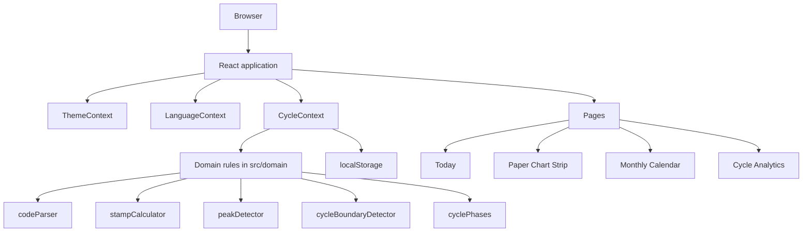
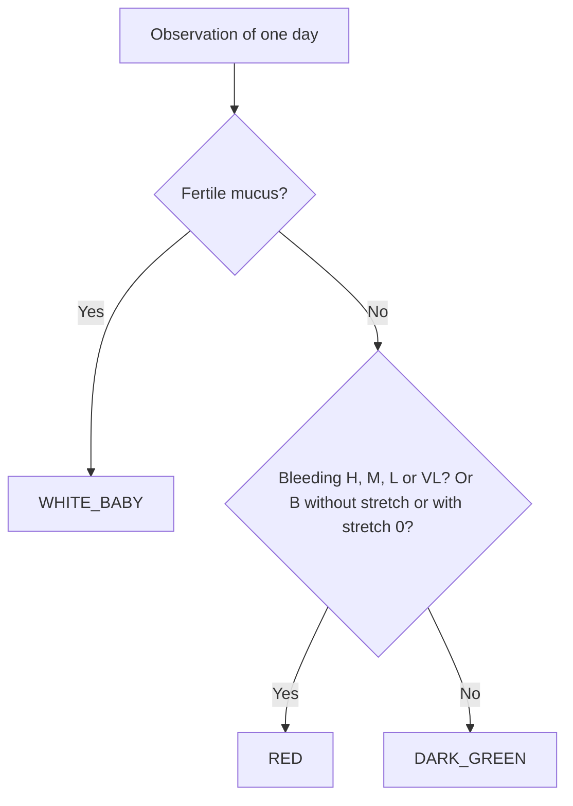

# Fertility Tracker specification

- **Document version:** 1.15.2
- **Status:** Approved
- **Last updated:** October 27, 2026
- **Repository:** [github.com/gsuquet/fertility-tracker](https://github.com/gsuquet/fertility-tracker)

This document is the full specification of the application. Change it before you change the code. The [docs](docs/README.md) give the same rules for users and contributors.

## Table of contents

1. [Summary](#1-summary)
2. [Architecture and technology](#2-architecture-and-technology)
3. [Domain rules](#3-domain-rules)
4. [Data types](#4-data-types)
5. [User interface](#5-user-interface)
6. [State and data storage](#6-state-and-data-storage)
7. [Languages and design system](#7-languages-and-design-system)
8. [Tests and quality](#8-tests-and-quality)
9. [Deployment and CI](#9-deployment-and-ci)
10. [Privacy, trademarks and medical limits](#10-privacy-trademarks-and-medical-limits)

## 1. Summary

Fertility Tracker is a web application to chart fertility signs with the Creighton Model FertilityCare™ System (CrMS). The user records bleeding and cervical mucus each day with the standard CrMS codes.

The application does not predict fertile days from a calendar. It uses only the daily observations. From these observations, it calculates the stamp of each day, the Peak Day, the count of three and the start of each cycle.

### Objectives

| Objective      | Requirement                                                                              |
| -------------- | ---------------------------------------------------------------------------------------- |
| Clinical rules | The application follows the standard CrMS codes and stamp rules.                         |
| Paper chart    | The chart looks like the CrMS paper chart. A calendar and statistics are also available. |
| Privacy        | All data stays in the browser. There is no server database, no account and no tracking.  |
| Export         | The user can print a 35-day chart, save it as a PDF file, and back up the data as JSON.  |

## 2. Architecture and technology

The application is a single-page React application. It has no backend. Vite builds it into static files, and Cloudflare Pages serves them.



### Versions

Each runtime, tool, dependency, pre-commit hook and CI action has an exact pinned version.

- `.npmrc` sets `save-exact=true` and `engine-strict=true`.
- `package.json` declares `engines`, `devEngines` and `packageManager`.
- `.mise/config.toml` and `.mise/mise.lock` pin the tools with checksums.

| Layer              | Technology                                 | Version                                                                                             |
| ------------------ | ------------------------------------------ | --------------------------------------------------------------------------------------------------- |
| Runtime            | Node.js and npm                            | `node 26.12.1`, `npm 11.20.0` (the npm of that Node.js release), `.node-version`, mise `2026.10.19` |
| User interface     | React                                      | `19.3.1`                                                                                            |
| Language           | TypeScript                                 | `7.0.2`, strict, ES2023 target, unchecked index access and exact optional properties                |
| Build              | Vite                                       | `8.3.5`                                                                                             |
| Lint and format    | Biome                                      | `@biomejs/biome 2.6.3`. A warning is a failure.                                                     |
| Git hooks          | pre-commit                                 | `pre-commit 4.7.0`, `pre-commit-hooks 6.0.0`, `gitleaks 8.30.1`, local hooks                        |
| Icons              | Lucide React                               | `1.61.0`                                                                                            |
| Styles             | CSS                                        | Custom properties, cascade layers, grid and flexbox                                                 |
| Tests and coverage | Vitest, React Testing Library, V8 coverage | `vitest 5.0.5`, `@vitest/coverage-v8 5.0.5`, `@testing-library/react 16.3.3`, `jsdom 30.1.3`        |
| Deployment         | Cloudflare Pages                           | `wrangler 4.153.0`, `compatibility_date 2026-10-23`                                                 |
| Dependency updates | Dependabot                                 | Weekly grouped updates for npm and GitHub Actions                                                   |

## 3. Domain rules

The rules are pure functions in `src/domain/`. They do not use React.

### 3.1 Codes

The code lists are in `src/types/crms.ts`. The labels are in `src/i18n/locales/en.ts`.

| Group       | Codes                                                                                                       |
| ----------- | ----------------------------------------------------------------------------------------------------------- |
| Bleeding    | `H` heavy, `M` moderate, `L` light, `VL` very light, `B` brown or black                                     |
| Stretch     | `0`, `2`, `2W`, `4`, `6`, `8`, `10`, `10DL`, `10SL`, `10WL`                                                 |
| Appearance  | `B` brown, `C` cloudy, `C/K` cloudy and clear, `G` gummy, `K` clear, `L` lubricative, `P` pasty, `Y` yellow |
| Frequency   | `X1`, `X2`, `X3`, `AD` (all day)                                                                            |
| Symptoms    | `AP` abdominal pain, `RAP` right abdominal pain, `LAP` left abdominal pain                                  |
| Intercourse | `I`                                                                                                         |

### 3.2 Code parser

**Module:** [src/domain/codeParser.ts](src/domain/codeParser.ts). **CrMS specification version:** `1.1.0`.

`formatCodeString` writes the code in this sequence: `[bleeding] [stretch][appearance][frequency] [I]`.

- There is no space between the mucus code and the frequency. Examples: `10KLX3 I`, `H`, `2WX2`, `0AD`.
- The code string does not include the symptoms. The pages show the symptoms separately.

`parseCodeString` reads the text that the user types.

- It accepts lowercase letters, and text with or without a space before the frequency. For example, `10KLX3`, `10KL X3`, `0AD` and `0 AD` are correct.
- It finds the stretch prefix, the appearance codes, the frequency, the symptoms and `I`.
- It accepts the bleeding codes `H`, `M`, `L` and `VL`. It reads `B` as the brown appearance code. The user selects bleeding `B` with the form buttons.
- It ignores letters that are not codes.

### 3.3 Stamp of one day

**Module:** [src/domain/stampCalculator.ts](src/domain/stampCalculator.ts)

Fertile mucus is stretch `6`, `8`, `10`, `10DL`, `10SL` or `10WL`, or appearance `K`, `L` or `C/K`. `calculateStamp` uses the first rule that applies:



### 3.4 Peak Day and count of three

**Module:** [src/domain/peakDetector.ts](src/domain/peakDetector.ts)

`processCycleObservations` sorts the days of one cycle by date. It sets `cycleDay`, `stamp` and `isPeakDay`.

The Peak Day is the first match of these rules:

1. The day of the `manualPeakDate` argument.
2. The first day of the cycle with `isManualPeak`.
3. The last day of the cycle with fertile mucus.

The count of three follows each run of fertile days. The Peak Day is also a fertile day for this rule.

| Calendar days after the last fertile day | Stamp of a dry day   |
| ---------------------------------------- | -------------------- |
| 1                                        | `LIGHT_GREEN_BABY_1` |
| 2                                        | `LIGHT_GREEN_BABY_2` |
| 3                                        | `LIGHT_GREEN_BABY_3` |
| 4 or more                                | `DARK_GREEN`         |
- The count applies before and after the Peak Day.
- The count uses calendar days. A day without an observation is part of the count.
- A new `WHITE_BABY` day starts the count again.
- Only a `DARK_GREEN` day changes. A `RED` day stays red.
- A `WHITE_BABY` day after a manual Peak Day stays white.

### 3.5 Cycles

**Module:** [src/domain/cycleBoundaryDetector.ts](src/domain/cycleBoundaryDetector.ts)

`groupObservationsIntoCycles` puts the days into cycles. The first observation starts the first cycle. For each subsequent day, the first matching rule applies:

1. `isCycleStart === true`: the day starts a new cycle.
2. `isCycleStart === false`: the day stays in the current cycle. For example, the user marks spotting between cycles.
3. Bleeding `H`, `M`, `L` or `VL` after a day without bleeding or with `B`: the day starts a new cycle.
4. Other days stay in the current cycle.

The function returns the cycles from the newest to the oldest. Each cycle goes through `processCycleObservations`.

The form asks "Is this bleeding day the start of a new cycle?" in this condition:

- The day has a bleeding code (`H`, `M`, `L`, `VL` or `B`).
- The previous observation has no bleeding, or there is no previous observation.
- The user did not answer for this day before.

### 3.6 Phases

**Module:** [src/domain/cyclePhases.ts](src/domain/cyclePhases.ts)

| Value      | One cycle (`getCyclePhases`)                                       | All cycles (`averagePhases`)                  |
| ---------- | ------------------------------------------------------------------ | --------------------------------------------- |
| Length     | Cycle day of the last observation                                  | Average of all cycles                         |
| Menses     | Number of `RED` days                                               | Average of all cycles                         |
| Follicular | Cycle day 1 to the Peak Day. Before the Peak Day: all days so far. | Average of the cycles with a Peak Day, if any |
| Luteal     | Days after the Peak Day. Before the Peak Day: 0.                   | Average of the cycles with a Peak Day, if any |

Before the Peak Day, the analytics page shows "in progress" after the follicular value.

### 3.7 Version tracker

**Module:** [src/domain/versionTracker.ts](src/domain/versionTracker.ts)

- `VERSION_HISTORY` has the release notes, newest first. Each release has a version, a date, a title, a tagline and highlights, in English and French.
- Vite puts the version from `package.json` and the build time into `__APP_VERSION__` and `__BUILD_DATE__`.
- `checkAndRecordVersionSeen()` compares the version with `fertility_tracker_last_seen_version` in `localStorage`, then saves the current version.
- `getStorageStats()` counts the storage keys, the size, the observations and the cycles.

## 4. Data types

**Module:** [src/types/crms.ts](src/types/crms.ts)

```typescript
export type BleedingCode = 'H' | 'M' | 'L' | 'VL' | 'B';

export type MucusStretch = '0' | '2' | '2W' | '4' | '6' | '8' | '10' | '10DL' | '10SL' | '10WL';

export type MucusModifier = 'B' | 'C' | 'C/K' | 'G' | 'K' | 'L' | 'P' | 'Y';

export type FrequencyCode = 'X1' | 'X2' | 'X3' | 'AD';

export type SymptomCode = 'AP' | 'RAP' | 'LAP';

export type StampType =
  | 'RED' // Bleeding
  | 'DARK_GREEN' // Dry day
  | 'WHITE_BABY' // Fertile mucus
  | 'LIGHT_GREEN_BABY_1' // Count of three, day 1
  | 'LIGHT_GREEN_BABY_2' // Count of three, day 2
  | 'LIGHT_GREEN_BABY_3' // Count of three, day 3
  | 'YELLOW'; // Shown in the welcome guide only

export interface Observation {
  id: string;
  date: string; // YYYY-MM-DD
  cycleDay: number;
  bleeding?: BleedingCode | undefined;
  stretch?: MucusStretch | undefined;
  modifiers?: MucusModifier[] | undefined;
  frequency?: FrequencyCode | undefined;
  symptoms?: SymptomCode[] | undefined;
  intercourse?: boolean | undefined;
  notes?: string | undefined;
  isManualPeak?: boolean | undefined;
  isCycleStart?: boolean | undefined;
  stamp: StampType;
  codeString: string; // For example "10KLX3 I"
  isPeakDay?: boolean | undefined;
}

export interface Cycle {
  id: string;
  startDate: string; // YYYY-MM-DD
  observations: Observation[];
  manualPeakDate?: string | undefined;
  notes?: string | undefined;
}

export type Language = 'en' | 'fr';
export type Theme = 'dark' | 'light';
export type ActiveTab = 'today' | 'chart' | 'calendar' | 'analytics';
```

## 5. User interface

The application has four pages, a header, a statistics bar, an observation drawer and dialogs. A phone screen is 640 pixels wide or less.

### 5.1 Navigation

| Part                                                         | Wide screen                                                                                                                            | Phone screen                                                                                                      |
| ------------------------------------------------------------ | -------------------------------------------------------------------------------------------------------------------------------------- | ----------------------------------------------------------------------------------------------------------------- |
| Header ([Header.tsx](src/components/Header.tsx))             | Logo, page buttons, cycle picker, **Log Observation**, export, guide, version, language and theme buttons. Buttons are 42 pixels high. | Logo, cycle picker and a menu button, 38 pixels high. The other buttons are in a menu that opens from the bottom. |
| Page buttons ([MobileNav.tsx](src/components/MobileNav.tsx)) | In the header                                                                                                                          | Fixed at the bottom, with a **+** button for a new observation                                                    |
| Dialogs                                                      | Centered                                                                                                                               | Open from the bottom, with rounded top corners, a maximum height of `88dvh`, and a fixed header and footer        |
| Footer ([Footer.tsx](src/components/Footer.tsx))             | Legal text, **User Guide** link and version button                                                                                     | The copyright and the two buttons are on separate lines                                                           |

The phone menu goes into `document.body` with `ReactDOM.createPortal`. Thus, the `backdrop-filter` of the header does not move it.

### 5.2 Statistics bar

**Module:** [src/components/CycleStatsHeader.tsx](src/components/CycleStatsHeader.tsx)

The bar shows four cards for the selected cycle, or for all cycles:

| Card                  | One cycle                                    | All cycles                                    |
| --------------------- | -------------------------------------------- | --------------------------------------------- |
| Cycle Length          | Number of observations                       | Average number of observations per cycle      |
| Estimated Peak Day    | Cycle day and date of the Peak Day, or `---` | The Peak Day of the newest cycle that has one |
| Luteal Phase Count    | Days after the Peak Day                      | Average of the cycles with a Peak Day         |
| Intercourse Frequency | Days with `I`                                | Days with `I` in all cycles                   |

On a screen of 768 pixels or less, the bar shows only on the **Cycle Analytics** page.

### 5.3 Today page

**Module:** [src/components/TodayView.tsx](src/components/TodayView.tsx)

| Part                                                                          | Content                                                                                                           |
| ----------------------------------------------------------------------------- | ----------------------------------------------------------------------------------------------------------------- |
| [TodayDateNav.tsx](src/components/today/TodayDateNav.tsx)                     | Previous and next day, date picker, date, and status: today, cycle day, recorded or not.                          |
| [TodayObservationForm.tsx](src/components/today/TodayObservationForm.tsx)     | **Direct Code Only** or **Detailed Form** mode, all fields, peak and cycle start buttons, notes, save and delete. |
| [TodayFertilityGuidance.tsx](src/components/today/TodayFertilityGuidance.tsx) | Stamp preview, code and a guidance text. A banner on a phone and a card on a wide screen.                         |
| [TodayHistoryList.tsx](src/components/today/TodayHistoryList.tsx)             | The last five days in three columns: date, stamp and code. A long code ends with an ellipsis.                     |

The application saves the last entry mode in `fertility_care_entry_mode`.

### 5.4 Paper Chart Strip page

**Module:** [src/components/ChartRow.tsx](src/components/ChartRow.tsx)

- Each cycle is one row, in the format of the CrMS paper chart. The **Full 35-Day Paper Grid** mode shows 35 cells. The **Compact Strip** mode shows only the recorded days.
- Each cell shows the cycle day, the date, the stamp, the code, the `I` mark and the `P` mark.
- Buttons go to day 1, to the Peak Day and to the newest day of each row.
- A click on a cell opens the observation drawer.
- Today has a 2-pixel accent border, a `TODAY` label (`.cell-today-pill`) and `aria-current="date"`.

### 5.5 Monthly Calendar page

**Module:** [src/components/CalendarGrid.tsx](src/components/CalendarGrid.tsx)

- The grid shows one month. Each day shows its stamp and its code. The week starts on Monday.
- Months after the current month are not available.
- A click on a day opens the observation drawer for that date. Days in the future are disabled.
- Today has a 2-pixel accent border, a light accent background, a round day number and `aria-current="date"`.
- Text uses the theme tokens `--text-primary` and `--text-secondary`. Thus, it is readable in the dark theme.
- On a phone, a long code goes onto more lines and the day cell becomes taller. The code is never cut.

### 5.6 Cycle Analytics page

**Module:** [src/components/CycleAnalyticsView.tsx](src/components/CycleAnalyticsView.tsx)

| Section                       | Content                                                                   |
| ----------------------------- | ------------------------------------------------------------------------- |
| Cycle Phases Breakdown        | Menses, follicular and luteal lengths from section 3.6, as bars.          |
| Mucus and stamp distribution  | Number and percentage of red, dry, fertile and count-of-three days.       |
| Creighton Mucus Score Trend   | One bar for each day, with its mucus score.                               |
| Practitioner Clinical Summary | Average mucus score, Peak Day, luteal phase health and intercourse count. |
| Creighton Mucus Score guide   | A short explanation of the score.                                         |

Mucus score of one day:

| Observation                                                      | Score |
| ---------------------------------------------------------------- | ----- |
| Stretch `10`, `10DL`, `10SL` or `10WL`, or appearance `K` or `L` | 10    |
| Stretch `8`                                                      | 8     |
| Stretch `6`                                                      | 6     |
| Stretch `4`                                                      | 4     |
| Stretch `2` or `2W`                                              | 2     |
| Other days                                                       | 0     |

Luteal phase health is "Normal" from 9 to 17 days. From 1 to 8 days or above 17 days, it is "Short/Extended". At 0 days, it is "Pending Peak Day".

### 5.7 Observation drawer

**Module:** [src/components/ObservationDrawer.tsx](src/components/ObservationDrawer.tsx)

- The drawer has the same fields as the Today form: date, direct code, the code buttons, intercourse, peak, cycle start and notes.
- The direct code and the buttons stay synchronized.
- The stamp preview shows the stamp and the code before the save.
- On a phone, the footer buttons become smaller to fit. The delete button shows only its icon.

### 5.8 Export and print

**Modules:** [ExportModal.tsx](src/components/ExportModal.tsx), [PrintExportView.tsx](src/components/PrintExportView.tsx), [exportUtils.ts](src/utils/exportUtils.ts)

The export dialog has these actions:

| Action              | Result                                                                                |
| ------------------- | ------------------------------------------------------------------------------------- |
| Print / Save as PDF | Prints one cycle or the selected cycles with the browser print dialog.                |
| Backup Data (JSON)  | Downloads `fertility-tracker-data-backup-YYYY-MM-DD.json`. The file is not encrypted. |
| Restore Data (JSON) | Replaces all observations with the valid items of a JSON file.                        |
| Load Demo Cycle     | Replaces all observations with two demo cycles.                                       |
| Clear Data / Reset  | Deletes all observations after a confirmation.                                        |

`getExportFilename()` makes file names with only lowercase letters, digits and dashes.

The print procedure:

1. The dialog names the selection: `cycle-N`, `selected-cycles` or `all-cycles`.
2. The application sets the document title to the file name, for example `fertility-tracker-chart-cycle-1-YYYY-MM-DD`. The browser uses it as the default PDF file name.
3. The application calls `window.print()`, then restores the title after one second.
4. The application closes the dialog and shows a message.

The print layout:

- It is landscape, with 35 days in each row, from the oldest cycle to the newest cycle.
- It hides the user interface.
- It does not show the day of the week.
- It removes the spaces from the codes and lets a long code go onto two lines.
- It has a line under the code of each day for the notes.

There is no PNG export.

### 5.9 Version dialog

**Module:** [src/components/VersionModal.tsx](src/components/VersionModal.tsx)

- The info button in the header and the version button in the footer open the dialog.
- The **Release Notes** tab shows the newest release and the full history. Each old release opens and closes.
- The **System Information** tab shows the version, the CrMS version, the build date, the mode, the storage statistics and the repository link.

### 5.10 Welcome guide

**Module:** [src/components/WelcomeModal.tsx](src/components/WelcomeModal.tsx)

The guide opens at the first visit, when `fertility_tracker_has_seen_welcome` is not in `localStorage`. It has four slides:

1. The CrMS method and the privacy of the data.
2. The stamps: red, green, green with a baby, white with a baby and yellow, and the count of three.
3. How to record: direct code (for example `10KLX3 I AP`) or the form buttons.
4. The four pages, with **Explore Demo Data** and **Start Fresh**.

The guide has **Previous**, **Next** and **Skip Tour** buttons and step dots. The **Escape** key closes it. It is in English and in French.

## 6. State and data storage

**Module:** [src/context/CycleContext.tsx](src/context/CycleContext.tsx)

| Context or hook                      | Content                                                                                   |
| ------------------------------------ | ----------------------------------------------------------------------------------------- |
| `CycleDataContext`, `useCycleData()` | Observations, cycles, selected cycle, save, delete, peak, export, import, demo and clear. |
| `CycleUiContext`, `useCycleUi()`     | The selected day and the open drawer.                                                     |
| `useCycle()`                         | Both contexts together.                                                                   |

The two contexts are separate. Thus, the drawer does not make the chart and the calendar render again.

After each change, the application calculates the cycles, the Peak Days and the stamps again for all days.

`localStorage` keys:

| Key                                   | Content                           |
| ------------------------------------- | --------------------------------- |
| `fertility_care_observations`         | All observations, as a JSON array |
| `fertility_care_lang`                 | Language                          |
| `fertility_care_theme`                | Theme                             |
| `fertility_care_entry_mode`           | Last entry mode of the Today page |
| `fertility_tracker_last_seen_version` | Last version that the user opened |
| `fertility_tracker_has_seen_welcome`  | The user closed the welcome guide |

A restore and the start-up read go through `src/domain/dataValidator.ts`. It ignores items without a valid date and codes that are not in the lists. It keeps one item for each date.

`buildDemoObservations` makes 56 days that end today: two 28-day cycles with the Peak Day on cycle day 13.

## 7. Languages and design system

### 7.1 Languages

**Modules:** [src/context/LanguageContext.tsx](src/context/LanguageContext.tsx), `src/i18n/`

| File                     | Content                                                    |
| ------------------------ | ---------------------------------------------------------- |
| `src/i18n/locales/en.ts` | The English text. This file defines the translation schema |
| `src/i18n/locales/fr.ts` | The French text, with the type of the translation schema   |
| `src/i18n/types.ts`      | The types `TranslationSchema` and `SupportedLanguage`      |
| `src/i18n/index.ts`      | The objects `translations` and `supportedLanguages`        |
- The languages are English (`en`) and French (`fr`).
- The type check fails if a language file does not have all the keys.
- Components get each text and the date locale (`t.locale`: `en-US` or `fr-FR`) from the dictionary. They do not test `language === 'fr'` and they have no fallback texts.
- Each release in `VERSION_HISTORY` has English and French text: `title` and `titleFr`, `tagline` and `taglineFr`, `highlights` and `highlightsFr`.

### 7.2 Design system and CSS layers

**Modules:** [src/context/ThemeContext.tsx](src/context/ThemeContext.tsx), [src/styles/index.css](src/styles/index.css). **Decision:** [ADR 0002](docs/adr/0002-css-maintainability-design-system.md).

The layer order is:

```css
@layer tokens, base, primitives, views, utilities;
```

| Folder        | Files                                                                                                                                                                                                |
| ------------- | ---------------------------------------------------------------------------------------------------------------------------------------------------------------------------------------------------- |
| `tokens/`     | `tokens.css`: colors, light and dark themes, each with its `color-scheme`, radii, shadows, stamp colors and feedback colors. `spacing.css`: spacing and z-index scales. `animations.css`: keyframes. |
| `base/`       | `reset.css`: box sizing, resets and font smoothing. `layout.css`: application frame and phone navigation space.                                                                                      |
| `primitives/` | `buttons.css`, `forms.css`, `badges.css` (stamps and badges) and `dialogs.css` (dialogs and drawer).                                                                                                 |
| `views/`      | `header.css`, `cycle-picker.css`, `mobile-nav.css`, `today.css`, `chart.css`, `calendar.css`, `analytics.css`, `drawer.css`, `modals.css`, `footer.css` and `print.css`.                             |
| `utilities/`  | `utilities.css`: layout and text helpers.                                                                                                                                                            |

`ThemeContext` sets `data-theme` on the `html` element. The first theme comes from `localStorage`, else from `prefers-color-scheme`.

## 8. Tests and quality

The project uses test-driven development (TDD). Write a test that fails before each change of behavior. Then write the minimum code that makes it pass. The tools are Vitest, React Testing Library and V8 coverage. Biome and the strict TypeScript compiler do the static analysis.

### 8.1 Coverage

- Coverage is 100% for statements, branches, functions and lines. `vite.config.ts` sets `coverage.thresholds: { 100: true }`. Thus, `npm run test:coverage` fails below 100%, also in CI.
- Coverage ignore comments are not permitted. Code that no test can reach is removed.
- The report includes `src/**` and `scripts/**`. It excludes test files, `src/test/**`, `src/setupTests.ts` and `src/vite-env.d.ts`.

### 8.2 Test layers

| Layer       | Location                       | Content                                                                            |
| ----------- | ------------------------------ | ---------------------------------------------------------------------------------- |
| Domain      | `src/domain/__tests__/`        | Code parser, stamps, Peak Day, cycles, phases, validation, demo data, form values. |
| Utilities   | `src/utils/__tests__/`         | Dates, export file names and safe `localStorage` access.                           |
| Hooks       | `src/hooks/__tests__/`         | `useObservationForm`, the form state of the Today page and the drawer.             |
| Contexts    | `src/context/__tests__/`       | Saved data, cycle selection, language and theme.                                   |
| Components  | `src/components/**/__tests__/` | Output and user actions. Tests find elements by role and accessible name.          |
| Application | `src/__tests__/`               | Flows across components: welcome guide, print and entry point.                     |
| Styles      | `src/styles/__tests__/`        | CSS rules that jsdom cannot show, for example theme colors and phone layout.       |
| Tools       | `scripts/*/__tests__/`         | The documentation check and the commit message check.                              |

The helpers are in `src/test/`:

- `makeObservation({ date, ...fields })` makes a valid observation.
- `renderWithProviders(ui, { language, observations, selectedCycleId })` renders in all providers.
- `src/setupTests.ts` clears `localStorage` after each test.

### 8.3 Commands

```bash
# Install the pinned tools and the Git hooks
mise install && mise run hooks

# Run the tests one time (or in watch mode with npm run test:watch)
npm run test

# Run the tests with coverage. Fails below 100%.
mise run coverage

# Biome lint and format check. A warning is a failure.
npm run check

# Correct the lint and format findings
npm run check:fix

# Strict type check
npm run typecheck

# Check the docs: STE rules, Diátaxis structure and links
mise run docs

# Run all CI gates (the tasks are in .mise/tasks/)
mise run validate
```

### 8.4 Documentation

- The pages in `docs/` follow [Diátaxis](https://diataxis.fr/) strictly. Each page is a tutorial, a how-to guide, a reference page or an explanation, in the folder of that type. Decision records are in `docs/adr/`. `docs/README.md` is the index.
- `README.md`, `AGENTS.md`, `SPEC.md` and `docs/` use a subset of ASD-STE100 Simplified Technical English.
- The limits are 20 words in a procedure step, 25 words in a descriptive sentence and 6 sentences in a paragraph. Contractions and the words in the list of words that are not approved are not permitted.
- `scripts/docs/checkDocs.ts` checks these rules, the Diátaxis folders, the index, the steps in tutorials and how-to guides, and the relative links and anchors.
- `mise run docs` runs the check. The `docs-check` pre-commit hook runs it in CI.

Read [Documentation rules](docs/reference/documentation-rules.md), [Testing strategy](docs/explanation/testing-strategy.md), [Test rules and helpers](docs/reference/test-rules.md) and [Write a test first](docs/how-to/write-a-test-first.md).

### 8.5 Commit messages

- Each commit message and each pull request title follows [Conventional Commits 1.0.0](https://www.conventionalcommits.org/en/v1.0.0/): `type(scope)!: description`.
- The types are `build`, `chore`, `ci`, `docs`, `feat`, `fix`, `perf`, `refactor`, `revert`, `style` and `test`. The scope and `!` are optional.
- `scripts/commits/checkCommitMessage.ts` does the check. The `conventional-commit` hook runs it on each commit message. Install the hook with `mise run hooks`.
- CI checks the pull request title, because a squash merge uses it as the commit message.
- Read [Commit messages](docs/reference/commit-messages.md).

## 9. Deployment and CI

### 9.1 Deployment

| Item             | Value                                                                                             |
| ---------------- | ------------------------------------------------------------------------------------------------- |
| Platform         | Cloudflare Pages, static site                                                                     |
| Settings         | [wrangler.json](wrangler.json): `name` is `fertility-tracker`, `pages_build_output_dir` is `dist` |
| Build command    | `npm run build`, that is `tsc --noEmit` then `vite build`                                         |
| Deploy command   | `npm run deploy`, that is the build then `wrangler pages deploy dist`                             |
| Automatic deploy | Cloudflare builds each commit on `main` and a preview for each pull request                       |

### 9.2 CI workflow

The `ci` workflow runs on each pull request to `main`. It does not run on a push to `main`. It installs the tools from `.mise/config.toml` with `jdx/mise-action`. Then it does these steps:

1. Installs the dependencies with `npm ci`.
2. Checks that the pull request title follows Conventional Commits.
3. Runs `npm audit signatures`.
4. Scans the pull request commits for secrets with gitleaks.
5. Runs `pre-commit run --all-files`: file hygiene, Biome, `tsc --noEmit` and the docs check.
6. Runs `npm run test:coverage`.
7. Runs `vite build`.

Each action is pinned to a full commit SHA, with the release tag in a comment.

## 10. Privacy, trademarks and medical limits

### Privacy

All the work occurs in the browser. All observations stay in the `localStorage` of the browser. The application sends no health data to a server.

### Trademarks

FertilityCare™ and Creighton Model FertilityCare™ System (CrMS) are trademarks of the Saint Paul VI Institute for the Study of Human Reproduction. Fertility Tracker is an independent open-source project. The Saint Paul VI Institute, FCCA and FCCI do not approve or sponsor it.

### Medical limits

Fertility Tracker is for personal records and education only. It does not give medical advice, a diagnosis or a treatment. A certified FertilityCare Practitioner or Medical Consultant must read the chart for clinical decisions.
