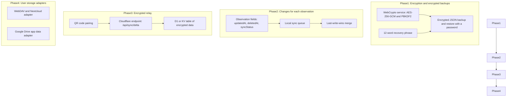

# ADR 0001: Automatic backup and synchronization with zero-knowledge privacy

- **Date:** 2026-08-14
- **Status:** Proposed. Not implemented.

## Context

The application keeps very sensitive health data: bleeding, mucus, intercourse and cycle dates. Today, it keeps the data only in the `localStorage` of the browser. The user can make a JSON backup and restore it manually.

Users need these functions:

1. Automatic backups, so that they do not lose data when they clear the browser or lose the device.
2. Synchronization between devices. For example, a user records on a phone and reads the statistics on a computer. A partner can also see the chart.
3. Full privacy. A host, a server or a network must never see the data or the medical metadata in clear text.
4. Local-first operation. The application must work without a network and synchronize when a network is available.

## Options

### Option A: Encrypted serverless relay on Cloudflare

The browser encrypts the data with WebCrypto (AES-256-GCM). Then it sends the encrypted data to a Cloudflare Pages function, which keeps it in D1, KV or R2.

| Advantages                                                         | Disadvantages                                                |
| ------------------------------------------------------------------ | ------------------------------------------------------------ |
| The user does not need a cloud account.                            | The project must keep a small backend and a database schema. |
| The server keeps only encrypted data and a hashed room identifier. |                                                              |
| Synchronization can be fast.                                       |                                                              |
| The free Cloudflare plan is sufficient.                            |                                                              |

### Option B: Storage of the user (WebDAV, Nextcloud, Google Drive, iCloud)

The browser connects directly to a storage service of the user.

| Advantages                                        | Disadvantages                                                        |
| ------------------------------------------------- | -------------------------------------------------------------------- |
| The project keeps no server.                      | The user must set up OAuth credentials, a WebDAV address or a token. |
| The user has full control of the encrypted files. | Background synchronization is limited on iOS and Safari.             |
|                                                   | Two devices that write the full file at the same time can lose data. |

### Option C: Direct connection between devices (WebRTC and CRDT)

The devices connect directly through WebRTC and exchange CRDT changes (Automerge or Yjs).

| Advantages                                   | Disadvantages                                   |
| -------------------------------------------- | ----------------------------------------------- |
| No server or storage service keeps the data. | Two devices must be online at the same time.    |
| The CRDT merge has no conflicts.             | If the only device is lost, there is no backup. |
|                                              | The CRDT library adds 50 to 200 KB.             |
|                                              | The connection needs STUN and TURN servers.     |

### Option D: Adapters with a default encrypted relay (selected)

One `SyncAdapter` interface in `src/domain/sync/`. The default adapter is the encrypted relay of option A. Optional adapters use WebDAV or another storage service of the user, or an encrypted file.

## Key management

| Method                          | Cryptography                                                                          | Setup for the user                                       | Recovery after device loss                         | Recommendation    |
| ------------------------------- | ------------------------------------------------------------------------------------- | -------------------------------------------------------- | -------------------------------------------------- | ----------------- |
| 12-word recovery phrase (BIP39) | PBKDF2 or Argon2id from 128 bits of entropy. Gives an AES-GCM key.                    | Write 12 words one time. Type them on the second device. | Yes, at all times.                                 | Default           |
| Temporary QR code (ECDH)        | The first device shows an ECDH public key. The second device scans it.                | Scan with the camera. No typing.                         | Only if one device is still available.             | For fast pairing  |
| Password and salt               | PBKDF2 with 600,000 or more iterations, or Argon2id.                                  | A password on each device.                               | Only as strong as the password.                    | Secondary option  |
| Sync link with the key          | The key is in the URL fragment. The browser does not send the fragment to the server. | Open a link or scan a QR code.                           | If the link is lost, the data cannot be decrypted. | For a partner     |
| Passkey (WebAuthn PRF)          | The authenticator makes the key with the PRF extension.                               | Face or fingerprint prompt.                              | Browser support is not complete.                   | Phase 3 candidate |

## Synchronization and conflicts

| Strategy                                   | Method                                                                                                   | Size of a sync                      | Conflict resolution                                                                  | Complexity |
| ------------------------------------------ | -------------------------------------------------------------------------------------------------------- | ----------------------------------- | ------------------------------------------------------------------------------------ | ---------- |
| A. Full snapshot                           | Encrypts the full observation list as one file with a version and a time.                                | Less than 200 KB                    | The last write wins for the full file. Two offline devices can overwrite each other. | Very low   |
| B. Changes for each observation (selected) | Each observation has `updatedAt` and `deletedAt`. The device sends only the changes since the last sync. | Less than 1 KB                      | The last write wins for each observation. Different days never conflict.             | Medium     |
| C. CRDT log for each field                 | Each change of a field is an operation in an encrypted log.                                              | The log grows. It needs compaction. | The merge never loses data.                                                          | High       |

## Comparison

| Criterion                  | A: Encrypted relay | B: User storage | C: Direct WebRTC | D: Adapters (selected) |
| -------------------------- | ------------------ | --------------- | ---------------- | ---------------------- |
| Privacy                    | Very good          | Very good       | Very good        | Very good              |
| Easy setup                 | Very good          | Poor            | Medium           | Very good              |
| Automatic background sync  | Very good          | Poor            | Very poor        | Very good              |
| Recovery after device loss | Very good          | Very good       | Very poor        | Very good              |
| Hosting cost               | None               | None            | Low              | None                   |
| Bundle size                | Less than 5 KB     | About 15 KB     | About 120 KB     | Loaded only when used  |
| Sharing with a partner     | Very good          | Poor            | Medium           | Very good              |

## Decision

The project will implement option D with strategy B:

1. **Encryption in the browser** (`src/utils/cryptoUtils.ts`):
   - AES-256-GCM with WebCrypto.
   - Key derivation with PBKDF2-SHA256 (600,000 iterations) and a 12-word BIP39 phrase.
   - No external cryptography library.
2. **Changes for each observation:**
   - Add `updatedAt: number` and `deletedAt?: number` to the `Observation` type. A deleted observation keeps a `deletedAt` value.
   - Merge with a last-write-wins rule for each observation.
3. **Cloudflare relay** (`/api/sync`):
   - Cloudflare Pages functions with D1 or KV.
   - The relay keeps encrypted data. The index is `HMAC-SHA256(MasterKey, 'sync-room')`.
4. **Pairing:**
   - A 12-word recovery phrase for recovery.
   - A temporary encrypted QR code to pair a new device.

## Plan

## Consequences

### Advantages

- The browser encrypts the data before it sends it. Hosts and networks cannot read the data.
- Users get automatic synchronization without a cloud account or a server to set up.
- All reads and writes stay local and fast. The synchronization occurs in the background.
- The free Cloudflare Pages plan is sufficient.

### Disadvantages

- The project must add a backend endpoint (`/api/sync`), although it cannot read the data.
- A deletion must go to all devices, also to devices that are offline. The `deletedAt` value needs careful work.

## Related documents

- [Privacy and data storage](../explanation/privacy-and-data-storage.md)
