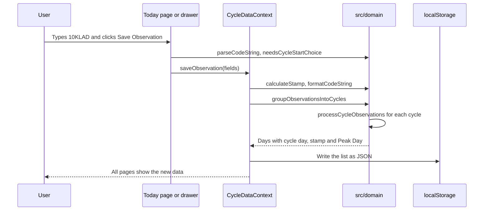

# Architecture

This page tells how the application is built and why. For the list of files, read [Project structure](../reference/project-structure.md).

## A browser application without a server

The application is a static React site. Vite builds it into HTML, CSS and JavaScript files. Cloudflare Pages serves the files. After the browser loads them, all the work occurs in the browser.

This design keeps health data on the device of the user. It also makes the hosting simple and cheap, because there is no database and no API. Read [Privacy and data storage](privacy-and-data-storage.md) for the consequences.

## The domain layer

The CrMS rules are in `src/domain/`. These functions are pure: they get data and return new data. They do not use React, the DOM or the network. The exceptions are `versionTracker.ts` and `appVersion.ts`, which read `localStorage`.

There are three reasons for this separation:

- The rules are the most important part of the application. An error in a rule gives incorrect fertility guidance.
- Pure functions are fast and easy to test. Each rule has tests without a browser.
- The rules do not change when the user interface changes.

## Data flow

The application keeps one list of observations. All other values come from this list.

After each change, the application calculates the cycles, the stamps and the Peak Days again for all days. This is simple and always correct. A save of one day can change the Peak Day and the stamps of other days. For a few hundred days, the calculation takes less than a millisecond.

## State

React contexts hold the state. The application does not use a state library, because the state is small.

| Context            | Content                                                                |
| ------------------ | ---------------------------------------------------------------------- |
| `CycleDataContext` | The observations, the cycles, the selected cycle and the data actions. |
| `CycleUiContext`   | The open drawer and the selected day.                                  |
| `LanguageContext`  | The language and the translations.                                     |
| `ThemeContext`     | The light or dark theme. It sets `data-theme` on the `html` element.   |

The data context and the user interface context are separate. Thus, when the drawer opens, the chart and the calendar do not render again.

## Shared form logic

The **Today** page and the observation drawer edit the same fields. The hook `useObservationForm` and the functions in `observationForm.ts` hold this logic one time. Thus, the two forms always act the same. The component `ObservationCodeSelector` shows the code buttons of the two forms.

## Lazy loading

The first screen needs only a part of the code. Thus, the main JavaScript file contains only this part. The other parts load later with `React.lazy`:

- The **Cycle Analytics** page loads when you open it.
- Each dialog loads when you open it for the first time. The application shows a dialog only while it is open.
- The release notes are in `versionTracker.ts`, and only the **About & Version Tracker** dialog imports this file. The header and the footer get the version from `appVersion.ts`, which is a small file.
- The print view loads when the application starts. The **Print / Save as PDF** button starts the print only after the print view has loaded. The browser print command (Ctrl+P) does not wait.

When the browser is idle after the first render, the application also loads the chunks of the page and the dialogs. Thus, the first screen is fast, and a dialog opens without a network later. This is important after a new deploy: the new service worker deletes the old files, and an old tab cannot get them again.

If a chunk does not load, the part shows an error with a **Reload** button. Each dialog has its own error boundary, and a failed dialog shows the error in a dialog. When you close it, the next opening tries again. A failed print view shows an error toast and does not print.

A smaller main file makes the first start faster, mainly on a slow phone. A unit test in `src/__tests__/mainChunk.test.ts` makes sure that the main file does not import the lazy parts.

While a part loads, a screen reader announces "Loading". The screen does not show a spinner, because the load is fast and a spinner flashes.

## Offline use

The application works without a network after the first visit. A service worker keeps a copy of all the application files in the browser cache.

The build makes the list of these files. The Vite plugin in `scripts/pwa/serviceWorkerPlugin.ts` bundles `src/sw/entry.ts` to `sw.js`. It adds the names of all the build files, also the pages that load later, such as **Cycle Analytics**. Thus, a page that you did not open online also opens offline.

The cache name contains the version and a hash of the build files. Each new build makes a new cache, and the service worker deletes the old caches. The service worker uses two strategies:

| Request                   | Strategy      | Reason                                                                     |
| ------------------------- | ------------- | -------------------------------------------------------------------------- |
| Files in `assets/`        | Cache first   | The file name contains a hash. A file with the same name never changes.    |
| Pages and the other files | Network first | You get the newest version online. Offline, you get the copy in the cache. |

`src/main.tsx` registers the service worker. There is no inline script in `index.html`. Thus, the Content Security Policy can block all inline scripts.

If a part of the application cannot load, an error boundary shows a message and a **Reload** button. The rest of the application stays available.

## Styles

The CSS uses cascade layers: `tokens`, `base`, `primitives`, `views` and `utilities`. A later layer always wins over an earlier layer, whatever the selector. Colors are tokens with one value for the light theme and one value for the dark theme. Read [ADR 0002](../adr/0002-css-maintainability-design-system.md) for the reasons.

All the text uses the font of the operating system: SF Pro on Apple devices, Roboto on Android and Segoe UI on Windows. Thus, the application looks like the other applications of the device. The application has no font file to download or to keep in the cache. Also, no request goes to a font service such as Google Fonts, which can learn about the visit.

## Related documents

- [Domain API](../reference/domain-api.md)
- [Testing strategy](testing-strategy.md)
