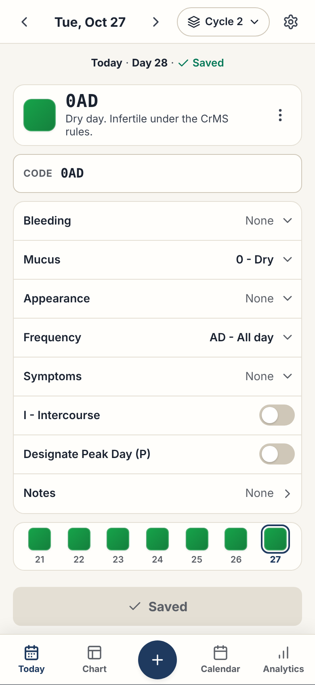
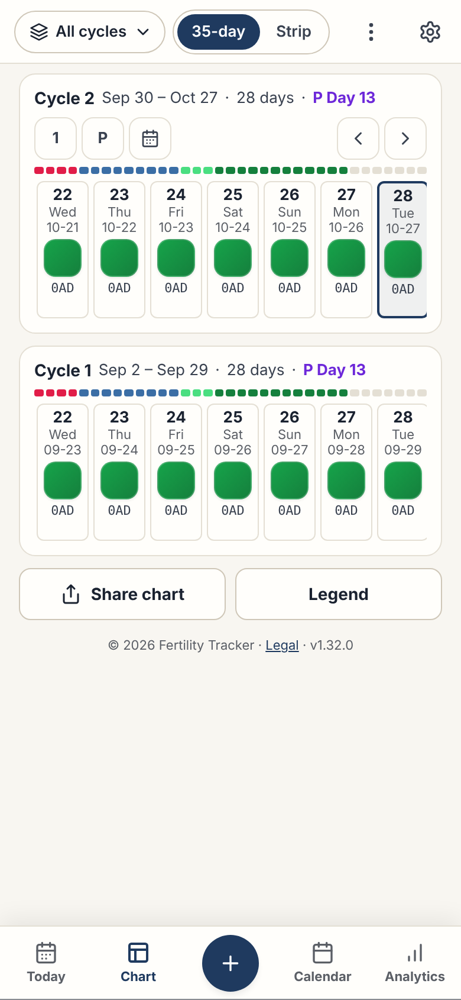
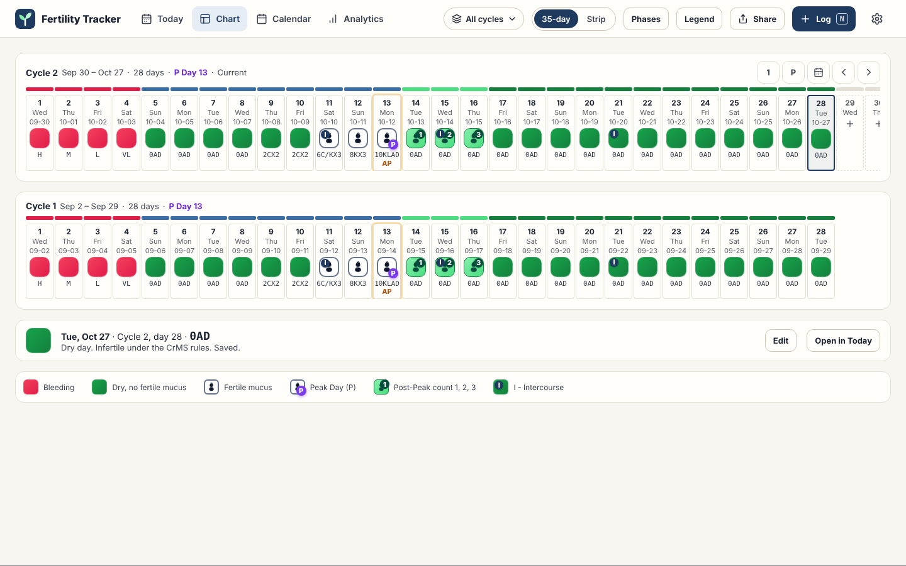
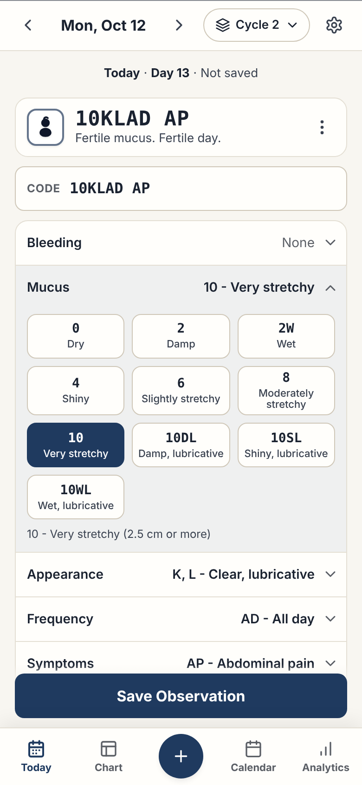
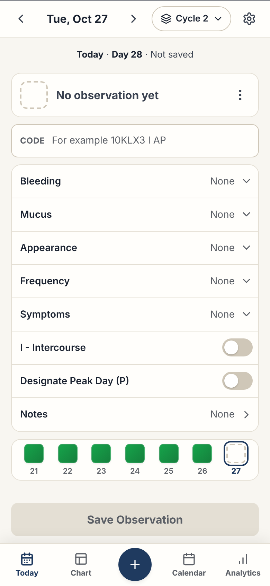
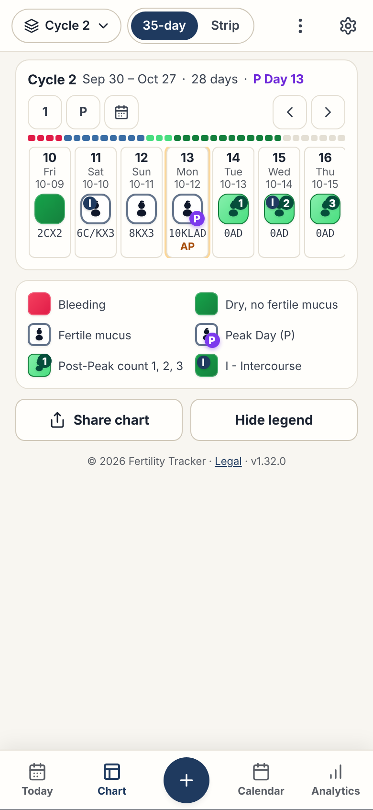
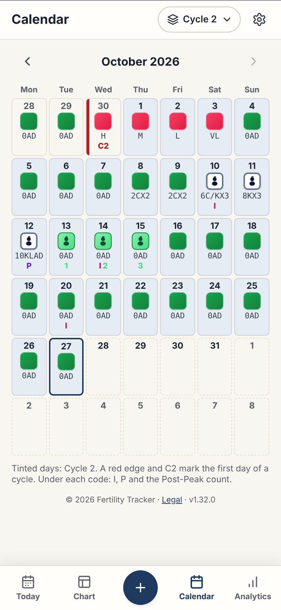

# RFC 0002: Phone-first redesign of the screens

- **Start date:** 2026-10-29
- **Status:** Accepted
- **Author:** Gabriel
- **Pull request:** [#116](https://github.com/gsuquet/fertility-tracker/pull/116)
- **Issue:** [#115](https://github.com/gsuquet/fertility-tracker/issues/115)

## Summary

This RFC changes the layout of all the screens so that the phone is the first design and the desktop uses its width. It keeps each function, the stamps, the code field, the observation sheet, the native behavior of #61 and the tokens of #76. It changes the navigation, the Today screen, the chart and the place of the settings. The static HTML mockups in [0002-assets](0002-assets/index.html) show each screen and each state on a phone and on a desktop.

## Motivation

The UX audit of 2026-10-29 tested version 1.32.0 on a phone of 390 × 844 px and on screens of 1024 px and 1440 px. The application is complete, but it is a desktop design that is made smaller for a phone. These are the main problems:

| Number | Problem                                                                                                      | Severity | Screen size |
| ------ | ------------------------------------------------------------------------------------------------------------ | -------- | ----------- |
| F1     | The Today page is 3,091 px high. The 30 code buttons show at the same time, and **Save** is at 2,058 px.     | High     | Phone       |
| F2     | A day with no observation shows the text "Dry / Infertile day". Thus, no data looks like an infertile day.   | High     | Both        |
| F3     | The phone hides the cycle day, the Today mark and the saved state.                                           | High     | Phone       |
| F19    | The phone hides **Jump to Today** too.                                                                       | High     | Phone       |
| F4     | The chart shows about 6 days under 330 px of controls on a phone. The day text is 9 px and 10 px.            | High     | Both        |
| F5     | In **All Cycles**, the rows do not align by cycle day.                                                       | Medium   | Both        |
| F6     | The phone has actions in 4 places. The settings are in two places.                                           | Medium   | Phone       |
| F7     | The phone navigation has no `aria-current`. A screen reader does not hear the current page.                  | Medium   | Phone       |
| F8     | **Delete Entry** is a red filled button next to **Save Observation**.                                        | Medium   | Both        |
| F9     | One dialog has print, backup, restore, demo and reset.                                                       | Medium   | Both        |
| F10    | The analytics tiles cut their labels on a phone. The mucus score trend is cut and does not show a scroll.    | Medium   | Phone       |
| F11    | At 1024 px the header is wider than the screen, and the page scrolls to the side.                            | Medium   | Desktop     |
| F12    | 11 to 14 controls on each phone screen are smaller than 44 px. The date arrows are 28 px.                    | Medium   | Phone       |
| F13    | The legal card (329 px) is the first item under the chart in the browser.                                    | Low      | Both        |
| F14    | The calendar does not follow the cycle picker and does not show the first day of a cycle.                    | Low      | Both        |
| F15    | On a desktop, two of the three columns of Today are almost empty.                                            | Low      | Desktop     |
| F16    | The phone navigation bar is not opaque. The content shows through it.                                        | Low      | Phone       |
| F17    | A phone page has no level 1 heading. The footer landmark is in `<main>`.                                     | Low      | Both        |
| F18    | In the dark theme, the status panel is lighter than its card. The edges of the stamps need a contrast check. | Low      | Phone       |

Issue [#115](https://github.com/gsuquet/fertility-tracker/issues/115) gives the full list of problems and the steps of the work. The full audit, with the screenshots and the measurements, is in the project folder of the maintainer.

## Guide-level explanation

### Record an observation on a phone

A person opens the application. The top bar shows the date, the cycle and the settings gear. Under it, a line shows **Today**, the cycle day and **Saved** or **Not saved**. The status card shows the stamp, the code and one line of fertility text.

The person types the code, or taps a group row. A group row opens and shows the codes of the group as chips. Each chip shows the code and a short name. The stamp changes at each tap. The person taps **Save Observation** at the bottom of the screen. The full form fits in one screen when all the groups are closed.



### Read the chart on a phone

The person taps **Chart**. The chart controls are in the top bar. Each cycle has one line of text, the phase bar and one row of day cards. Two cycles fit in one screen, and the rows align by cycle day.



### Use a desktop

The four pages are tabs in the top bar. Today shows the form on the left and the status, the current cycle and the last 7 days on the right. The chart shows 28 days at 1440 px, and a bar under the rows gives the data of the selected day.



### Change a setting

The person taps the gear. Settings is a page on a phone and a dialog on a desktop. It holds the display settings, the backup and the restore, the help and the about page. **Delete all data** is the last item.

## Reference-level explanation

### Principles

1. Each screen has one task. Today records a day. Chart shows the cycles. Calendar finds a date. Analytics explains the cycle. Settings holds the other actions.
2. The phone layout is the reference. The desktop puts two columns next to each other. It does not make the phone layout wider.
3. On the chart, only the day rows and one row of controls are above the fold.
4. Each screen shows the cycle day, the saved state and the stamp before the form.
5. A destructive action is in a menu or at the end of Settings. It is never next to **Save** or **Restore**.
6. Screen text is 11 px or more on a phone. A control used each day is 44 px or more.

### Pages and navigation

| Page      | Phone                     | Desktop                      | Content                                                                                  |
| --------- | ------------------------- | ---------------------------- | ---------------------------------------------------------------------------------------- |
| Today     | Bottom bar, item 1        | Tab 1                        | The selected day: status, code, groups, last 7 days. The desktop adds the current cycle. |
| Chart     | Bottom bar, item 2        | Tab 2                        | The chart rows, aligned by cycle day. **Share chart** is here.                           |
| Log (+)   | Bottom bar, center button | **Log** button and the key N | The observation sheet for today, or for the day that the person taps on the chart.       |
| Calendar  | Bottom bar, item 3        | Tab 3                        | One month, with the stamps, the codes and the first day of each cycle.                   |
| Analytics | Bottom bar, item 4        | Tab 4                        | The tiles, the phases, the trend, the stamps, the clinical summary and the explanation.  |
| Settings  | Gear in the top bar       | Gear in the top bar          | All the other actions.                                                                   |

The cycle picker is in the top bar of each page. The calendar follows it. The statistics bar is only on Analytics. The names Log and Analytics do not change.

### Phone shell

- The top bar is 54 px high and opaque (`--bg-surface`). On Today it holds the previous day button, the date, the next day button, the cycle picker and the gear. On Chart it holds the chart controls. On the other pages it holds the page title, the cycle picker and the gear.
- The bottom bar is 62 px high plus the safe area, and opaque. It stays a `<nav>` of buttons. The current item has `aria-current="page"`.
- The browser footer is one line under the last card: "© 2026 Fertility Tracker · Legal · version". The full legal and medical notice is in Settings, About, and in the welcome guide. The maintainer decided this on 2026-10-29.
- Each page has one `h1`. The footer landmark is outside `<main>`.

### Desktop shell

- From 1360 px, the top bar is one row of 60 px: the wordmark, the four tabs, the page controls, **Log** and the gear. The tabs stay a `tablist`.
- From 1024 px to 1359 px, the top bar has two rows. The second row (44 px) holds the date control of Today or the chart controls. Thus, the French labels fit, and the page does not scroll to the side.
- The six icon buttons of the current header go. Export goes to Chart, **Share**. The guide, the about dialog, the language and the theme go to Settings.
- The content is 1392 px wide or less, with a 24 px margin.
- In the installed application with the window controls overlay of #98, the top bar is the title bar.

### Today

| Part         | Rules                                                                                                                                                                |
| ------------ | -------------------------------------------------------------------------------------------------------------------------------------------------------------------- |
| Day status   | A line with **Today** or the number of days ago, the cycle day, and **Saved** or **Not saved**. On an earlier day, a **Today** button is at the right.               |
| Status card  | The stamp (40 px), the code (22 px) and one or two lines of fertility text. The **Observation actions** menu (⋮) is at the right.                                    |
| Code field   | The direct code field. A change in the field changes the rows. A change in the rows changes the field.                                                               |
| Group rows   | One row of 48 px for each group: Bleeding, Mucus, Appearance, Frequency, Symptoms. The row shows the code and its name, and cuts a long name with an ellipsis.       |
| Open group   | A tap opens the chips of the group under the row and closes the other groups. Each chip is 48 px high, with the code over a short name.                              |
| Switches     | **I - Intercourse**, **Designate Peak Day (P)** and **Notes** are rows of the same list.                                                                             |
| Last 7 days  | Phone: seven stamps that end on today, with the day numbers. A tap opens that day. The strip does not scroll. Desktop: a list of the 7 days before the selected day. |
| Save         | 48 px, above the bottom bar. It is enabled after any change, also a switch or a note alone. It shows **Saved** and is disabled when there is no change.              |
| Actions menu | **Copy yesterday**, **Direct Code Only** and **Delete observation**, in red text, as the last item.                                                                  |

These rules also apply:

- The form never fills in the data of the day before. A CrMS code comes from the observations of that day. **Copy yesterday** is an explicit action.
- With no observation, the stamp is a dashed square (`--stamp-empty`) and the text is "No observation yet". No fertility text shows. The word "Infertile" never shows without a code.
- The fertility texts are one sentence, for example "Dry day. Infertile under the CrMS rules." and "Fertile mucus. Fertile day."
- While the phone keyboard is open, the **Save** bar hides. The code field shows a **Done** button.
- **Direct Code Only** hides the group rows. The switches and the notes stay.
- On a desktop, the form is 640 px wide and the chips are in rows of four. **Ctrl+S** or **⌘S** saves. **Delete observation** is in **More**.

| Condition                             | Result                                                                                            |
| ------------------------------------- | ------------------------------------------------------------------------------------------------- |
| The screen is 1360 px wide or more    | Two columns. The right column has the status, the current cycle (35 columns) and the last 7 days. |
| The screen is 1024 px to 1359 px wide | Two columns. The right column has the status and the last 5 days.                                 |
| Else                                  | One column, as on the phone.                                                                      |





### Observation sheet

The sheet keeps its handle, its drag to close and its focus rules. It uses the progressive form of Today. The header shows the date, the cycle, the cycle day and the saved state, the **Observation actions** menu and **Close**. The footer has **Cancel** and **Save Observation**. The red delete icon of the footer goes to the **Observation actions** menu. From 1024 px, the sheet is a panel of 480 px on the right side, so that the chart stays visible.

### Chart

| Part         | Rules                                                                                                                                                                           |
| ------------ | ------------------------------------------------------------------------------------------------------------------------------------------------------------------------------- |
| Controls     | Phone: the cycle picker, **35-day** and **Strip**, and a menu with **Phase bar**, **Legend** and **Share chart**. Desktop: the same controls as buttons.                        |
| Cycle line   | One line: the cycle, the dates, the length and the Peak Day. Then the jump buttons (Day 1, P, Today) and the scroll arrows, each 36 px.                                         |
| Day card     | 44 × 116 px. It shows the cycle day (13 px), the weekday and the date (11 px), the stamp (32 px), the code and the symptom mark.                                                |
| Long code    | A code breaks only between its tokens, for example `10KLAD` over `AP`. A token wider than the card is cut with an ellipsis. The full code is in the accessible name.            |
| All Cycles   | All the rows share one scroll position, so the same cycle day is in the same column. The page opens on the column of today.                                                     |
| Strip view   | Cards of 34 × 62 px with the cycle day and the stamp only. About nine days fit on a phone.                                                                                      |
| Phase bar    | The four phases of Analytics, in the same colors. Phone: one bar for the full cycle, which does not scroll. Desktop: one segment above each column, which scrolls with the row. |
| Desktop cell | 44 px wide and 118 px high, with the same content as the phone card. A code can use two lines.                                                                                  |
| Many cycles  | Desktop: when more than 4 cycles show, each past cycle shows only its stamp row. A click opens the full row.                                                                    |
| Day detail   | Desktop only. A bar under the rows shows the selected day, with **Edit** and **Open in Today**. It replaces the dialog of a click on a day.                                     |

| Condition                          | Result                                                |
| ---------------------------------- | ----------------------------------------------------- |
| The screen is 1600 px wide or more | The 35 columns of 44 px fit. The row does not scroll. |
| The screen is 1440 px wide         | 28 columns fit. Days 29 to 35 scroll.                 |
| The screen is 1024 px wide         | About 20 columns fit.                                 |
| Else                               | Phone cards. Seven cards fit at 390 px.               |

The maintainer selected the 44 px columns on 2026-10-29.



### Pages with no data

When there is no observation, Chart, Calendar and Analytics show one card. The card gives the stamp legend, a **Record today** button and a link to the demo cycles in Settings. The calendar keeps its month grid above the card, so that the person can find a date. Analytics shows no tile.

### Share chart

**Share chart** replaces the print part of the current export dialog. It shows the list of cycles, **Download PNG** and **Print or PDF**. On a phone it is a sheet. On a desktop it is a dialog of 480 px. Backup, restore, demo and reset go to Settings.

### Calendar

- On a phone, the cells are 48 × 80 px and the code is 11 px.
- The I, P and 1, 2, 3 marks move from the stamp to a row of 12 px under the code.
- The first day of a cycle has a red edge and the mark C and the cycle number, for example C2.
- The days of the selected cycle have a tint. All the days keep full contrast.
- On a desktop, the grid is 896 px wide with cells of 120 × 96 px. A day panel in the rest of the width (about 470 px at 1440 px) shows the selected day.



### Analytics

1. Four tiles: 2 × 2 on a phone, 4 × 1 on a desktop. Each label is complete, on two lines if necessary.
2. The cycle phases.
3. The mucus score trend. The bars are 8 px with a gap of 1 px, so 35 bars fit on a phone.
4. The stamps in the cycle.
5. The clinical summary, without the numbers of the tiles.
6. The explanation of the mucus score, closed, at the end.

### Settings

| Group                | Items                                                                        |
| -------------------- | ---------------------------------------------------------------------------- |
| First row            | **Install app**, only when the browser can install the application.          |
| Appearance and input | Language, theme, vibration, app icon badge, keyboard shortcuts.              |
| Backup and restore   | **Back up now**, with the date of the last backup. **Restore from a file**.  |
| Help                 | Welcome guide, keyboard shortcuts.                                           |
| About                | Version, release notes, storage, the legal and medical notice.               |
| Data                 | **Load the demo cycles**. **Delete all data** in red text, as the last item. |

Settings is a page on a phone. Back closes it. On a desktop it is a dialog of 560 px. The confirmations of the demo, the restore and the delete do not change.

### Welcome guide

The welcome guide keeps its four slides. **Explore Demo Data** is on the first slide too.

### Design system rules

| Rule          | Value                                                                                                                                                                                      |
| ------------- | ------------------------------------------------------------------------------------------------------------------------------------------------------------------------------------------ |
| Screen text   | 11 px (`--font-size-2xs`) or more on a phone, 12 px or more on a desktop, but 11 px in chart and calendar cells. `--font-size-3xs` and `--font-size-4xs` are for print only.               |
| Stamp marks   | The I, P and count marks on a stamp change from 10 px to 11 px.                                                                                                                            |
| Code text     | `--font-mono`, 12 px in forms and lists, 11 px in chart and calendar cells.                                                                                                                |
| Type scale    | 22, 16, 14, 13, 12 and 11 px.                                                                                                                                                              |
| Touch targets | 44 px for each control used each day. 36 px for secondary icons. 32 px or more for the other controls, with 8 px between them.                                                             |
| Spacing       | A grid of 4 px. A page margin of 16 px on a phone and 24 px on a desktop. Rows of 48 px.                                                                                                   |
| Cards         | Two levels or less: the page and one card.                                                                                                                                                 |
| Bars          | The top bar and the bottom bar use `--bg-surface`, not `--glass-bg`.                                                                                                                       |
| Buttons       | One filled accent button on each screen, plus the + button of the phone navigation. A danger action is red text or a red outline. It is never a filled red button next to the main button. |
| Motion        | A group opens and closes in 160 ms. The animation stops when `prefers-reduced-motion` is on.                                                                                               |
| Language      | The French text is the size reference. Each label has a rule to wrap or to cut.                                                                                                            |

These are the new tokens. The token contrast test must check the two new colors.

| Token               | Value                               |
| ------------------- | ----------------------------------- |
| `--bg-hero`         | The background of the status card.  |
| `--stamp-empty`     | The dashed edge of the empty stamp. |
| `--control-size-lg` | 44 px                               |
| `--control-size-md` | 36 px                               |
| `--control-size-sm` | 32 px                               |
| `--row-height`      | 48 px                               |

### Accessibility

- A group row is a button with `aria-expanded`. The chips of a group with one value are a radio group. The chips of a group with more values are toggle buttons with `aria-pressed`.
- When a group opens, the focus moves to the selected chip. When it closes, the focus goes back to the row.
- The day detail bar of the desktop chart is a polite live region. The arrow keys move the selection, as now.
- In **All Cycles**, the arrow keys scroll all the rows together. The jump buttons act on all the rows.
- The desktop observation panel is a dialog with the focus rules of the current sheet. Escape and Back close it.
- The swipe to change the day stays. A swipe that starts in a field or in the chips does not change the day.

### Mockups

The folder [0002-assets](0002-assets/index.html) holds one static HTML file for each screen and state, and a screenshot of each in `images/`. The mockups load `tokens.css`, `spacing.css` and `badges.css` from `src/styles/`. The file `mock.css` adds only the new tokens and the layout. The mockups use the demo data, with today on 2026-10-27. The icons are the paths of lucide.

To change a mockup, edit `build.mjs`. Then run these commands from the root of the repository:

```sh
node docs/records/rfcs/0002-assets/build.mjs
node docs/records/rfcs/0002-assets/capture.mjs
```

| Screen            | Phone (390 × 844 px)                                                                                                                                                                                                                                                                                                                                                                                                                   | Desktop                                                                             |
| ----------------- | -------------------------------------------------------------------------------------------------------------------------------------------------------------------------------------------------------------------------------------------------------------------------------------------------------------------------------------------------------------------------------------------------------------------------------------- | ----------------------------------------------------------------------------------- |
| Today             | [Saved day](0002-assets/today-phone.html), [group open](0002-assets/today-group-open-phone.html), [no observation](0002-assets/today-empty-phone.html), [earlier day](0002-assets/today-past-day-phone.html), [keyboard open](0002-assets/today-keyboard-phone.html), [actions menu](0002-assets/today-menu-phone.html), [Direct Code Only](0002-assets/today-direct-code-phone.html), [dark theme](0002-assets/today-dark-phone.html) | [1440 px](0002-assets/today-desktop.html), [1024 px](0002-assets/today-laptop.html) |
| Observation sheet | [Sheet](0002-assets/observation-sheet-phone.html)                                                                                                                                                                                                                                                                                                                                                                                      | [Panel](0002-assets/observation-panel-desktop.html)                                 |
| Chart             | [All cycles](0002-assets/chart-phone.html), [Peak Day and legend](0002-assets/chart-peak-phone.html), [Strip view](0002-assets/chart-strip-phone.html), [chart menu](0002-assets/chart-menu-phone.html), [no data](0002-assets/chart-empty-phone.html)                                                                                                                                                                                 | [1440 px](0002-assets/chart-desktop.html), [1024 px](0002-assets/chart-laptop.html) |
| Share chart       | [Sheet](0002-assets/share-sheet-phone.html)                                                                                                                                                                                                                                                                                                                                                                                            | [Dialog](0002-assets/share-desktop.html)                                            |
| Cycle picker      | [Sheet](0002-assets/cycle-picker-phone.html)                                                                                                                                                                                                                                                                                                                                                                                           | The same menu as now                                                                |
| Calendar          | [Month](0002-assets/calendar-phone.html), [no data](0002-assets/calendar-empty-phone.html)                                                                                                                                                                                                                                                                                                                                             | [Month and day panel](0002-assets/calendar-desktop.html)                            |
| Analytics         | [Full page](0002-assets/analytics-phone.html), [no data](0002-assets/analytics-empty-phone.html)                                                                                                                                                                                                                                                                                                                                       | [1440 px](0002-assets/analytics-desktop.html)                                       |
| Settings          | [Full page](0002-assets/settings-phone.html), [About](0002-assets/settings-about-phone.html)                                                                                                                                                                                                                                                                                                                                           | [Dialog](0002-assets/settings-desktop.html)                                         |
| Welcome guide     | [First slide](0002-assets/welcome-phone.html)                                                                                                                                                                                                                                                                                                                                                                                          | The same dialog as now                                                              |

The mockups show the layout and the sizes. They are not the final pixels. They have no French version. Step 10 of the work adds a French check.

### Changes to the reference pages

Each step of the work changes the screen pages in `docs/reference/screens/`, their snapshots and their screenshots, and `docs/reference/design-system.md`. The application keeps its version history: each step adds a release.

### Steps of the work

Each step is one pull request, or a small set. Each step follows `AGENTS.md`.

| Step | Work                                                                                                                                                                                              | Problems              |
| ---- | ------------------------------------------------------------------------------------------------------------------------------------------------------------------------------------------------- | --------------------- |
| 0    | This RFC and its mockups.                                                                                                                                                                         | All                   |
| 1    | The empty stamp and "No observation yet". The cycle day, the saved state and **Today** on the phone day status line.                                                                              | F2, F3, F19           |
| 2    | The progressive form, for Today and the observation sheet. **Copy yesterday** and **Delete observation** in the actions menu.                                                                     | F1, F8, F12           |
| 3    | The chart: controls in one row, the cycle line, the 44 × 116 px cards, the shared scroll and the 44 px desktop columns.                                                                           | F4, F5                |
| 4a   | The phone shell: the opaque bottom bar with `aria-current`, the one-line footer, one `h1` on each page.                                                                                           | F6, F7, F13, F16, F17 |
| 4b   | The desktop shell: one-line tabs, the statistics bar on Analytics only, the two-row top bar from 1024 px to 1359 px.                                                                              | F11, F13              |
| 5    | Settings, **Share chart**, and the split of the export dialog.                                                                                                                                    | F6, F9                |
| 6    | Analytics: the order, the tiles and the trend.                                                                                                                                                    | F10                   |
| 7    | Calendar: the cell sizes, the marks row, the first day mark, the cycle tint and the desktop day panel.                                                                                            | F14                   |
| 8    | The desktop Today columns and the desktop observation panel.                                                                                                                                      | F15                   |
| 9    | The dark theme status card and the stamp edges, after a contrast check.                                                                                                                           | F18                   |
| 10   | Screenshots of the installed application and at 1024 px, a test on real phones, a screen reader test and a French check. A phone project in `playwright.config.ts`. Step 10 comes before step 4b. | F7, F11, F12          |

## Drawbacks

- A group needs one more tap. A dry day takes 5 taps (3 now). A day with fertile mucus takes 8 taps (5 now). The code field stays for fast input of a code.
- The work changes all the screens, so the e2e tests, the ARIA snapshots and the screenshots change many times.
- A person who knows the current layout must learn the new places of the export and the settings.

## Rationale and alternatives

- **Make the current screens smaller.** This does not change the 3,091 px Today page or the 9 px text. The RFC does not select it.
- **A form in steps (one group on each screen).** This adds a tap for each group, also for a group that does not change. The RFC selects one list with one open group.
- **Fill in the form with the data of the day before.** A saved copy by reflex can move the Peak Day and the count of three. The RFC selects an explicit **Copy yesterday** action.
- **35 narrow columns at 1440 px.** These columns cut a code of 6 characters in the middle of a token. The maintainer selected 44 px columns.
- **No change.** The daily observation stays a long scroll on a phone, and an empty day continues to show an infertile text.

## Prior art

- The paper chart of the CrMS: one row for each cycle, with the cycles aligned by cycle day.
- The settings pages of iOS and Android: groups of rows, and the destructive action last in red.
- The [WAI-ARIA Authoring Practices](https://www.w3.org/WAI/ARIA/apg/) for the disclosure, radio group and dialog patterns.
- WCAG 2.2, criterion 2.5.8 (target size).

## Unresolved questions

- Is the Settings page on a phone a page without the bottom bar, as the mockup shows, or a page with the bottom bar?
- Does the **Observation actions** menu on the status card hold the correct actions, or does the top bar need a menu too?
- Is the left rail for screens of 1600 px or more necessary? This RFC does not include it.

## Future possibilities

- A left rail with icons and labels for screens of 1600 px or more.
- A French version of the mockups.
- One shared day panel for the chart, the calendar and the desktop Today page.
