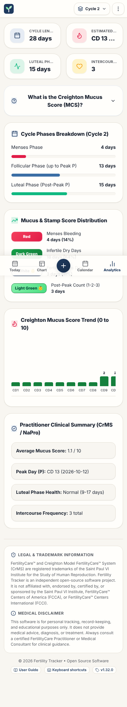

# Cycle Analytics page

This page gives the rules for the **Cycle Analytics** page.

## Layout

The test `e2e/screenLayout.spec.ts` compares the ARIA snapshots with the screen, with the demo data. Read [ADR 0006](../../records/adrs/0006-screen-layout-snapshots-and-screenshots.md).

| Size                     | Screenshot                                        | ARIA snapshot                                                  |
| ------------------------ | ------------------------------------------------- | -------------------------------------------------------------- |
| Phone, 390 by 844 pixels | [analytics-phone.png](images/analytics-phone.png) | [analytics-phone.aria.yml](snapshots/analytics-phone.aria.yml) |
| Wide, 1440 by 900 pixels | [analytics-wide.png](images/analytics-wide.png)   | [analytics-wide.aria.yml](snapshots/analytics-wide.aria.yml)   |

## Behavior

| Section                          | Content                                                                                                                                                                                     |
| -------------------------------- | ------------------------------------------------------------------------------------------------------------------------------------------------------------------------------------------- |
| Cycle Phases Breakdown           | Menses, follicular and luteal lengths from [Cycle and phase rules](../cycle-and-phase-rules.md), as bars.                                                                                   |
| Mucus & Stamp Score Distribution | Number and percentage of red, dry, fertile and count-of-three days.                                                                                                                         |
| Creighton Mucus Score Trend      | One bar for each day, with its [mucus score](../cycle-and-phase-rules.md#mucus-score). Dry bars are dark green, fertile bars (score 6 or more) use the accent and the Peak Day bar is pink. |
| Practitioner Clinical Summary    | Average mucus score, Peak Day, luteal phase health and intercourse count.                                                                                                                   |
| Creighton Mucus Score guide      | A short explanation of the score.                                                                                                                                                           |
- Before the Peak Day, the page shows "in progress" after the follicular value.
- The labels of luteal phase health are in [Cycle and phase rules](../cycle-and-phase-rules.md#luteal-phase-health).
- Without observations, the page shows an empty state with `id="analytics-panel"`.

## Accessibility

- The trend chart (`.mucus-trend-wrapper`) scrolls horizontally on a narrow screen. It is a `<section>` with `tabIndex={0}` and `aria-labelledby` (role `region`).

## Implementation

- [src/components/CycleAnalyticsView.tsx](../../../src/components/CycleAnalyticsView.tsx)

## Related documents

- [Cycle and phase rules](../cycle-and-phase-rules.md)
- [Application behavior](../application-behavior.md)
- [User interface](../user-interface.md)
