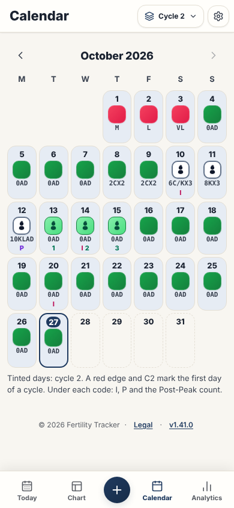

# Monthly Calendar page

This page gives the rules for the **Monthly Calendar** page.

## Layout

The test `e2e/screenLayout.spec.ts` compares the ARIA snapshots with the screen, with the demo data. Read [ADR 0006](../../records/adrs/0006-screen-layout-snapshots-and-screenshots.md).

| Size                     | Screenshot                                      | ARIA snapshot                                                |
| ------------------------ | ----------------------------------------------- | ------------------------------------------------------------ |
| Phone, 390 by 844 pixels | [calendar-phone.png](images/calendar-phone.png) | [calendar-phone.aria.yml](snapshots/calendar-phone.aria.yml) |
| Wide, 1440 by 900 pixels | [calendar-wide.png](images/calendar-wide.png)   | [calendar-wide.aria.yml](snapshots/calendar-wide.aria.yml)   |

## Behavior

- The grid shows one month, from Monday to Sunday. The page has no card around the grid.
- Each day shows its number, its stamp and its code. The code has no `I` and no symptom, because the marks show `I` and the drawer shows the symptoms. A saved day with no bleeding, mucus or frequency code and the `DARK_GREEN` stamp shows the empty stamp ([Day with no code](../stamp-and-peak-rules.md#day-with-no-code)).
- A past day with no observation shows a plus sign. A day after today has a dashed edge and is disabled.
- The next-month button is disabled in the current month. Thus, the user cannot go to a month after the current month.
- Text uses the theme tokens `--text-primary` and `--text-secondary`. Thus, it is readable in the dark theme.

### Cells

| Size         | Cell                                                    | Code                     |
| ------------ | ------------------------------------------------------- | ------------------------ |
| Phone        | 80 pixels high or more, 1/7 of the width                | 11 pixels, `--font-mono` |
| From 1024 px | 96 pixels high or more, in a grid of 896 pixels or less | 12 pixels                |

A long code goes onto more lines and the cell becomes taller. The code is never cut.

### Marks

A row of 12 pixels under the code shows the marks of the day. The stamp does not show them.

| Mark                                       | Day                          | Color                      |
| ------------------------------------------ | ---------------------------- | -------------------------- |
| `I`                                        | A day with intercourse       | `--color-intercourse-text` |
| `P`                                        | The Peak Day                 | `--color-peak-text`        |
| `1`, `2` or `3`                            | A day of the Post-Peak count | `--color-success-text`     |
| `C` and the cycle number, for example `C2` | The first day of a cycle     | `--color-danger-text`      |

The first day of a cycle also has a red left edge (`--stamp-red`).

### Cycle picker

The calendar follows the cycle picker in the top bar.

| Selection         | Month that opens             | Tint                              |
| ----------------- | ---------------------------- | --------------------------------- |
| The current cycle | The month of today           | The days of the cycle up to today |
| A past cycle      | The first month of the cycle | The days of the cycle             |
| **All Cycles**    | The month of today           | No tint                           |

The tint is `--accent-light` behind the cell. All the days keep text of full contrast. A line under the grid explains the tint and the marks.

### Click on a day

| Size         | Result                                                                                                                                                     |
| ------------ | ---------------------------------------------------------------------------------------------------------------------------------------------------------- |
| Phone        | The observation drawer opens for that date.                                                                                                                |
| From 1024 px | The click selects the day. The day panel at the right of the grid shows it. The panel is the day detail of the chart ([Paper Chart Strip page](chart.md)). |

On a desktop, today is selected when the page opens. The day panel shows the stamp, the date, the cycle and the cycle day, the code, the fertility sentence and the saved state. It has three buttons: **Edit** opens the drawer, **Open in Chart** opens the chart, and **Open in Today** opens the **Today** page on that day. A date before the first cycle shows only the date.

### Swipe between months

On a touch screen, a swipe on the calendar changes the month. It uses the hook of the **Today** page, [useDaySwipe.ts](../../../src/hooks/useDaySwipe.ts), with the same rules ([Today page](today.md#swipe-between-days)), and these differences:

- A swipe to the left opens the next month. A swipe to the right opens the previous month. The swipe calls the same functions as the arrow buttons.
- In the current month, a swipe to the left does nothing, as the disabled next-month button. The grid goes back, and the click after the swipe is blocked.
- The days grid follows the finger and slides. The header with the month name and the buttons stays in place.
- The calendar has `touch-action: pan-y pinch-zoom`. Thus, a vertical drag scrolls the page and never changes the month.

## Accessibility

- Today (`.calendar-day.is-today`) has a 2-pixel accent border, a round day number and `aria-current="date"`. The date of today comes from `getTodayStr()`.
- The name of a day gives the date, the code and the facts of the marks. An example is "Date 2026-08-19, Observation H, first day of cycle 2". The row of marks has `aria-hidden="true"`.
- On a desktop, each day button has `aria-pressed`. The selected day has `aria-pressed="true"`.
- The month buttons are 44 pixels.

## Implementation

- [src/components/CalendarGrid.tsx](../../../src/components/CalendarGrid.tsx)
- [src/components/chart/ChartDayDetail.tsx](../../../src/components/chart/ChartDayDetail.tsx): the day panel

## Related documents

- [Application behavior](../application-behavior.md)
- [Dialog component](../dialog-component.md)
- [User interface](../user-interface.md)
