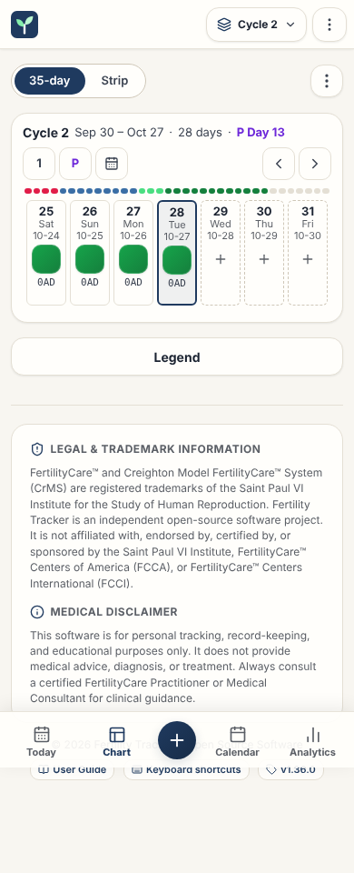

# Paper Chart Strip page

This page gives the rules for the **Paper Chart Strip** page.

## Layout

The test `e2e/screenLayout.spec.ts` compares the ARIA snapshots with the screen, with the demo data. Read [ADR 0006](../../records/adrs/0006-screen-layout-snapshots-and-screenshots.md).

| Size                     | Screenshot                                | ARIA snapshot                                          |
| ------------------------ | ----------------------------------------- | ------------------------------------------------------ |
| Phone, 390 by 844 pixels | [chart-phone.png](images/chart-phone.png) | [chart-phone.aria.yml](snapshots/chart-phone.aria.yml) |
| Wide, 1440 by 900 pixels | [chart-wide.png](images/chart-wide.png)   | [chart-wide.aria.yml](snapshots/chart-wide.aria.yml)   |

## Behavior

| Part                                                                           | Content                                                                                                                                                      |
| ------------------------------------------------------------------------------ | ------------------------------------------------------------------------------------------------------------------------------------------------------------ |
| [ChartToolbar.tsx](../../../src/components/chart/ChartToolbar.tsx)             | One row: **35-day** and **Strip**, and the ⋮ menu (**Chart options**) with the **Phase bar** and **Legend** check items. An empty chart shows only the menu. |
| [ChartCycleRow.tsx](../../../src/components/chart/ChartCycleRow.tsx)           | One card for each cycle: the cycle line, the phase bar and one row of day cards. The first card also has the controls.                                       |
| [ChartPhaseTimeline.tsx](../../../src/components/chart/ChartPhaseTimeline.tsx) | The phase bar: one segment for each day, 6 px high, over the width of the card. It does not scroll.                                                          |
| [ChartCell.tsx](../../../src/components/chart/ChartCell.tsx)                   | A day card with an observation, or an empty day card. Each card is a native `<button type="button">`.                                                        |
| [ChartCellPopover.tsx](../../../src/components/chart/ChartCellPopover.tsx)     | Details of a day card: code, bleeding, stretch, modifiers, intercourse and notes.                                                                            |
| [ChartBlankGrid.tsx](../../../src/components/chart/ChartBlankGrid.tsx)         | A 35-day grid before the first observation, from today. Each card opens a new observation.                                                                   |
| [ChartLegend.tsx](../../../src/components/chart/ChartLegend.tsx)               | The stamp legend, under the rows. The **Legend** button under the rows and the menu item show it.                                                            |

### Cycle line

One line gives the cycle, the dates, the length and the Peak Day. For example: "Cycle 2 Sep 30 – Oct 27 · 28 days · P Day 13". The length is the cycle day of the last observation. When the line is too long, the dates end with an ellipsis.

### Controls

The first card has the controls. They act on all the rows. Each button is 36 px.

| Button               | Result                                                                                            |
| -------------------- | ------------------------------------------------------------------------------------------------- |
| **1**                | Goes to day 1.                                                                                    |
| **P**                | Goes to the Peak Day of the first cycle with a Peak Day. It shows only when a row has a Peak Day. |
| Calendar icon        | **Jump to Today**. It shows only when a row has a card for today.                                 |
| Left and right arrow | Scroll by 320 px.                                                                                 |

### Day card

| View       | Size        | Content                                                                                                                 |
| ---------- | ----------- | ----------------------------------------------------------------------------------------------------------------------- |
| **35-day** | 44 × 116 px | The cycle day (13 px), the weekday and the date (11 px), the stamp (32 px), the code (11 px, mono) and the symptom tag. |
| **Strip**  | 34 × 62 px  | The cycle day and the stamp.                                                                                            |
- Each row has 35 day cards or more. A longer cycle adds cards in groups of 7. All the rows have the same number of cards. **Strip** keeps a card for each day, so that the columns align.
- The code shows one token on each line, and two lines or less. A token wider than the card ends with an ellipsis. The code does not show the `I` mark and the symptoms. The stamp shows the `I` mark, and the tag shows the symptoms. The accessible name has the full code. A long symptom tag ends with an ellipsis.
- An empty day card has a dashed border, the weekday, the date and a + sign.
- Today has a 2 px accent border and `--accent-soft`. The Peak Day has a ring of `--color-warning-ring`.
- A saved day with no bleeding, mucus or frequency code and the `DARK_GREEN` stamp shows the empty stamp ([Day with no code](../stamp-and-peak-rules.md#day-with-no-code)).

### Phase bar

The bar uses the four phases of Analytics ([Cycle and phase rules](../cycle-and-phase-rules.md)), day by day. A day with a bleeding code or a red stamp before the Peak Day is a menses day.

| Phase                          | Color                 |
| ------------------------------ | --------------------- |
| Menses, before the Peak Day    | `--stamp-red`         |
| Follicular, up to the Peak Day | `--color-info`        |
| Days 1 to 3 after the Peak Day | `--stamp-light-green` |
| Luteal, after the count        | `--stamp-dark-green`  |
| No observation                 | `--bg-surface-border` |

### Shared scroll

- All the rows share one scroll position. Thus, the same cycle day is in the same column.
- A scroll of one row sets `scrollLeft` of the other rows. The scroll event of a row that the sync moved does not move the other rows back.
- When the chart opens, today is near the middle of the rows. Late in the cycle, the rows stop at their end. Today belongs to the last cycle that starts on or before today.
  - If today has no card, the rows open at their end. For example, today is after the last card of the row.
  - The rows set `scrollLeft` at once, before the browser paints. There is no smooth scroll, and the page does not scroll vertically.
  - A change of the view puts today in view again.
  - When only a past cycle shows, its row opens at day 1.

### Other rules

- A click, `Enter` or `Space` on a card opens the observation drawer. The user sets or removes the manual Peak Day there with **Designate Peak Day (P)**.
- The details show when the mouse is on a day card or when the card has the focus. Each card has its own hover state, so a hover does not render other cards again.
- Two details can show at the same time: one on the card with the focus and one under the mouse.

## Accessibility

- The page heading is for screen readers only. Each cycle is a `section` with the name "Cycle N".
- **35-day** and **Strip** are toggle buttons with `aria-pressed`, in a group with the name **Chart view**.
- Today has `aria-current="date"`. This applies to day cards with an observation and to empty day cards. The date of today comes from `getTodayStr()`.
- The phase bar has `aria-hidden="true"`. Each segment has a title with the day and its phase.

## Implementation

- [src/components/ChartRow.tsx](../../../src/components/ChartRow.tsx)

## Related documents

- [Application behavior](../application-behavior.md)
- [Dialog component](../dialog-component.md)
- [User interface](../user-interface.md)
