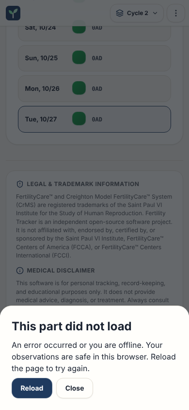

# Error screen

This page gives the rules for the error screen that `ErrorBoundary` shows.

## Layout

The test `e2e/screenLayout.spec.ts` stops the load of the chunk of the version dialog, then opens the dialog. Thus, the snapshots and the screenshots show the dialog mode. Read [ADR 0006](../../records/adrs/0006-screen-layout-snapshots-and-screenshots.md).

| Size                     | Screenshot                                              | ARIA snapshot                                                        |
| ------------------------ | ------------------------------------------------------- | -------------------------------------------------------------------- |
| Phone, 390 by 844 pixels | [error-screen-phone.png](images/error-screen-phone.png) | [error-screen-phone.aria.yml](snapshots/error-screen-phone.aria.yml) |
| Wide, 1440 by 900 pixels | [error-screen-wide.png](images/error-screen-wide.png)   | [error-screen-wide.aria.yml](snapshots/error-screen-wide.aria.yml)   |

## Behavior

- `App.tsx` puts each `React.Suspense` in an `ErrorBoundary`: the pages, the lazy dialogs and the print view.
- The boundary of the pages has `key={activeTab}`. Thus, a change of page removes the alert and loads the new page again.
- When a child fails during render, or a lazy chunk does not load, the boundary shows an alert. The header, the footer and the navigation stay visible.
- The alert shows `errorBoundary.title`, `errorBoundary.message` and a **Reload** button (`errorBoundary.reload`) that calls `window.location.reload()`.
- With an `onClose` property, the boundary shows the alert in the dialog component. It adds a **Close** button (`errorBoundary.close`).
- In this dialog mode, **Close**, `Escape` and the backdrop call `onClose`. Each lazy dialog uses this mode.
- With an `onError` property, the boundary calls it one time when a child fails. The print view uses it to show `exportModal.printError`.

## Accessibility

- The alert has `role="alert"`.
- In dialog mode, the alert title gives the name of the dialog.

## Implementation

- [src/components/ErrorBoundary.tsx](../../../src/components/ErrorBoundary.tsx)

## Related documents

- [Application behavior](../application-behavior.md)
- [Dialog component](../dialog-component.md)
- [User interface](../user-interface.md)
