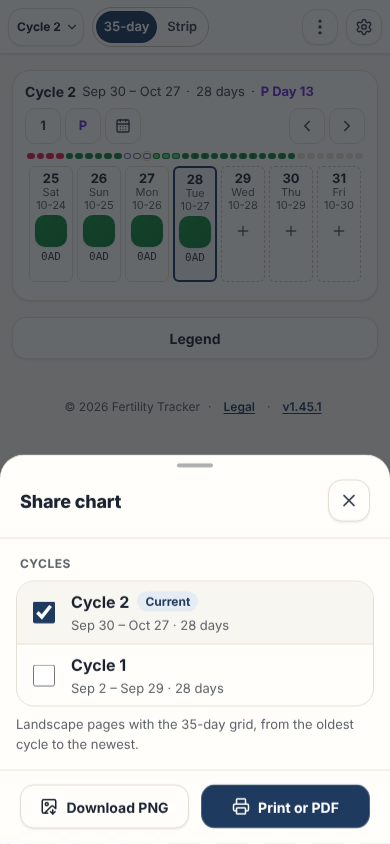

# Export dialog

This page gives the rules for the export dialog (**Share chart**): the print of the chart.

## Layout

The test `e2e/screenLayout.spec.ts` compares the ARIA snapshots with the screen, with the demo data. Read [ADR 0006](../../records/adrs/0006-screen-layout-snapshots-and-screenshots.md).

| Size                     | Screenshot                                                | ARIA snapshot                                                          |
| ------------------------ | --------------------------------------------------------- | ---------------------------------------------------------------------- |
| Phone, 390 by 844 pixels | [export-dialog-phone.png](images/export-dialog-phone.png) | [export-dialog-phone.aria.yml](snapshots/export-dialog-phone.aria.yml) |
| Wide, 1440 by 900 pixels | [export-dialog-wide.png](images/export-dialog-wide.png)   | [export-dialog-wide.aria.yml](snapshots/export-dialog-wide.aria.yml)   |

## Behavior

The dialog has the title **Share chart**. It holds the list of cycles, **Download PNG** and **Print or PDF**. Backup, restore, demo data and the delete of all data are in [Settings](settings.md).

On a phone, the dialog is a bottom sheet. On a wider screen, it is a dialog of 480 pixels.

**Share chart** in the **Chart options** menu (`⋮`) of the chart page opens the dialog. It is after **Stamp bar** and **Legend** ([Paper Chart Strip page](chart.md)). The header has no export button ([Navigation](navigation.md)).

### Cycles

- **Cycles** is a list of check boxes, one for each cycle, from the newest cycle to the oldest.
- Each row shows the cycle number, the first and the last date, and the number of days. The newest cycle has the tag **Current**.
- Each opening selects one cycle: the cycle of the cycle picker. With **All cycles** in the cycle picker, it selects the newest cycle.
- With no cycle selected, **Download PNG** and **Print or PDF** are disabled.
- Without cycles, the dialog has no list. The two actions export one empty cycle that starts today.

| Action           | Result                                                                           |
| ---------------- | -------------------------------------------------------------------------------- |
| **Download PNG** | Downloads an image of the selected cycles, and closes the dialog.                |
| **Print or PDF** | Prints the selected cycles with the browser print dialog, and closes the dialog. |

The dialog names the selection: `cycle-N` for one cycle, `selected-cycles` for some cycles, or `all-cycles` for all the cycles.

`getExportFilename()` makes file names with only lowercase letters, digits and dashes.

### Print

The print view is a lazy chunk. The rules of its load are in [Code splitting and lazy loading](../technology.md#code-splitting-and-lazy-loading).

1. The application sets the document title to the file name, for example `fertility-tracker-chart-cycle-1-YYYY-MM-DD`.
2. The application calls `window.print()`. The browser uses the title as the default PDF file name.
3. The application restores the title one second later. A second print in that second restores the first title.
4. The application closes the dialog. It shows the success message when the user clicks, before the print starts. The message closes 3.5 seconds after the last print.

When the application unmounts, it stops the title and message timers.

The print layout:

- It is landscape, with 35 days in each row. It hides the user interface.
- It does not show the day of the week. It removes the spaces from the codes and lets a long code go onto two lines.
- It has a line under the code of each day for the notes.
- Without cycles, it shows one empty cycle that starts today (`getTodayStr()`).
- It uses the language of the interface: `printExport.*`, `chartStrip.*` and `t.locale` for the export date. The CrMS codes and the stamp colors are the same in each language.
- The date of each cell uses `common.monthDay`: `MM-DD` in English and `DD/MM` in French.
- Each legend label is one text: `chartStrip.legendMenses`, `legendDry`, `legendFertile`, `legendPostPeak` and `legendPeakDay`. The chart legend uses the same texts.

### PNG

`downloadChartPng()` draws the image on a canvas. It does not use the print view.

- The image has the title, the export date, one 35-day grid for each cycle and the legend of the print. The cycles go from the oldest to the newest.
- Each cell shows the cycle day, the date (`common.monthDay`), the stamp, the Peak Day mark (P), the intercourse mark (I) and the code. The image does not show the symptoms and the notes of the print. A long code gets narrower to fit its cell.
- The image always uses the colors of the light theme on a white background, as the print does.
- The image has two pixels for each CSS pixel. A row of 35 days is 3176 pixels wide.
- For a very tall image, the scale goes down to keep the canvas under 16 million pixels, the limit of Safari. The scale is never less than one pixel for each CSS pixel.
- A selection of about 70 cycles or more is too large for Safari even at this scale. Then the browser cannot make the image, and the application shows the error message.
- The length of a cycle is the cycle day of its last observation (`cycleLength()`), as on the chart. The image, the dialog and the print use it.
- The file name is the print file name with `.png`, for example `fertility-tracker-chart-cycle-1-YYYY-MM-DD.png`.
- After the download, the application shows **Chart image downloaded.** If the browser cannot make the image, it shows an error message, and the user can use **Print or PDF**.

## Accessibility

- The [dialog component](../dialog-component.md) gives the name, the focus trap and the focus return. The name is the title **Share chart**.
- The list of cycles is a group with the name **Cycles**. Each check box has the cycle number as its name. Its description is the **Current** tag, the dates and the length.
- On a phone, the user can drag the sheet down to close it ([Drag down to close](observation-drawer.md#drag-down-to-close)).

## Implementation

- [ExportModal.tsx](../../../src/components/ExportModal.tsx)
- [PrintExportView.tsx](../../../src/components/PrintExportView.tsx)
- [chartImage.ts](../../../src/utils/chartImage.ts)
- [printCycles.ts](../../../src/utils/printCycles.ts)
- [exportUtils.ts](../../../src/utils/exportUtils.ts)

## Related documents

- [Settings](settings.md)
- [Application behavior](../application-behavior.md)
- [Dialog component](../dialog-component.md)
- [User interface](../user-interface.md)
