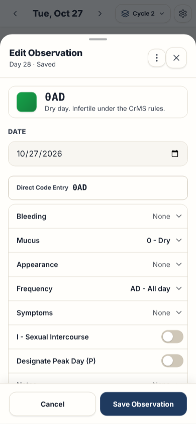

# Observation drawer

This page gives the rules for the observation drawer and the bottom sheets.

## Layout

The test `e2e/screenLayout.spec.ts` compares the ARIA snapshots with the screen, with the demo data. Read [ADR 0006](../../records/adrs/0006-screen-layout-snapshots-and-screenshots.md).

On a phone, the drawer opens from **Log**. On a wide screen, it opens from the cell of today on the chart.

| Size                     | Screenshot                                                          | ARIA snapshot                                                                    |
| ------------------------ | ------------------------------------------------------------------- | -------------------------------------------------------------------------------- |
| Phone, 390 by 844 pixels | [observation-drawer-phone.png](images/observation-drawer-phone.png) | [observation-drawer-phone.aria.yml](snapshots/observation-drawer-phone.aria.yml) |
| Wide, 1440 by 900 pixels | [observation-drawer-wide.png](images/observation-drawer-wide.png)   | [observation-drawer-wide.aria.yml](snapshots/observation-drawer-wide.aria.yml)   |

## Behavior

- The drawer has the date field and the same form as the **Today** page ([Observation form](today.md#observation-form)).
- The header shows the title, the cycle day and **Saved** or **Not saved**, the ⋮ menu and the close button. The focus starts on the close button.
- The cycle day comes from the saved observation. A day with no observation gets the cycle day of the **Today** page. A day after today shows no cycle day.
- The status card is the banner of the **Today** page. A saved day with no change shows its saved stamp, with the Peak Day and the count of three. A change shows the stamp of the form.
- **Ctrl+S** or **⌘S** saves while the drawer is the dialog on top.
- The drawer always shows the saved observation of its date, as the Today form does. This is true for each way to open it: **+**, **Log Observation**, **Log today**, the chart and the calendar.

| Condition                   | Result                                                                                                      |
| --------------------------- | ----------------------------------------------------------------------------------------------------------- |
| The date has an observation | The title is **Edit Observation**. The fields show the saved values. The ⋮ menu has **Delete observation**. |
| **Else**                    | The title is **Log Observation**. The form is empty.                                                        |
- Thus, a save with no change never replaces a saved day with an empty observation.
- A change of the date input loads the observation of the new date. When the new date has no observation, a form with no change becomes empty. Thus, the values of a saved day are not copied to another day. A changed form keeps the draft.
- The saved data can change while the drawer is open, for example with **Undo**. Then the title and **Delete observation** follow the saved data of the date. A form with no change shows the new saved values. A changed form keeps the draft.
- The direct code and the buttons stay synchronized. The status card shows the stamp and the code before the save. With no code, it shows the empty stamp and "No observation yet" ([Day with no code](today.md#day-with-no-code)).
- The footer has **Cancel** and **Save Observation**: two equal buttons of 48 px.
- **Copy yesterday** copies the code of the day before the date of the drawer.

### Drag down to close

On a phone, the drawer, the cycle menu and the other dialogs are bottom sheets ([Navigation](navigation.md)). The other dialogs are **Share chart**, **About & Version Tracker**, the welcome guide, **New Cycle Start?**, the confirmation dialog, the install guide and the keyboard shortcuts. The hook [useSheetDrag.ts](../../../src/hooks/useSheetDrag.ts) lets the user drag them down to close them. On a larger screen, nothing changes.

The rules below apply to all these sheets. The body is the part that scrolls. It is the form of the drawer, the list of a menu, or the body of a dialog.

- A drag down from the handle or the header moves the sheet with the finger. These two parts have `touch-action: none` and use Pointer Events. A press on a button of the header does not start a drag.
- A drag in the body scrolls the body. It moves the sheet only when the body is at the top and the finger moves down. The body uses touch events, so that the drag can stop the scroll. A drag that starts on a button of the body also moves the sheet, and the button does not get a click.
- A swipe on the sheet never scrolls the page under it:
  - A body that has nothing to scroll stops the scroll of the browser for each move of one finger. A move that starts in a text area, or in an element of the body that scrolls by itself, keeps its scroll.
  - A body that scrolls has `overscroll-behavior: contain`. At its end, the page does not scroll.
  - A move of one finger outside the body, for example on the backdrop, stops the scroll of the browser.
  - A pinch with two fingers stays available, so the user can zoom. It never moves the sheet, also when the second finger lands outside the body.
- One gesture moves the sheet at a time. A touch of the body does not move or end a drag of the handle. During the slide down, the sheet ignores taps.
- A close in another way during the slide, for example with `Escape` or **Back**, stops the slide timer. Thus, the timer cannot close a drawer that opens again.
- The backdrop becomes lighter in proportion to the drag.
- At the release, [sheetDrag.ts](../../../src/domain/sheetDrag.ts) decides. The speed comes from the moves of the last 100 milliseconds. Thus, a pause before the release is not a flick.

| Condition                                                                   | Result                               |
| --------------------------------------------------------------------------- | ------------------------------------ |
| The drag is more than 25% of the sheet height                               | The sheet closes.                    |
| A flick down of at least 0.5 pixels per millisecond over at least 24 pixels | The sheet closes.                    |
| **Else**                                                                    | The sheet goes back to its position. |
- A close by drag does the same as the close button (for the confirmation dialog and **New Cycle Start?**: the cancel). The draft is not kept, and the history entry of the sheet goes ([Back button and address](../application-behavior.md#back-button-and-address)).
- The sheet slides down in 200 milliseconds, then closes. With `prefers-reduced-motion: reduce`, the sheet has no animation: it opens and closes at once.

[ProgressiveObservationForm.tsx](../../../src/components/observation/ProgressiveObservationForm.tsx) reads the values and functions of `useObservationForm`. The drawer and the Today form have the same markup, classes, ARIA attributes and labels. The field ids start with `obs` in the drawer and with `today` on the **Today** page.

## Accessibility

- A grab handle shows at the top center of the sheet. It has `aria-hidden="true"`. The close button stays the accessible way to close the sheet.
- The rows, the chips and the ⋮ menu follow the rules of the **Today** page ([Accessibility](today.md#accessibility)).

## Implementation

- [src/components/ObservationDrawer.tsx](../../../src/components/ObservationDrawer.tsx)

## Related documents

- [Today page](today.md)
- [Application behavior](../application-behavior.md)
- [Dialog component](../dialog-component.md)
- [User interface](../user-interface.md)
