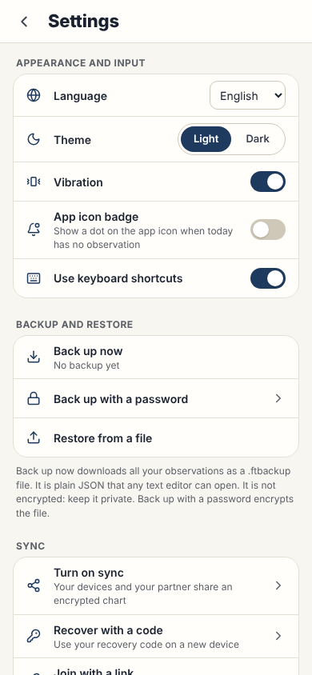

# Settings

This page gives the rules for **Settings**: the display settings, backup, restore, help, about, demo data and the delete of all data.

## Layout

The test `e2e/screenLayout.spec.ts` compares the ARIA snapshots with the screen, with the demo data. Read [ADR 0006](../../records/adrs/0006-screen-layout-snapshots-and-screenshots.md).

| Size                     | Screenshot                                      | ARIA snapshot                                                |
| ------------------------ | ----------------------------------------------- | ------------------------------------------------------------ |
| Phone, 390 by 844 pixels | [settings-phone.png](images/settings-phone.png) | [settings-phone.aria.yml](snapshots/settings-phone.aria.yml) |
| Wide, 1440 by 900 pixels | [settings-wide.png](images/settings-wide.png)   | [settings-wide.aria.yml](snapshots/settings-wide.aria.yml)   |

| Condition                             | Result                                                                                                                          |
| ------------------------------------- | ------------------------------------------------------------------------------------------------------------------------------- |
| The screen is 640 pixels wide or less | A full page over the bottom bar. It does not slide and the user cannot drag it. The close button is a back chevron at the left. |
| **Else**                              | A dialog of 560 pixels. The close button is an `X` at the right.                                                                |

## Behavior

The **Settings** gear in the header opens Settings on each screen width. On a phone, the gear is the last control of the top bar ([Navigation](navigation.md)).

The close button, **Back** and `Escape` close Settings.

Settings has these groups, in this sequence:

| Group                    | Rows                                                                                                                                                      |
| ------------------------ | --------------------------------------------------------------------------------------------------------------------------------------------------------- |
| Install                  | **Install app**, its hint and an **Install** button. It shows only when the browser can install the application.                                          |
| **Appearance and input** | **Language**, **Theme**, **Vibration**, **App icon badge** and **Use keyboard shortcuts**.                                                                |
| **Backup and restore**   | **Back up now**, **Back up with a password** and **Restore from a file**. Under the group, a note tells which file is encrypted.                          |
| **Sync**                 | The rows of the sync. They change with the device record ([Sync group](#sync-group)).                                                                     |
| **Help**                 | **Welcome guide** and **Keyboard shortcuts**.                                                                                                             |
| **About**                | **About Fertility Tracker** (detail "Release notes, storage", with the version at the right), **Legal and medical notice** and **Check for updates**.     |
| **Data**                 | **Load the demo cycles**, without a device record, and **Delete all data**. **Delete all data** is the last row. Its text is red (`--color-danger-text`). |

### Rows

| Row                           | Result                                                                                                                           |
| ----------------------------- | -------------------------------------------------------------------------------------------------------------------------------- |
| **Install**                   | Installs the application, as the other install buttons do ([Install](../application-behavior.md#install)).                       |
| **Language**                  | A native select of the languages. Each name is in its own language. The change applies at once.                                  |
| **Theme**                     | Two radio buttons: **Light** and **Dark**.                                                                                       |
| **Vibration**                 | A switch. It shows only when the browser has the Vibration API ([Haptic feedback](../application-behavior.md#haptic-feedback)).  |
| **App icon badge**            | A switch. It shows only when the browser has the Badging API ([App icon badge](../application-behavior.md#app-icon-badge)).      |
| **Use keyboard shortcuts**    | A switch. It turns all the single-key shortcuts on or off ([Keyboard shortcuts](../application-behavior.md#keyboard-shortcuts)). |
| **Back up now**               | Downloads `fertility-tracker-backup-YYYY-MM-DD.ftbackup` at once and records the backup date. Settings stays open.               |
| **Back up with a password**   | Opens the [password dialog](#password-dialog) for a backup. Settings stays open.                                                 |
| **Restore from a file**       | Opens the file picker. Then it shows a preview and replaces or merges the observations with the file.                            |
| **Welcome guide**             | Opens the welcome guide over Settings.                                                                                           |
| **Keyboard shortcuts** (Help) | Opens the **Keyboard shortcuts** dialog over Settings.                                                                           |
| **About Fertility Tracker**   | Opens the version dialog over Settings, on the release notes ([Version dialog](version-dialog.md)).                              |
| **Legal and medical notice**  | Opens the version dialog over Settings, at the legal notice.                                                                     |
| **Check for updates**         | Asks the browser for a new version at once ([Update](../application-behavior.md#update)). Settings stays open.                   |
| **Load the demo cycles**      | Replaces all observations with the demo data.                                                                                    |
| **Delete all data**           | Deletes all observations.                                                                                                        |
- The options of **Language** are "English" and "Français".
- The detail of **Back up now** is "Last backup: " and the date of the last backup, for example "Last backup: Oct 27, 2026". Without a backup, it is "No backup yet".
- **Restore from a file**, **Load the demo cycles** and **Delete all data** close Settings after they run.
- **Check for updates** shows the result of the check in its detail. A hidden `role="status"` text reads it aloud. While the check runs, the detail is "Checking…" and a new tap does nothing. Then the detail is "You have the latest version", "The check failed. Check your connection and try again" or "Updates are not available in this browser".
- When a new version is ready, the row is **Reload to update** with the detail "A new version is ready". A tap applies the update with `applyUpdate()`, and the application reloads one time. The update message at the bottom of the screen hides while Settings is open. Thus, this row applies the update from Settings.
- `useBackUpNow()` gives the action of **Back up now**. The backup reminder and the save warning use the same hook ([Data storage](../data-storage.md#backup-reminder)).
- A backup file that the user opens with the application opens Settings. Settings then restores the file, as **Restore from a file** does ([Open a backup file with the app](../application-behavior.md#open-a-backup-file-with-the-app)).
- **Restore a backup** of the welcome guide opens Settings with the focus on **Restore from a file** ([Welcome guide](welcome-guide.md)).

### Backup file

- The file uses the write format of the browser storage ([Storage format](../data-storage.md#storage-format)). In this version, that is a bare JSON array, so older versions can restore it.
- **Restore from a file** accepts the bare array (format 0) and the object `{ "schemaVersion": 1, "observations": [...] }` (format 1).
- The file of **Back up now** is plain JSON. It is not encrypted. The file of **Back up with a password** is encrypted ([Encrypted backup file](../data-format.md#encrypted-backup-file)). The note under **Backup and restore** (`exportModal.jsonDescription`) tells this to the user.
- The file has the extension `.ftbackup` and the type `application/octet-stream`. With `application/json`, a browser can add `.json` after the name. The content is plain JSON, and any text editor can open it.
- The file input has no `accept` filter. iOS greys out a file with an extension that it does not know. The application checks the contents, not the extension. Thus, a `.ftbackup` file and an old `.json` backup both restore.
- A file that is not a valid backup shows `exportModal.importError` under the note. The data does not change.
- An encrypted file opens the password dialog for a restore. After the decryption, the restore continues as for a plain file.

### Password dialog

[PasswordDialog.tsx](../../../src/components/settings/PasswordDialog.tsx) opens over Settings. It has two modes:

| Mode    | Title                        | Fields                                    | Button                    |
| ------- | ---------------------------- | ----------------------------------------- | ------------------------- |
| Backup  | **Back up with a password**  | **Password** and **Confirm the password** | **Save encrypted backup** |
| Restore | **Open an encrypted backup** | **Password**                              | **Open the file**         |

- In the backup mode, a note says that nobody can open the file without the password. The application cannot reset it.
- **Cancel**, `Escape` and a click on the backdrop close the password dialog. Settings stays open, and the data does not change.
- They also close it while the encryption or the decryption runs. The application then drops the result: no file downloads, and no preview opens.
- `Enter` in a field submits the form.
- While the encryption or the decryption runs, the button is disabled and shows `passwordDialog.working`.

When the user submits the backup mode:

| Condition                                 | Result                                                                                                             |
| ----------------------------------------- | ------------------------------------------------------------------------------------------------------------------ |
| The password has fewer than 12 characters | The message `passwordDialog.tooShort` shows. No file downloads.                                                    |
| The two fields are different              | The message `passwordDialog.mismatch` shows. No file downloads.                                                    |
| The encryption fails                      | The message `passwordDialog.failed` shows. No file downloads.                                                      |
| **Else**                                  | Downloads `fertility-tracker-backup-YYYY-MM-DD-encrypted.ftbackup`, records the backup date and closes the dialog. |

When the user submits the restore mode:

| Condition            | Result                                                                          |
| -------------------- | ------------------------------------------------------------------------------- |
| The decryption fails | The message `passwordDialog.wrongPassword` shows. The data does not change.     |
| **Else**             | The dialog closes. Settings shows the preview of the file, as for a plain file. |

### Confirmation

[ConfirmDialog.tsx](../../../src/components/ConfirmDialog.tsx) is a small confirmation dialog. It replaces `window.confirm()` and `window.alert()`, which no code in `src/` uses.

- It opens over Settings. All its text comes from the dictionary (`confirmDialog.*`, `actions.cancel`).
- `Escape`, **Cancel** and a click on the backdrop cancel it. They do not close Settings.
- These buttons open it:

| Condition          | Result                                                                                                 |
| ------------------ | ------------------------------------------------------------------------------------------------------ |
| Observations exist | **Load the demo cycles**, **Restore from a file** and **Delete all data** open the confirmation.       |
| **Else**           | **Load the demo cycles** and **Restore from a file** act immediately. **Delete all data** is disabled. |
- The message for **Delete all data** says that a copy stays on the device until the user selects **Delete the copy**.

Before a backup changes existing observations, the dialog shows a preview from `summarizeObservations()`. The preview gives the number of observations in the file and the first and last date. If the file has no observations, the preview says so.

| Action  | Result                                                                                                                  |
| ------- | ----------------------------------------------------------------------------------------------------------------------- |
| Replace | `importDataJson(text, 'replace')`: the file replaces all the current observations.                                      |
| Merge   | `importDataJson(text, 'merge')`: each day of the file replaces the current day with the same date. The other days stay. |

During a merge, `mergeObservations()` keeps one manual Peak Day in each cycle. When a day of the file is a manual Peak Day, it clears the manual Peak Day of the current days in the same cycle.

#### On a synced device

**Delete all data** and **Replace** delete days on each device of the vault ([ADR 0012](../../records/adrs/0012-encrypted-sync-and-partner-sharing.md#conflict-list)). Thus, on an owner device, the confirmation gives two actions in place of one. It also shows the message `confirmDialog.syncedMessage`.

| Action                                                          | Result                                                                                                                                                                                                                                                                     |
| --------------------------------------------------------------- | -------------------------------------------------------------------------------------------------------------------------------------------------------------------------------------------------------------------------------------------------------------------------- |
| **Delete on this device only**, **Replace on this device only** | First, the device syncs, so that the vault gets its last changes. Then `leaveVault()` removes the device from the vault ([Sync client](../sync-client.md#removal-of-a-member)). Then it deletes the sync state and the conflict list. Then the action runs on this device. |
| **Delete on all devices**, **Replace on all devices**           | The action runs on this device. Then the device syncs. Each other owner device gets the deletions at its next sync. When that sync deletes more than 7 days, that device asks its user first ([Sync client](../sync-client.md#when-the-application-syncs)).                |

- **Merge** deletes no day. Thus, it is the same on a synced device.
- **On this device only** runs after the sync that runs, with the sync lock. While it runs, the buttons are disabled, and `Escape`, Back and a drag down do nothing.
- When the sync tells that the device is already out of the vault, the device does not need to send its changes. Thus, the action goes on ([Sync client](../sync-client.md#removal-of-a-member)).
- When the sync is skipped, the device cannot send its changes. Thus, the action goes on. The sync is skipped when the data is not readable, or when the browser refused a save.
- In the other cases, when the sync does not send the changes or `leaveVault()` fails, an alert in the confirmation gives the cause. The delete or the replace does not run.
- Without a known cause, the alert is the general sync failure. Without a connection, the user can select **Turn off sync on this device** first.
- After **On all devices**, the undo copy stays until a sync brings a change from another device ([ADR 0012](../../records/adrs/0012-encrypted-sync-and-partner-sharing.md#conflict-list)). The message `confirmDialog.syncedMessage` says so.
- A reader device asks no question. Its own days do not go into the vault.
- Without observations on this device, **Restore from a file** acts immediately, as on all devices.

### Sync group

Settings has a **Sync** group after **Backup and restore** ([Sync client](../sync-client.md#sync-in-the-application)). [SyncSettings.tsx](../../../src/components/settings/SyncSettings.tsx) shows these rows:

| Device record of this device | Rows                                                                                                                                                |
| ---------------------------- | --------------------------------------------------------------------------------------------------------------------------------------------------- |
| None                         | **Turn on sync**, **Recover with a code** and **Join with a link**                                                                                  |
| Owner                        | **Sync now**, **Days to check**, **Devices**, **Invite a device**, **Invite a partner**, **New recovery code** and **Turn off sync on this device** |
| Reader                       | **Sync now** and **Stop viewing**                                                                                                                   |
| The browser blocks storage   | No row. The note "Sync needs the storage of the browser, and this browser blocks it." shows under the group. It is not an alert.                    |

| Row                              | Result                                                                                                                                                                                     |
| -------------------------------- | ------------------------------------------------------------------------------------------------------------------------------------------------------------------------------------------ |
| **Turn on sync**                 | Opens the [name dialog](#name-dialog). **Turn on sync** of the dialog makes a vault with `createVault()`, then syncs. It shows the [recovery code](#recovery-code-dialog).                 |
| **Join with a link**             | Opens a dialog with the field **Invitation link** and **Join**. **Join** opens the [join dialog](#join-dialog) with the fragment of the link. Thus, an installed app on iOS can join.      |
| **Recover with a code**          | Opens the code dialog, with the fields **Recovery code** and **Device name**. **Recover** calls `recoverWithCode()`, then syncs. It shows the new recovery code.                           |
| **Sync now**                     | Starts a sync at once. The detail is "Last sync: " and the date, or "Not synced yet". On a reader device, the date is that of `fertility_care_shared_read`.                                |
| **Days to check**                | Shows only when the conflict list is not empty. Its detail gives the number of days, for example "2 days changed on two devices". It opens the [conflict dialog](#conflict-dialog).        |
| **Devices**                      | Opens the [device list](#device-list). Its detail is "See or remove your devices and partners".                                                                                            |
| **Invite a device**              | Opens the [invitation dialog](#invitation-dialog). Its detail is "Add your phone or your computer".                                                                                        |
| **Invite a partner**             | Opens the [invitation dialog](#invitation-dialog) for a reader. Its detail is "Let your partner read the chart".                                                                           |
| **New recovery code**            | Makes a new code with `newRecoveryCode()`. It shows the new code. The old code stops working.                                                                                              |
| **Turn off sync on this device** | Asks for a confirmation. Then it deletes the device record, the sync state, the conflict list and the shared chart. The observations stay.                                                 |
| **Stop viewing**                 | Asks for a confirmation. Then it deletes the device record, the sync state, the conflict list and the [shared chart](../sync-client.md#shared-chart) with its date. The observations stay. |

- Each row runs after the sync that runs, with the sync lock ([Sync control](../sync-client.md#sync-control)). Thus, a sync cannot write the record or the state again after **Turn off sync on this device**.
- While a row runs, the rows of the group are disabled.
- While a row that makes a recovery code runs, and while the code dialog is open, Settings does not close. Thus, the user sees each new code. A data action, for example **Delete all data**, also keeps Settings open. **Load the demo cycles** does not show.
- **Turn on sync** and **Recover** first read the key store. When another tab saved a record, they show its rows and make no vault.
- After a failure, the group reads the key store again. For example, a recovery can save the record before its new code fails.
- While an undo copy exists, **Recover** shows the alert "Click Undo or Delete the copy first." The device does not join ([ADR 0012](../../records/adrs/0012-encrypted-sync-and-partner-sharing.md#data-that-syncs)).
- **Turn on sync** and **Recover** remove the demo days from this device before the device joins the vault. When the browser refuses this write, the device does not join.
- The browser blocks storage when the key store fails with `StorageBlocked` ([Device record](../sync-client.md#device-record)). After another failure of the key store, the group has no row and shows the alert of a general failure.
- When a row fails, an alert under the group gives the cause. While the device has a record, the alert also gives the cause of a failed sync. The causes are no connection, sync not available yet, a code that is not valid, or another error.
- While the device has a record, the **Data** group does not show **Load the demo cycles** ([ADR 0012](../../records/adrs/0012-encrypted-sync-and-partner-sharing.md#data-that-syncs)).
- The confirmation of **Stop viewing** says that the shared chart goes from this device. To read it again, the device needs a new invitation.
- A reader device cannot write the vault. Thus, **Stop viewing** does not remove it from the keyring. An owner device can remove it in the device list ([ADR 0012](../../records/adrs/0012-encrypted-sync-and-partner-sharing.md#partner-devices)).
- **Turn off sync on this device** does not remove the device from the keyring. An owner device can remove it later. **On this device only** of **Delete all data** and of **Replace** removes it ([On a synced device](#on-a-synced-device)).

While **Recover** runs, the code dialog does not close. **Cancel** is disabled, and `Escape`, Back and a drag down do nothing.

### Device list

[DevicesDialog.tsx](../../../src/components/settings/DevicesDialog.tsx) shows the members of the vault, as [Removing a member](../../records/adrs/0012-encrypted-sync-and-partner-sharing.md#removing-a-member) gives. When it opens, it calls `listMembers()` with the sync lock ([Sync client](../sync-client.md#device-list)). While the list loads, it shows "Working…".

| Member              | Name                                 | Detail                                   | Action     |
| ------------------- | ------------------------------------ | ---------------------------------------- | ---------- |
| This device         | The name, or "Device without a name" | "This device", then the text of its role | None       |
| The recovery member | "Recovery code"                      | "Use it when you lose all your devices"  | None       |
| **Else**            | The name, or "Device without a name" | The text of its role                     | **Remove** |

- The text of the role `owner` is "Can change the chart". The text of the role `reader` is "Can only read the chart".
- **Remove** asks for a confirmation. The title is "Remove" and the name, with a question mark. The message says that the device stops syncing at once, and keeps what it already shows.
- For an owner device, the message also says that a new recovery code follows. The removed device can know the old code.
- After the confirmation, the dialog calls `removeDevice()` with the sync lock. When it succeeds, the dialog loads the list again.
- When `removeDevice()` gives a new code, Settings shows the [recovery code dialog](#recovery-code-dialog). Settings stays open until the user closes it.
- While the list loads or a removal runs, the buttons are disabled, and `Escape`, Back and a drag down do nothing.
- When a call fails, an alert in the dialog gives the cause, as in the [Sync group](#sync-group).

### Name dialog

**Turn on sync** opens this dialog. It has the field **Device name**, **Cancel** and **Turn on sync**. The text tells the user that the other devices show this name in the device list ([Device names](../../records/adrs/0012-encrypted-sync-and-partner-sharing.md#device-names)).

- The field is empty at the start. It accepts at most 40 characters.
- When the name is not valid, the dialog shows "Type a name of 1 to 40 characters." It does not close.
- The code dialog of **Recover with a code** and the Name step of the join dialog check the name in the same way.

### Recovery code dialog

The dialog shows the code in groups of 4 characters, in a monospace font. The text tells the user to write down the code and to keep it in a safe place. Without the code and without a device, nobody can open the vault.

- **Copy** copies the code to the clipboard. After the copy, the button shows **Copied**.
- **I wrote it down** closes the dialog. The dialog has no other close button. `Escape`, Back and a click on the backdrop do nothing.

### Invitation dialog

The owner device adds a device with an invitation, as [Adding a member](../../records/adrs/0012-encrypted-sync-and-partner-sharing.md#adding-a-member) gives. [InviteDialog.tsx](../../../src/components/settings/InviteDialog.tsx) shows these steps:

| Step         | Content                                                                                                                                                                                                                                                 |
| ------------ | ------------------------------------------------------------------------------------------------------------------------------------------------------------------------------------------------------------------------------------------------------- |
| Start        | "Working…" while `startInvitation()` runs. The role is `owner` for **Invite a device** and `reader` for **Invite a partner**.                                                                                                                           |
| Waiting      | The [QR code](#qr-code) of the link, the link `#invite=<id>.<secret>` and **Copy**. A text tells the user to scan the code with an Android phone, or to open the link on the new device. On iOS, the user pastes the link in the installed application. |
| Confirmation | The name of the new device, the 6-digit code in groups of 3, and the question "Does the new device show the same code?". **The codes match** and **They do not match**.                                                                                 |
| Adding       | "Working…" while `approveInvitation()` runs.                                                                                                                                                                                                            |
| Done         | "The device is added." or "The partner is added." Then the owner device syncs.                                                                                                                                                                          |
| End          | A message for an invitation that expired, that the relay refused, or that failed. The causes are those of the Sync group.                                                                                                                               |

- The title of the dialog is the label of its row.
- While the dialog waits, it calls `checkAsOwner()` each 3 seconds.
- When a check fails with no connection or no relay, the dialog shows the cause and checks again.
- When `approveInvitation()` fails, the dialog shows the cause and the code again. The owner can click **The codes match** again.
- At each end, and when the dialog goes away, the owner device deletes the invitation on the relay. Thus, the new device stops.
- **They do not match** and **Cancel** delete the invitation on the relay and close the dialog.
- `approveInvitation()` runs with the sync lock, after the sync that runs.
- While **Adding** runs, the dialog does not close.

### QR code

[QrCode.tsx](../../../src/components/settings/QrCode.tsx) shows the invitation link as a QR code. On an Android phone, the system camera reads it. Thus, the application needs no camera permission. On iOS, a QR code opens Safari, so the user pastes the link in the installed application ([ADR 0012](../../records/adrs/0012-encrypted-sync-and-partner-sharing.md#adding-a-member)).

- [qrMatrix.ts](../../../src/components/settings/qrMatrix.ts) makes the code in the browser. No other service sees the link.
- The code follows ISO/IEC 18004: byte mode with UTF-8, error correction level M, and versions 1 to 10. Version 10 holds 213 bytes. An invitation link has about 110 bytes.
- `qrMatrix()` uses the smallest version that holds the text. It selects the mask with the lowest penalty of the standard.
- The SVG has dark modules on a white background, with a quiet zone of 4 modules. The colors stay the same in the dark theme, because some cameras do not read a light code on a dark background.
- The SVG has `role="img"` and the name "QR code of the invitation link". A screen reader user uses the link and **Copy**.

### Conflict dialog

A conflict occurs when two devices change the same day before a sync. The sync keeps the version with the later clock, and the other version goes to the conflict list ([ADR 0012](../../records/adrs/0012-encrypted-sync-and-partner-sharing.md#conflict-list)). [ConflictDialog.tsx](../../../src/components/settings/ConflictDialog.tsx) shows each conflict of the list, sorted by date.

| Part of a conflict | Content                                                                                                                       |
| ------------------ | ----------------------------------------------------------------------------------------------------------------------------- |
| Title              | The date                                                                                                                      |
| **Other version**  | The code of the version that lost, then its note. "Deleted day" for a deletion that lost. "No code" for a day without a code. |
| **Now**            | The code of the current observation of the date, then its note. "No observation" when the date has no observation.            |
| **Restore**        | Calls `resolveConflict(conflict, true)`. The other version takes the place of the current day.                                |
| **Dismiss**        | Calls `resolveConflict(conflict, false)`. The current day stays.                                                              |

- While an action runs, the buttons of the dialog are disabled.
- When the list becomes empty, the dialog closes.
- **Close** closes the dialog. The list does not change.
- When a sync replaced the conflict of a date before the action ran, the action changes nothing. The dialog then shows the new conflict.
- A restored day is a new local change. Thus, it goes to the vault at the next sync ([Sync client](../sync-client.md#conflict-list)).

### Join dialog

When the address has `#invite=`, the application opens the join dialog. It removes the fragment from the address at once with `history.replaceState()`. This also occurs when the user opens the link in a tab of the application (`hashchange`). While the join dialog is open, the welcome guide does not open. [JoinDialog.tsx](../../../src/components/JoinDialog.tsx) shows these steps:

| Step         | Content                                                                                                                                      |
| ------------ | -------------------------------------------------------------------------------------------------------------------------------------------- |
| Check        | When the device has a record, the message "This device already syncs. Turn off sync on this device first."                                   |
| Check        | When the link is not valid, the message "This invitation link is not valid. Ask for a new invitation."                                       |
| Check        | When an undo copy exists, the message "Click Undo or Delete the copy first, then open the link again."                                       |
| Name         | "Working…" while the checks run. Then the field **Device name** and **Continue**. The device sends nothing to the relay before **Continue**. |
| Waiting      | "Waiting for the other device…" while `startJoin()` and `checkAsNewDevice()` run.                                                            |
| Confirmation | The 6-digit code and the question "Does the other device show the same code?". **The codes match** and **They do not match**.                |
| Joining      | "Working…" until the answer of the owner device comes. Then `finishJoin()` runs with the sync lock.                                          |
| Done         | "This device now syncs." Then the device syncs.                                                                                              |
| End          | A message for an invitation that expired, that the relay refused, or that failed.                                                            |

- The dialog calls `checkAsNewDevice()` each 3 seconds until the answer comes. When a check fails with no connection or no relay, the dialog shows the cause and checks again.
- Before `finishJoin()`, the dialog checks again for a record and for an undo copy.
- At each end, and when the dialog goes away, the new device deletes the invitation on the relay. Thus, the owner device stops.
- When the relay has no invitation with the id of the link, the message is the message of an invitation that expired.
- After **The codes match** and before the answer comes, **Cancel** stays.
- The device uses the answer only after its user clicks **The codes match**.
- Before `finishJoin()`, the device removes its demo days. When the browser refuses this write, the device does not join.
- **They do not match** and **Cancel** delete the invitation on the relay and close the dialog.
- While **Joining** runs, the dialog does not close.

### Load

Settings is a lazy chunk. The application imports it when the browser is idle, as it imports the other dialogs ([Code splitting and lazy loading](../technology.md#code-splitting-and-lazy-loading)).

## Accessibility

- Settings is a dialog of the [dialog component](../dialog-component.md), with the name "Settings". The close button has the name "Close settings".
- Each group is a `<section>` (role `region`) with an `h3` title, and its rows are a list.
- **Theme** is a `<fieldset>` with the legend "Theme". **Light** and **Dark** are radio buttons.
- **Vibration**, **App icon badge** and **Use keyboard shortcuts** are buttons with `role="switch"` and `aria-checked`.
- The name of each row button is only its label (`aria-labelledby`). Its detail line, for example "Last backup: Oct 20, 2026" or "Release notes, storage", is its description (`aria-describedby`).
- The detail of **App icon badge** is "Show a dot on the app icon when today has no observation". On Apple systems, the text about the permission for notifications follows it. While the system asks for the permission, the switch is disabled.
- **Restore from a file** is a button that opens a hidden file input. Thus, the keyboard can reach it.
- The password dialog is a dialog of the [dialog component](../dialog-component.md), with its title as its name. The focus starts on **Password**.
- Each password field is an `<input type="password">` with a visible label. The backup mode uses `autocomplete="new-password"`, and the restore mode uses `autocomplete="current-password"`.
- The messages of the password dialog have `role="alert"`.
- The messages `exportModal.importError` and `appBadge.denied` have `role="alert"`.
- The text of **Delete all data** uses `--color-danger-text`. It has a contrast of 4.5:1 or more in both themes ([Design system](../design-system.md)).
- The confirmation dialog has `aria-labelledby` (its title) and `aria-describedby` (its message). When it opens, the focus goes to **Cancel**.
- The invitation dialog and the join dialog have their title as their name. Each step text is in a `role="status"` region. A failure message has `role="alert"`.

## Implementation

- [settings/SettingsDialog.tsx](../../../src/components/settings/SettingsDialog.tsx)
- [AppBadgeSetting.tsx](../../../src/components/AppBadgeSetting.tsx)
- [ConfirmDialog.tsx](../../../src/components/ConfirmDialog.tsx)
- [settings/PasswordDialog.tsx](../../../src/components/settings/PasswordDialog.tsx)
- [settings/SyncSettings.tsx](../../../src/components/settings/SyncSettings.tsx)
- [settings/InviteDialog.tsx](../../../src/components/settings/InviteDialog.tsx)
- [JoinDialog.tsx](../../../src/components/JoinDialog.tsx)
- [useBackUpNow.ts](../../../src/hooks/useBackUpNow.ts)
- [encryptedBackup.ts](../../../src/domain/encryptedBackup.ts)
- [exportUtils.ts](../../../src/utils/exportUtils.ts)
- [backupImport.ts](../../../src/domain/backupImport.ts)
- [settings.css](../../../src/styles/views/settings.css)

## Related documents

- [ADR 0007: Phone-first shell and one Settings page](../../records/adrs/0007-phone-first-shell-and-settings.md)
- [Data storage](../data-storage.md)
- [Data format](../data-format.md)
- [Application behavior](../application-behavior.md)
- [Dialog component](../dialog-component.md)
- [User interface](../user-interface.md)
