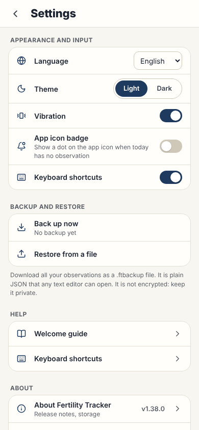

# Settings

This page gives the rules for **Settings**: the display settings, backup, restore, help, about, demo data and the delete of all data.

## Layout

The test `e2e/screenLayout.spec.ts` compares the ARIA snapshots with the screen, with the demo data. Read [ADR 0006](../../records/adrs/0006-screen-layout-snapshots-and-screenshots.md).

| Size                     | Screenshot                                      | ARIA snapshot                                                |
| ------------------------ | ----------------------------------------------- | ------------------------------------------------------------ |
| Phone, 390 by 844 pixels | [settings-phone.png](images/settings-phone.png) | [settings-phone.aria.yml](snapshots/settings-phone.aria.yml) |
| Wide, 1440 by 900 pixels | [settings-wide.png](images/settings-wide.png)   | [settings-wide.aria.yml](snapshots/settings-wide.aria.yml)   |

| Condition                             | Result                                                                                                                          |
| ------------------------------------- | ------------------------------------------------------------------------------------------------------------------------------- |
| The screen is 640 pixels wide or less | A full page over the bottom bar. It does not slide and the user cannot drag it. The close button is a back chevron at the left. |
| **Else**                              | A dialog of 560 pixels. The close button is an `X` at the right.                                                                |

## Behavior

The **Settings** gear in the header opens Settings on each screen width. On a phone, the gear is the last control of the top bar ([Navigation](navigation.md)).

The close button, **Back** and `Escape` close Settings.

Settings has these groups, in this sequence:

| Group                    | Rows                                                                                                                            |
| ------------------------ | ------------------------------------------------------------------------------------------------------------------------------- |
| Install                  | **Install app**, its hint and an **Install** button. It shows only when the browser can install the application.                |
| **Appearance and input** | **Language**, **Theme**, **Vibration**, **App icon badge** and **Keyboard shortcuts**.                                          |
| **Backup and restore**   | **Back up now** and **Restore from a file**. Under the group, a note says that the file is plain JSON and is not encrypted.     |
| **Help**                 | **Welcome guide** and **Keyboard shortcuts**.                                                                                   |
| **About**                | **About Fertility Tracker** (detail "Release notes, storage", with the version at the right) and **Legal and medical notice**.  |
| **Data**                 | **Load the demo cycles** and **Delete all data**. **Delete all data** is the last row. Its text is red (`--color-danger-text`). |

### Rows

| Row                           | Result                                                                                                                           |
| ----------------------------- | -------------------------------------------------------------------------------------------------------------------------------- |
| **Install**                   | Installs the application, as the other install buttons do ([Install](../application-behavior.md#install)).                       |
| **Language**                  | A native select of the languages. Each name is in its own language. The change applies at once.                                  |
| **Theme**                     | Two radio buttons: **Light** and **Dark**.                                                                                       |
| **Vibration**                 | A switch. It shows only when the browser has the Vibration API ([Haptic feedback](../application-behavior.md#haptic-feedback)).  |
| **App icon badge**            | A switch. It shows only when the browser has the Badging API ([App icon badge](../application-behavior.md#app-icon-badge)).      |
| **Keyboard shortcuts**        | A switch. It turns all the single-key shortcuts on or off ([Keyboard shortcuts](../application-behavior.md#keyboard-shortcuts)). |
| **Back up now**               | Downloads `fertility-tracker-backup-YYYY-MM-DD.ftbackup` at once and records the backup date. Settings stays open.               |
| **Restore from a file**       | Opens the file picker. Then it shows a preview and replaces or merges the observations with the file.                            |
| **Welcome guide**             | Opens the welcome guide over Settings.                                                                                           |
| **Keyboard shortcuts** (Help) | Opens the **Keyboard shortcuts** dialog over Settings.                                                                           |
| **About Fertility Tracker**   | Opens the version dialog over Settings, on the release notes ([Version dialog](version-dialog.md)).                              |
| **Legal and medical notice**  | Opens the version dialog over Settings, at the legal notice.                                                                     |
| **Load the demo cycles**      | Replaces all observations with the demo data.                                                                                    |
| **Delete all data**           | Deletes all observations.                                                                                                        |
- The options of **Language** are "English" and "Français".
- The detail of **Back up now** is "Last backup: " and the date of the last backup, for example "Last backup: Oct 27, 2026". Without a backup, it is "No backup yet".
- **Restore from a file**, **Load the demo cycles** and **Delete all data** close Settings after they run.
- `useBackUpNow()` gives the action of **Back up now**. The backup reminder and the save warning use the same hook ([Data storage](../data-storage.md#backup-reminder)).
- A backup file that the user opens with the application opens Settings. Settings then restores the file, as **Restore from a file** does ([Open a backup file with the app](../application-behavior.md#open-a-backup-file-with-the-app)).
- **Restore a backup** of the welcome guide opens Settings with the focus on **Restore from a file** ([Welcome guide](welcome-guide.md)).

### Backup file

- The file uses the write format of the browser storage ([Storage format](../data-storage.md#storage-format)). In this version, that is a bare JSON array, so older versions can restore it.
- **Restore from a file** accepts the bare array (format 0) and the object `{ "schemaVersion": 1, "observations": [...] }` (format 1).
- The file is plain JSON. It is not encrypted. The note under **Backup and restore** (`exportModal.jsonDescription`) tells this to the user.
- The file has the extension `.ftbackup` and the type `application/octet-stream`. With `application/json`, a browser can add `.json` after the name. The content is plain JSON, and any text editor can open it.
- The file input has no `accept` filter. iOS greys out a file with an extension that it does not know. The application checks the contents, not the extension. Thus, a `.ftbackup` file and an old `.json` backup both restore.
- A file that is not a valid backup shows `exportModal.importError` under the note. The data does not change.

### Confirmation

[ConfirmDialog.tsx](../../../src/components/ConfirmDialog.tsx) is a small confirmation dialog. It replaces `window.confirm()` and `window.alert()`, which no code in `src/` uses.

- It opens over Settings. All its text comes from the dictionary (`confirmDialog.*`, `actions.cancel`).
- `Escape`, **Cancel** and a click on the backdrop cancel it. They do not close Settings.
- These buttons open it:

| Condition          | Result                                                                                                 |
| ------------------ | ------------------------------------------------------------------------------------------------------ |
| Observations exist | **Load the demo cycles**, **Restore from a file** and **Delete all data** open the confirmation.       |
| **Else**           | **Load the demo cycles** and **Restore from a file** act immediately. **Delete all data** is disabled. |
- The message for **Delete all data** says that a copy stays on the device until the user selects **Delete the copy**.

Before a backup changes existing observations, the dialog shows a preview from `summarizeObservations()`. The preview gives the number of observations in the file and the first and last date. If the file has no observations, the preview says so.

| Action  | Result                                                                                                                  |
| ------- | ----------------------------------------------------------------------------------------------------------------------- |
| Replace | `importDataJson(text, 'replace')`: the file replaces all the current observations.                                      |
| Merge   | `importDataJson(text, 'merge')`: each day of the file replaces the current day with the same date. The other days stay. |

During a merge, `mergeObservations()` keeps one manual Peak Day in each cycle. When a day of the file is a manual Peak Day, it clears the manual Peak Day of the current days in the same cycle.

### Load

Settings is a lazy chunk. The application imports it when the browser is idle, as it imports the other dialogs ([Code splitting and lazy loading](../technology.md#code-splitting-and-lazy-loading)).

## Accessibility

- Settings is a dialog of the [dialog component](../dialog-component.md), with the name "Settings". The close button has the name "Close settings".
- Each group is a `<section>` (role `region`) with an `h3` title, and its rows are a list.
- **Theme** is a `<fieldset>` with the legend "Theme". **Light** and **Dark** are radio buttons.
- **Vibration**, **App icon badge** and **Keyboard shortcuts** (in **Appearance and input**) are buttons with `role="switch"` and `aria-checked`.
- The name of each row button is only its label (`aria-labelledby`). Its detail line, for example "Last backup: Oct 20, 2026" or "Release notes, storage", is its description (`aria-describedby`).
- The detail of **App icon badge** is "Show a dot on the app icon when today has no observation". On Apple systems, the text about the permission for notifications follows it. While the system asks for the permission, the switch is disabled.
- **Restore from a file** is a button that opens a hidden file input. Thus, the keyboard can reach it.
- The messages `exportModal.importError` and `appBadge.denied` have `role="alert"`.
- The text of **Delete all data** uses `--color-danger-text`. It has a contrast of 4.5:1 or more in both themes ([Design system](../design-system.md)).
- The confirmation dialog has `aria-labelledby` (its title) and `aria-describedby` (its message). When it opens, the focus goes to **Cancel**.

## Implementation

- [settings/SettingsDialog.tsx](../../../src/components/settings/SettingsDialog.tsx)
- [AppBadgeSetting.tsx](../../../src/components/AppBadgeSetting.tsx)
- [ConfirmDialog.tsx](../../../src/components/ConfirmDialog.tsx)
- [useBackUpNow.ts](../../../src/hooks/useBackUpNow.ts)
- [exportUtils.ts](../../../src/utils/exportUtils.ts)
- [backupImport.ts](../../../src/domain/backupImport.ts)
- [settings.css](../../../src/styles/views/settings.css)

## Related documents

- [ADR 0007: Phone-first shell and one Settings page](../../records/adrs/0007-phone-first-shell-and-settings.md)
- [Data storage](../data-storage.md)
- [Data format](../data-format.md)
- [Application behavior](../application-behavior.md)
- [Dialog component](../dialog-component.md)
- [User interface](../user-interface.md)
