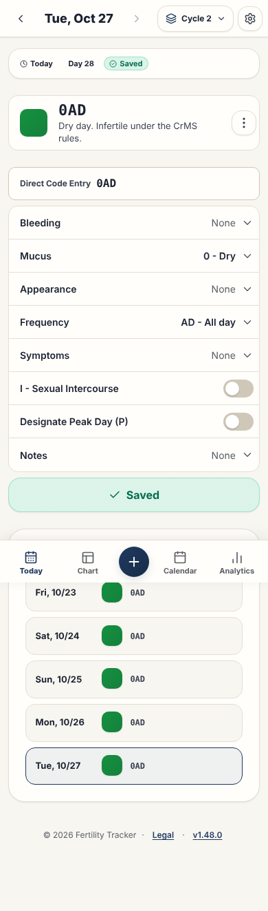

# Today page

This page gives the rules for the **Today** page: the date navigation, the observation form, the guidance and the history list.

## Layout

The test `e2e/screenLayout.spec.ts` compares the ARIA snapshots with the screen, with the demo data. Read [ADR 0006](../../records/adrs/0006-screen-layout-snapshots-and-screenshots.md).

| Size                     | Screenshot                                | ARIA snapshot                                          |
| ------------------------ | ----------------------------------------- | ------------------------------------------------------ |
| Phone, 390 by 844 pixels | [today-phone.png](images/today-phone.png) | [today-phone.aria.yml](snapshots/today-phone.aria.yml) |
| Wide, 1440 by 900 pixels | [today-wide.png](images/today-wide.png)   | [today-wide.aria.yml](snapshots/today-wide.aria.yml)   |

## Behavior

| Part                                                                                           | Content                                                                                                                                                                                            |
| ---------------------------------------------------------------------------------------------- | -------------------------------------------------------------------------------------------------------------------------------------------------------------------------------------------------- |
| [TodayDateNav.tsx](../../../src/components/today/TodayDateNav.tsx)                             | Previous and next day (44 px), date picker and date. The day status: **Today** or **Jump to Today**, the cycle day, and **Saved** or **Not saved**. A phone shows the day status on a second line. |
| [TodayObservationForm.tsx](../../../src/components/today/TodayObservationForm.tsx)             | **Direct Code Only** or **Detailed Form** mode, the code buttons, intercourse, peak, notes, save and delete.                                                                                       |
| [ObservationCodeSelector.tsx](../../../src/components/observation/ObservationCodeSelector.tsx) | The code buttons. The drawer uses the same component ([Observation drawer](observation-drawer.md)).                                                                                                |
| [TodayFertilityGuidance.tsx](../../../src/components/today/TodayFertilityGuidance.tsx)         | Stamp preview, code and a guidance text. A banner on a screen of 900 pixels or less, else a card. A day with no code shows the empty stamp and "No observation yet", and no guidance text.         |
| [TodayHistoryList.tsx](../../../src/components/today/TodayHistoryList.tsx)                     | The selected date and the 4 days before it, in three columns: date, stamp and code. A day with no code shows the empty stamp. A click selects that date. A long code ends with an ellipsis.        |
- The application saves the last entry mode in `fertility_care_entry_mode`.
- The cycle day of the day status comes from the saved observation. A day with no observation gets the cycle day from the start date of the last cycle that starts on or before that day. A day before the first cycle or after today shows no cycle day.

### Day with no code

A day with no code is not a dry day. The word "Infertile" never shows without a code. Here, a code is a bleeding, mucus or frequency code. The `I` mark, the symptoms and the notes alone are not a code. `hasObservationCode` in `src/domain/stampCalculator.ts` gives the rule.

| Condition                                                                           | Result                                                                                                      |
| ----------------------------------------------------------------------------------- | ----------------------------------------------------------------------------------------------------------- |
| The form has no code: no saved observation, or only the `I` mark, symptoms or notes | The empty stamp (a dashed square with `--stamp-empty`), the text "No observation yet" and no guidance text. |
| The form has a code                                                                 | The stamp of the code, the code and the guidance text of the stamp.                                         |

### Swipe between days

On a touch screen, a swipe on the **Today** page changes the day. The hook [useDaySwipe.ts](../../../src/hooks/useDaySwipe.ts) uses Pointer Events of `touch` and `pen` type only. Thus, a mouse does not swipe, and the arrow buttons stay for the keyboard and the desktop.

- A swipe to the left opens the next day. A swipe to the right opens the previous day. The swipe calls the same functions as the arrow buttons, with the same rules.
- [swipe.ts](../../../src/domain/swipe.ts) decides at the release:
  - The angle of the swipe must be less than 30 degrees from horizontal.
  - The swipe must be longer than 60 pixels, or a fast flick: at least 0.5 pixels per millisecond over at least 24 pixels.
- The page has `touch-action: pan-y pinch-zoom`. Thus, a vertical drag scrolls the page and the browser cancels the swipe. A vertical drag never changes the day.
- These swipes do nothing:
  - A swipe that starts in an input, a text area, a select or an element that scrolls horizontally.
  - A swipe that starts less than 20 pixels from the left or right edge of the screen. The back and forward gestures of iOS use these edges.
  - A swipe that starts its move with an angle of 30 degrees or more from horizontal.
  - A swipe in a dialog of the page, for example **New Cycle Start?**. React sends the events of a portal to the page, so the hook ignores a target outside the page.
  - A swipe on a zoomed page. The page then has `touch-action: auto`, so that the finger can pan the zoomed page in all directions.
- After a swipe, the hook blocks the next click for 100 milliseconds. Thus, a swipe that starts on a button does not also press it. A tap that moves a little is not a swipe, so its click stays.
- A second swipe during the slide first applies the day change of the first swipe. Thus, two fast swipes move two days.
- During the swipe, the main grid follows the finger by 40% of the move. After a swipe, the grid slides out in the swipe direction in 150 milliseconds. Then the day changes, and the grid slides in from the other side. Else the grid goes back.
- With `prefers-reduced-motion: reduce`, the grid does not move. The day changes at the release.
- A save or a delete shows a message (`role="status"`). The message closes 3 seconds after the last save or delete. The page stops the timer when it unmounts.

## Accessibility

- The entry mode selector is a `role="radiogroup"` with two native radio inputs (`name="entry-mode"`). Each input is in a `<label>`, and the arrow keys move between them.

## Implementation

- [src/components/TodayView.tsx](../../../src/components/TodayView.tsx)

## Related documents

- [Dialog component](../dialog-component.md)
- [Application behavior](../application-behavior.md)
- [User interface](../user-interface.md)
