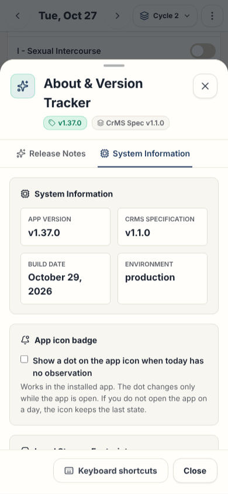

# Version dialog

This page gives the rules for the **About & Version Tracker** dialog.

## Layout

The test `e2e/screenLayout.spec.ts` compares the ARIA snapshots with the screen, with the demo data. Read [ADR 0006](../../records/adrs/0006-screen-layout-snapshots-and-screenshots.md).

The release notes change at each release. Thus, the snapshots and the screenshots show the **System Information** tab.

| Size                     | Screenshot                                                  | ARIA snapshot                                                            |
| ------------------------ | ----------------------------------------------------------- | ------------------------------------------------------------------------ |
| Phone, 390 by 844 pixels | [version-dialog-phone.png](images/version-dialog-phone.png) | [version-dialog-phone.aria.yml](snapshots/version-dialog-phone.aria.yml) |
| Wide, 1440 by 900 pixels | [version-dialog-wide.png](images/version-dialog-wide.png)   | [version-dialog-wide.aria.yml](snapshots/version-dialog-wide.aria.yml)   |

## Behavior

- **About Fertility Tracker** in [Settings](settings.md) and the version in the footer open the dialog. It then shows the **Release Notes** tab.
- **Legal** in the footer and **Legal and medical notice** in Settings open the dialog on the **System Information** tab, with the legal notice.
- From Settings, the dialog opens over Settings. When it closes, Settings shows again.
- The **Release Notes** tab shows the newest release and the full history. Each old release opens and closes. Its header shows only the version and the date.
- The **System Information** tab shows the version, the CrMS version, the build date and the environment. It also has the repository link.
- The tab also shows the storage statistics: the number of storage keys, cycles and observations, and the size in KB. The switch of the app icon badge is not in this tab. It is in Settings.
- At the end, the tab shows the legal notice ([LegalNotice.tsx](../../../src/components/LegalNotice.tsx)): the trademark text, the medical text and the copyright. The footer has one line only, so this tab and the welcome guide have the full notice.
- The dialog uses the surface tokens `--bg-surface`, `--bg-primary` and `--bg-surface-border`.

## Accessibility

- No accessibility rule is specific to this dialog. The [dialog component](../dialog-component.md) gives the name, the focus trap and the focus return.

## Implementation

- [src/components/VersionModal.tsx](../../../src/components/VersionModal.tsx)

## Related documents

- [Version tracker](../version-tracker.md)
- [Application behavior](../application-behavior.md)
- [Dialog component](../dialog-component.md)
- [User interface](../user-interface.md)
