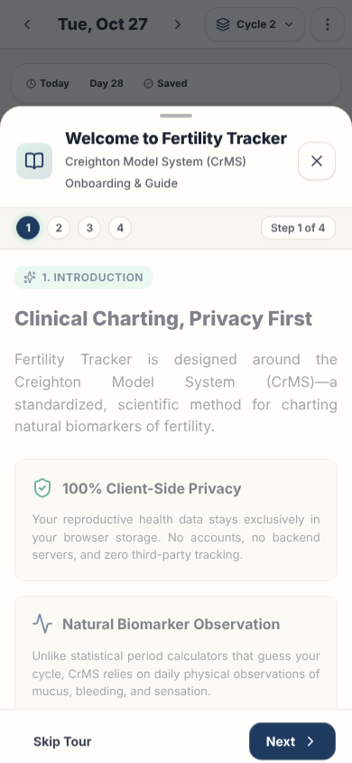

# Welcome guide

This page gives the rules for the welcome guide.

## Layout

The test `e2e/screenLayout.spec.ts` compares the ARIA snapshots with the screen, with the demo data. Read [ADR 0006](../../records/adrs/0006-screen-layout-snapshots-and-screenshots.md).

| Size                     | Screenshot                                                | ARIA snapshot                                                          |
| ------------------------ | --------------------------------------------------------- | ---------------------------------------------------------------------- |
| Phone, 390 by 844 pixels | [welcome-guide-phone.png](images/welcome-guide-phone.png) | [welcome-guide-phone.aria.yml](snapshots/welcome-guide-phone.aria.yml) |
| Wide, 1440 by 900 pixels | [welcome-guide-wide.png](images/welcome-guide-wide.png)   | [welcome-guide-wide.aria.yml](snapshots/welcome-guide-wide.aria.yml)   |

## Behavior

The guide opens at the first visit, when `fertility_tracker_has_seen_welcome` is not in `localStorage`. It has four slides:

| Slide | Content                                                                                          |
| ----- | ------------------------------------------------------------------------------------------------ |
| 1     | The CrMS method, the privacy of the data, and the full legal and medical notice.                 |
| 2     | The stamps: red, green, green with a baby, white with a baby and yellow, and the count of three. |
| 3     | How to record: direct code (for example `10KLX3 I AP`) or the form buttons.                      |
| 4     | The pages, with **Explore Demo Data** and **Start Fresh**.                                       |

In the installed application on iOS and iPadOS, with no observations, slide 4 also has **Restore a backup**. It closes the guide and opens the export dialog ([Install and update](../application-behavior.md#install-and-update)).

Each opening starts on slide 1. The guide has **Previous**, **Next** and **Skip** buttons and step dots. The guide is in English and in French.

## Accessibility

- The [dialog component](../dialog-component.md) gives `Escape`, the focus trap and the focus return.
- The slide body can get the focus and scroll.
- When **Restore a backup** opens the export dialog, the focus goes to **Restore Data**.

## Implementation

- [src/components/WelcomeModal.tsx](../../../src/components/WelcomeModal.tsx)

## Related documents

- [Application behavior](../application-behavior.md)
- [Dialog component](../dialog-component.md)
- [User interface](../user-interface.md)
