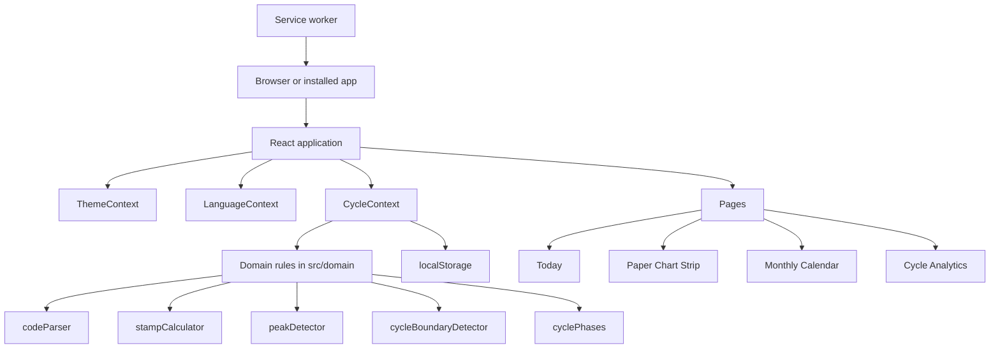

# Technology

This page gives the architecture, the pinned versions of the tools and the rules for code splitting. For the reasons, read [Architecture](../explanation/architecture.md). For the folders, read [Project structure](project-structure.md).

## Architecture

The application is a single-page React application. It has no backend. Vite builds it into static files, and Cloudflare Pages serves them.

## Versions

Each runtime, tool, dependency, pre-commit hook and CI action has an exact pinned version.

- `.npmrc` sets `save-exact=true` and `engine-strict=true`.
- `package.json` declares `engines`, `devEngines` and `packageManager`.
- `.mise/config.toml` and `.mise/mise.lock` pin the tools with checksums.

| Layer              | Technology                                 | Version                                                                                             |
| ------------------ | ------------------------------------------ | --------------------------------------------------------------------------------------------------- |
| Runtime            | Node.js and npm                            | `node 26.12.1`, `npm 11.20.0` (the npm of that Node.js release), `.node-version`, mise `2026.10.19` |
| User interface     | React                                      | `19.3.1`                                                                                            |
| Language           | TypeScript                                 | `7.0.2`, strict, ES2023 target, unchecked index access and exact optional properties                |
| Build              | Vite                                       | `8.3.5`                                                                                             |
| Lint and format    | Biome                                      | `@biomejs/biome 2.6.3` for TS, TSX, CSS, JSON, YAML and Markdown. A warning is a failure.           |
| Git hooks          | pre-commit                                 | `pre-commit 4.7.0`, `pre-commit-hooks 6.0.0`, `gitleaks 8.30.1`, local hooks                        |
| Icons              | Lucide React                               | `1.61.0`                                                                                            |
| Font               | Font of the operating system               | `system-ui` stack, no font file                                                                     |
| Styles             | CSS                                        | Custom properties, cascade layers, grid and flexbox                                                 |
| Unit tests         | Vitest, React Testing Library, V8 coverage | `vitest 5.0.5`, `@vitest/coverage-v8 5.0.5`, `@testing-library/react 16.3.3`, `jsdom 30.1.3`        |
| End-to-end tests   | Playwright and axe                         | `@playwright/test` and `@axe-core/playwright`, pinned in `package.json`                             |
| Deployment         | Cloudflare Pages                           | `wrangler 4.153.0`, `compatibility_date 2026-10-23`                                                 |
| Dependency updates | Dependabot                                 | Weekly grouped updates for npm and GitHub Actions                                                   |

## Code splitting and lazy loading

The main chunk has only the code of the first screen. The other parts load with `React.lazy` when the user needs them.

| Part                                                                                     | Rule                                                                                    |
| ---------------------------------------------------------------------------------------- | --------------------------------------------------------------------------------------- |
| `CycleAnalyticsView`, `ExportModal`, `VersionModal`, `WelcomeModal`, `InstallGuideModal` | Lazy chunks. `App.tsx` renders a dialog only while it is open.                          |
| `VERSION_HISTORY`                                                                        | Only in the `VersionModal` chunk. The main chunk gets the version from `appVersion.ts`. |
| `PrintExportView`                                                                        | A lazy chunk that the application renders from the start.                               |
- Each opening of a dialog starts a new dialog. The version dialog opens on **Release Notes**, and the welcome guide opens on step 1. The export dialog opens in **Single Cycle** mode with the cycle of the cycle picker.
- A unit test follows the static imports from `main.tsx`. It fails if they reach `versionTracker.ts` or a lazy component.
- **Print / Save as PDF** calls `window.print()` only after the print view chunk loads and renders the selected cycles. A click before that waits for the chunk.
- The browser print command (**Ctrl+P**) does not wait. Before the print view chunk loads, it prints an empty page.
- If the print view chunk does not load, **Print / Save as PDF** does not print and does not show the success message. It shows the error `exportModal.printError`.
- Each dialog and the print view has its own `React.Suspense`. Thus, a dialog that loads does not hide the print view.
- While a page or a dialog loads, a hidden `role="status"` element announces `common.loading`. A dialog shows nothing visible while it loads. The page fallback keeps a minimum height, so the footer does not move.
- After the first render, when the browser is idle, the application imports the four lazy chunks, except `InstallGuideModal`. Only Safari on iOS uses the install guide, so it does not load before it opens. It uses `requestIdleCallback` with a 2-second `timeout`, or `setTimeout` in a browser without it.
- A failed preload has no effect. The part tries again when the user opens it.
- Each lazy dialog has its own `ErrorBoundary` in dialog mode ([Error screen](screens/error-screen.md)). A failure does not block the other dialogs, and the next opening tries again.
- The service worker keeps all the lazy chunks ([Offline use and installation](deployment.md#offline-use-and-installation)). Thus, each lazy part also opens offline.

## Related documents

- [Architecture](../explanation/architecture.md)
- [Project structure](project-structure.md)
- [Commands](commands.md)
