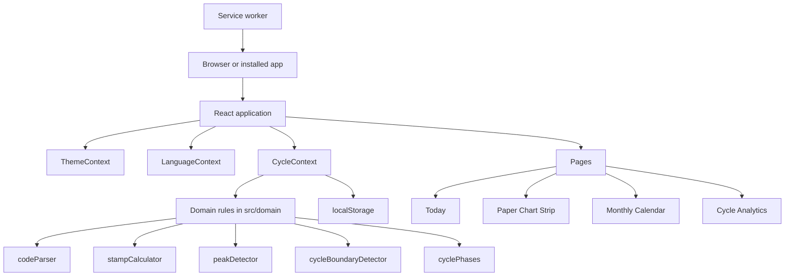

# Technology

This page gives the architecture, the pinned versions of the tools and the rules for code splitting. For the reasons, read [Architecture](../explanation/architecture.md). For the folders, read [Project structure](project-structure.md).

## Architecture

The application is a single-page React application. It has no backend. Vite builds it into static files, and Cloudflare Pages serves them.

## Versions

Each runtime, tool, dependency, pre-commit hook and CI action has an exact pinned version.

- `.npmrc` sets `save-exact=true` and `engine-strict=true`.
- `package.json` declares `engines`, `devEngines` and `packageManager`.
- `.mise/config.toml` and `.mise/mise.lock` pin the tools with checksums.

The table gives the place of each version. It does not copy the numbers, because the numbers change often. For example, Dependabot changes the npm packages each week.

| Layer              | Technology                                        | Version and settings                                                                         |
| ------------------ | ------------------------------------------------- | -------------------------------------------------------------------------------------------- |
| Runtime            | Node.js and npm                                   | `.node-version`, `engines` and `packageManager` in `package.json`, and `.mise/config.toml`   |
| User interface     | React                                             | `package.json`                                                                               |
| Language           | TypeScript                                        | `package.json`. Strict, ES2023 target, unchecked index access and exact optional properties. |
| Build              | Vite                                              | `package.json`                                                                               |
| Lint and format    | Biome                                             | `package.json`. It checks TS, TSX, CSS, JSON, YAML and Markdown. A warning is a failure.     |
| Git hooks          | pre-commit and gitleaks                           | `.mise/config.toml` for the tools, and `.pre-commit-config.yaml` for the hooks               |
| Icons              | Lucide React                                      | `package.json`                                                                               |
| Font               | Font of the operating system                      | `system-ui` stack, no font file                                                              |
| Styles             | CSS                                               | Custom properties, cascade layers, grid and flexbox                                          |
| Unit tests         | Vitest, React Testing Library, V8 coverage, jsdom | `package.json`                                                                               |
| End-to-end tests   | Playwright and axe                                | `package.json`                                                                               |
| Deployment         | Cloudflare Pages                                  | `wrangler` in `package.json`, and `compatibility_date` in `wrangler.json`                    |
| Dependency updates | Dependabot                                        | Weekly updates. Patch and minor updates merge automatically when CI passes                   |

## Code splitting and lazy loading

The main chunk has only the code of the first screen. The other parts load with `React.lazy` when the user needs them.

| Part                                                                                                                                 | Rule                                                                                    |
| ------------------------------------------------------------------------------------------------------------------------------------ | --------------------------------------------------------------------------------------- |
| `CycleAnalyticsView`, `ExportModal`, `SettingsDialog`, `VersionModal`, `WelcomeModal`, `InstallGuideModal`, `KeyboardShortcutsModal` | Lazy chunks. `App.tsx` renders a dialog only while it is open.                          |
| `VERSION_HISTORY`                                                                                                                    | Only in the `VersionModal` chunk. The main chunk gets the version from `appVersion.ts`. |
| `PrintExportView`                                                                                                                    | A lazy chunk that the application renders from the start.                               |
- `App.tsx` mounts a dialog again at each opening. Thus, each opening starts a new dialog.
- A unit test follows the static imports from `main.tsx`. It fails if they reach `versionTracker.ts` or a lazy component.
- **Print or PDF** calls `window.print()` only after the print view chunk loads and renders the selected cycles. A click before that waits for the chunk.
- The browser print command (**Ctrl+P**) does not wait. Before the print view chunk loads, it prints an empty page.
- If the print view chunk does not load, **Print or PDF** does not print and does not show the success message. It shows the error `exportModal.printError`.
- Each dialog and the print view has its own `React.Suspense`. Thus, a dialog that loads does not hide the print view.
- While a page or a dialog loads, a hidden `role="status"` element announces `common.loading`. A dialog shows nothing visible while it loads. The page fallback keeps a minimum height, so the footer does not move.
- After the first render, when the browser is idle, the application imports all the lazy chunks, except `InstallGuideModal`. Only Safari on iOS uses the install guide, so it does not load before it opens. It uses `requestIdleCallback` with a 2-second `timeout`, or `setTimeout` in a browser without it.
- A failed preload has no effect. The part tries again when the user opens it.
- Each lazy dialog has its own `ErrorBoundary` in dialog mode ([Error screen](screens/error-screen.md)). A failure does not block the other dialogs, and the next opening tries again.
- The service worker keeps all the lazy chunks ([Offline use and installation](deployment.md#offline-use-and-installation)). Thus, each lazy part also opens offline.

## Related documents

- [Architecture](../explanation/architecture.md)
- [Project structure](project-structure.md)
- [Commands](commands.md)
